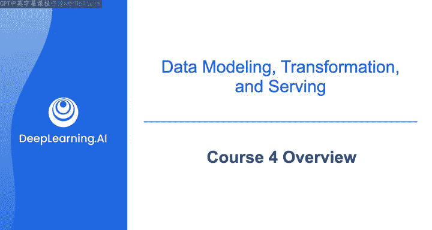
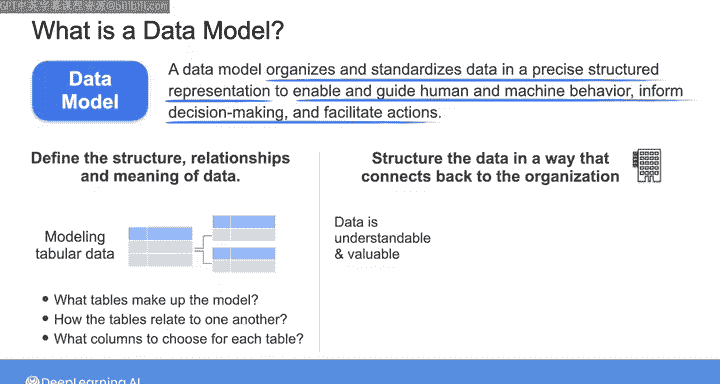
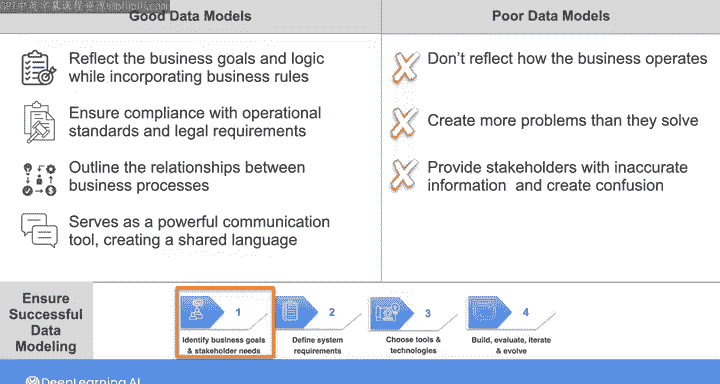
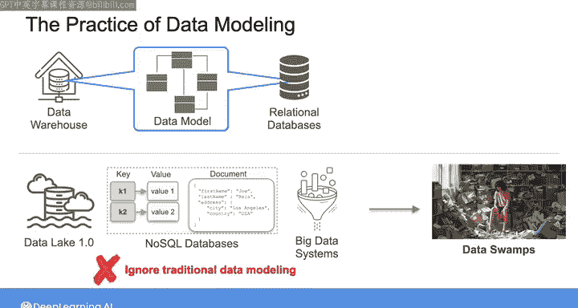
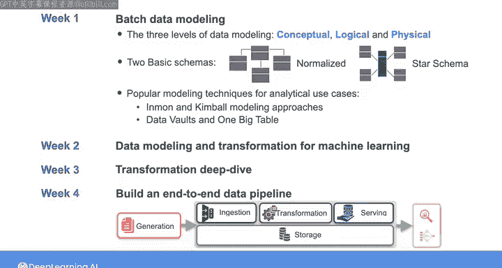

# 吴恩达《数据工程（数据建模、转换和服务）第4课，完结｜DeepLearning.AI Data Engineering》 - P2：1_第4课程概览.zh_en - GPT中英字幕课程资源 - BV13mtpe7ESt

In courses two and three you learned how to ingest data into your data pipeline and explore various storage solutions for hosting your data Now before you serve the data to your end users。

 you need to transform and model it in a form that supports its intended use cases in this course we'll start with data modeling and then look more closely at transformation in the second half of this course。

Moodeling your data involves deliberately choosing a coherent data structure that aligns with the business goals and logic So what is a data model Here's my definition A data model organizes and standardizes data into a precise structured representation to enable and guide human and machine behavior informed decision making and facilitate actions the first part of the definition implies that when you model your data you define the structure relationships and meaning of the data。

 For example， when you model tabular data， you need to think about the tables that make up the model。

 how to label the tables， how the tables relate to one another and what columns to choose for each table you should structure the data in a way that connects back to the organization and this is what the second part of the definition implies for the data to serve its purpose you'll need to make the data understandable and valuable to humans if you're modeling the data for analytical use cases such as creating reports or dashboards and if the data is going to be used for machine learning use。

You need to model the data into a form that is meaningful to a computer a well-constructed data model should reflect the business goals and logic while incorporating business rules like requiring a valid payment method before processing an order to ensure compliance with operational standards and legal requirements a good data model should also outline the relationships between business processes For instance。

 linking sales data with product inventory data to ensure that the sales process is directly informed by current inventory levels。

 preventing oversellingBeyond that， a robust data model serves as a powerful communication tool。

 creating a shared language among stakeholders like engineers。

 analysts and executives by standardizing business vocabulary such as clearly defining what constitutes an active user is that someone who is logged into their account in the last 30 days。

 someone who has made a purchase in the previous six months or something else entirely carefully defining business terms can have a massive impact on downstream reports that describe customer behavior。

And things like projecting customer churn and so to ensure successful data modeling。

 recall the framework for thinking like a data engineer from course1 and always start with talking to your stakeholders understanding the business definitions。

 rules and goals is the first step to modeling the data and providing the business with quality data for actionable insights and intelligent automation on the other hand。

 poor data models that are created haphazardly and don't reflect how the business operates can create more problems than they solve instead of promoting communication and shared understanding poor data models might provide stakeholders with inaccurate information and create confusion Another professional oversight that I often see is when data teams ignore data modeling entirely because they see it as a slow tedious and irrelevant process that's only reserved for big companies so they jump directly into building data systems without a plan for how they will organizer data to make it useful for the business Well that is a huge。

Mistake data modeling has been a practice for decades and was traditionally used to structure data stored in data warehouses and relational databases with the rise of data lake 1。

0 no SQL and big data systems， engineers started ignoring traditional data modeling sometimes for legitimate performance gains however。

 the lack of rigorous data modeling created data swamps along with lots of redundant mismatched or simply inaccurate data nowadays。

 the growing popularity of data management in particular data governance and data quality is pushing the need for coherent business logic I see data modeling as a critical practice that enhances your understanding of the data throughout its lifecycle as a data engineer data modeling helps you improve data quality and integration and encourages the adoption of data throughout the organization no matter the size of the business you're a part of。

 you should take a targeted approach to data modeling by focusing on specific business domains for instance。

You could create a data model to help the marketing team better understand customer behavior and campaign effectiveness。

Or you can model the company's financial transactions so that the finance team can analyze spending patterns and identify cost-saving opportunities。

 targeted data modeling efforts can provide valuable insights to drive better decision making and impactful AI models even within highly complex businesses in the first week of this course I'll mainly focus on discussing batch data modeling since that's where most data modeling techniques come from we'll start by taking a quick look at the three traditional levels of data modeling。

 conceptual logical and physical each differing in the degree of detail they provide then we'll go over two basic schemas。

 the normal schema and the star schema which you'll implement in the labs this week and finally we'll dive into some popular modeling techniques for analytical use cases such as the inmen and Kimball modeling approaches as well as other techniques like data vault and one big table in week two of this course we'll discuss data modeling and transformation techniques for machine learning use cases then in week three we'll dive deeper into transformations and discuss the various。

Technical considerations for choosing data processing frameworks and finally。

 we'll bring everything you learned in this program together in the fourth week of this course where you'll get a chance to build an end to- end data pipeline that encompasses all the stages of the data entering lifecycl as well as the key undercurrents Jo me in the next video to take a look at the different levels of data modeling。

