# 吴恩达《数据工程（数据建模、转换和服务）第4课，完结｜DeepLearning.AI Data Engineering》 - P30：29_Amazon EMR.zh_en - GPT中英字幕课程资源 - BV13mtpe7ESt

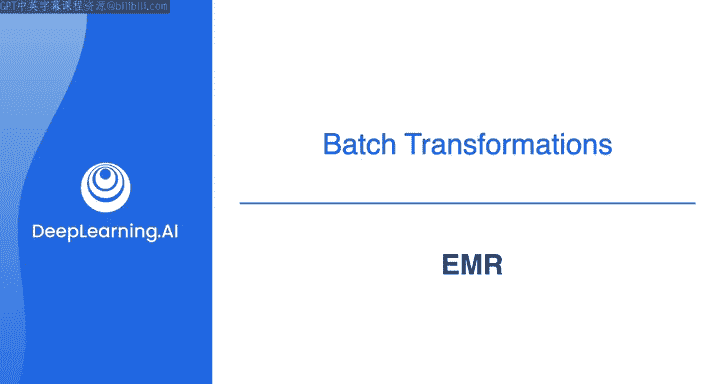

Back in course one， you were introduced to Amazon EMR as a big data tool that supports a wide range of processing frameworks。

 and in the upcoming lab you'll use EMR to run Spark jobs in an Amazon EMR Studio notebook。

In this video I want to help you understand a bit more about what's going on behind the scenes when you run Spk jobs on Amazon EMR。

 as well as some of the other features of EMR so let's get into it if you remember our earlier lesson about Amazon Redshift you learned how it uses massively parallel processing to tackle big data analytics EMR works in a similar way in that there is a cluster with multiple nodes and each node does a portion of the work when you submit a job using EMR it gets run across these nodes working in parallel and each node processes a part of the data because of this parallelization the job is completed much quicker than what could be achieved by a single machine the size of your cluster can impact how quickly your jobs run and with EMR a cluster is elastic meaning that it can scale up or down as needed once your job completes the results are stored in your design。

Iir destination。This could be an Amazon S3 HDFS or another data store option。

 You can then analyze the results or feed them into another application or workflow for further processing EMR also supports numerous popular big data frameworks including Apache Spark Hadoop hive Presto Flink Hbase and many more tools and frameworks that enable data analysis tasks EMR provides a managed environment that simplifies the setup and scaling of these frameworks and integrates natively with other ADS services so with EMR you can focus more on your data workflows rather than the underlying infrastructure。

 For example， if you want to analyze data stored in S3 with Hadoop you can do that with the integration between S3 and the Amazon EMR file system This allows you to decouple compute and storage and analyze large amounts of data that may not be able to fit on local storage the way this works is。

That when you launch your cluster， EMR streams the data from S3 to each instance in your cluster and begins processing it Another advantage of storing your data in S3 is you can use multiple EMR clusters to process the same data in different ways EMR can also integrate with other AWS data sources like Amazon DynamoDB Amazon RDS and Amazon Redshift as a few examples in the upcoming lab you'll use Amazon EMR Studio which is a browserbased IDE for Jupyter notebooks that runs on EMR clusters。

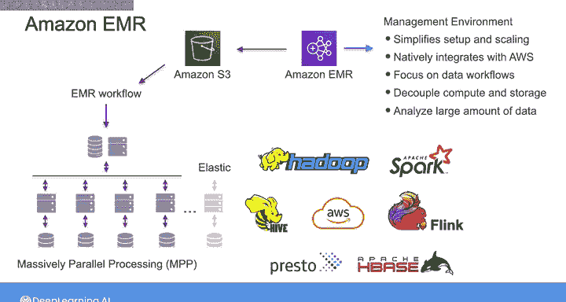

You'll use a notebook to run a Sp job let's run through a basic example of using a notebook so that you're prepared to complete the lab here I am in the AWS console and I first need to create an EMR cluster to work with。

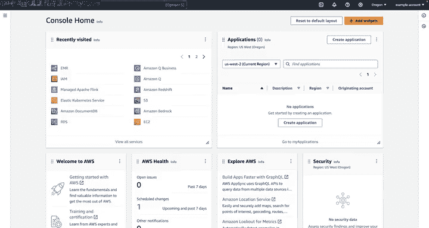

To do that， I will navigate to the EMR dashboard by typing EMR into the search bar。

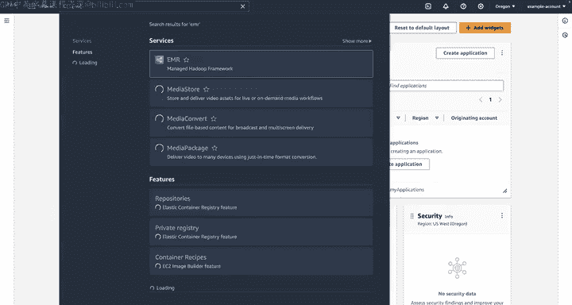

Then selecting EMR from here， I can create the cluster and for this。

 I want to launch a serverless cluster so I will select EMR serverless from the navigation。

 then get started to manage EMR serverless applications。

 You need EMR Studio so I will select create and launch EMR Studio Now we can create an application for EMR serverless。

 I'll give the application a name like example app。

 then leave the type as Sp and accept the default release version then I need to select the application setup options I can choose from accepting the defaults for batch workloads accepting the defaults for interactive workloads or use custom settings Im going to use the defaults for interactive workloads which includes enabling the interactive endpoint for EMR Studio which needs to be configured so that we can use EMR studio to run applications on our cluster Now I will select。

Create。And start application the application is starting， which will take a few minutes。

 We'll come back when this is done。

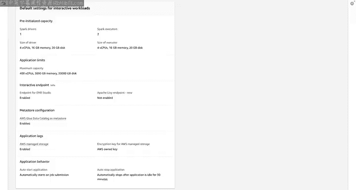

The application is now started， which means I can create the workspace and notebook that we will use to run Spark jobs。

 I'll select dashboard。 then create workspace。 This brings up an error at the top that tells me I need to enable this studio for interactive workspaces so I'll select editit studio This takes me to a page where I can edit the configurations for my studio to use workspaces for interactive workloads you have to configure the storage location for workspaces and the studio service role So I'll select an existing I role for this studio。

 This IM role lets the studio interact with other8 resources。

 Then I will also navigate to an existing espre storage location in this account This is the backup location for workspaces Once both of these values are filled out I'll select save changes and this studio has now been updated I can then select View workspaces to go back to creating the workspace needed to。

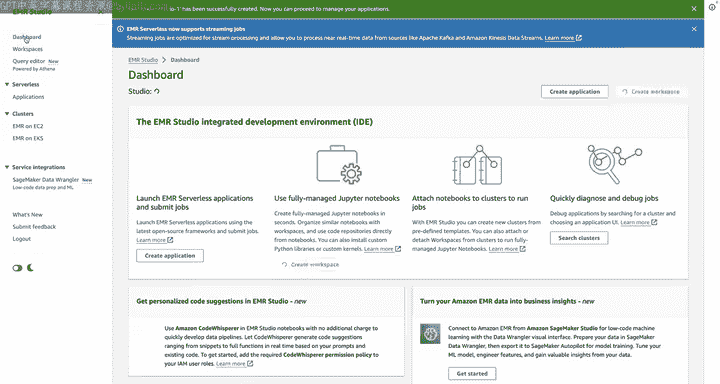

ch the notebook from here， I'll select create workspace。 Then I can give the workspace a name。

 I'll call this example workspace。 then select create workspace。

 accepting the rest of the default values。 Now that this workspace is created。

 I can launch it to gain access to the notebook。 Once I open the workspace。

 I can check to see if it's connected to any specific EMR application。

 because this is just a frontend to interact with the EMR cluster on the backend。

 We need to attach this notebook to compute resources。

 So if I select the compute tab I'll see that this notebook is not connected to an EMR serverless application to do that。

 I will select the dropdown to select the application we created earlier。

 Then I also need to select the interactive runtime role the notebook we' be using。

 This is the role that will be assumed to call other A of services on your behalf。

 I'll select the dropdown and select。

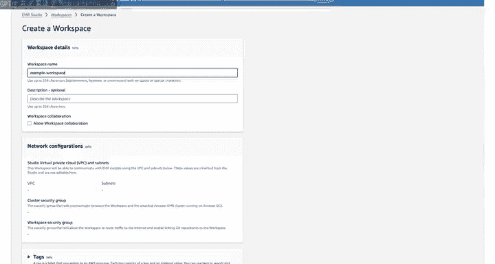

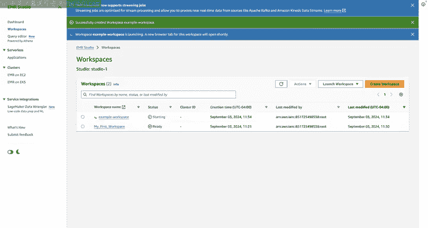

EMR serverless role which is an I am role I already created in this account now that this is configured。

 I can submit jobs to this application。Now if I go back to the files in this workspace。

 there is a notebook created for me that is empty， so I'll select that。

 then I need to choose which kernel I want to use I'm going to select Pi Spk for the kernel。😡。

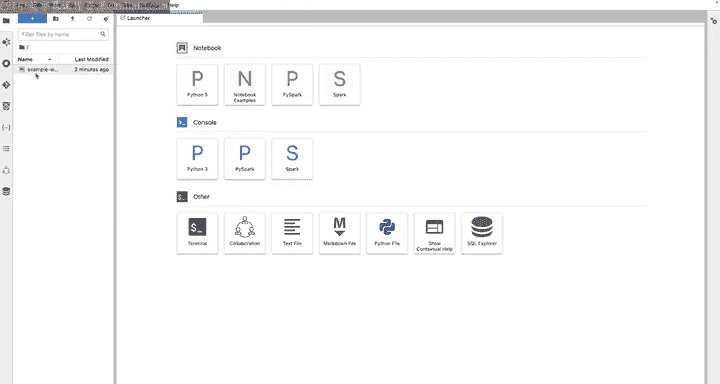

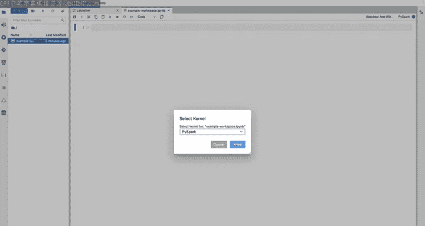

Next， I want to run a very simple Pipark script to do some data analysis on a file that I have uploaded to an S3 bucket in my account。

 This file contains generated sample taxi data。 I want to write a script that will calculate the average fare for the taxi rides between two dates so I will paste in a script to perform that task and then hit shift enter to run it This will take some time to run and the output will show under the code snippet Okay so the job is done running and the average fare for the rides contained in this data set comes out to be $5064。

This code was run as a job on the EMR serverless cluster this notebook is attached to and behind the scenes。

 this code had to call some AS APIs to be able to read the file from S3。

 Allright so that was a simple example of using EMR studio and workspaces Hopefully this gives you a better understanding of EMR and you'll have a chance to do some more interesting analysis on data yourself in the upcoming lab Good luck。

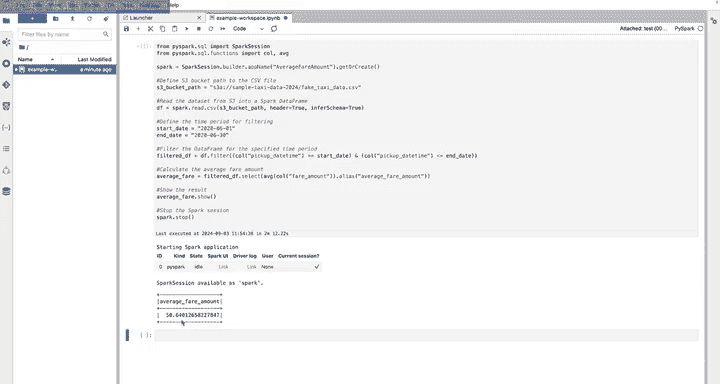