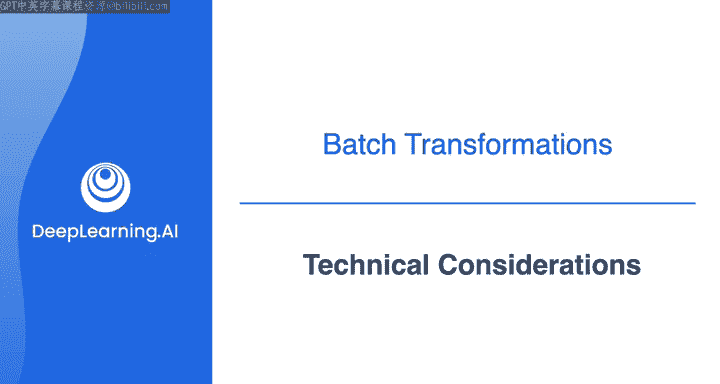
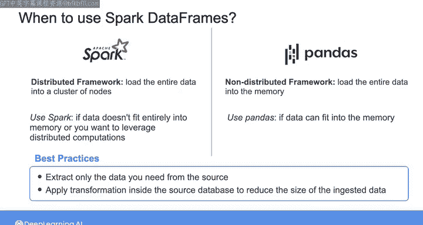

# 吴恩达《数据工程（数据建模、转换和服务）第4课，完结｜DeepLearning.AI Data Engineering》 - P31：30_技术考虑因素.zh_en - GPT中英字幕课程资源 - BV13mtpe7ESt

To transform your data using Pypark， you saw that you can issue SQL queries with SparsQL or operate directly on Spark data frames using Python when choosing between using SQL versus Python on Spark data frames。

 you should consider things like the transformation complexity code reusability and testability and the skills and technical background of your team when you're working with Pypark performing simple transformations such as filtering grouping and aggregation directly on a Spark data frame using Python or code these transformations as SQL queries generally results in comparable performance and this is because both Python and SQL approaches are ultimately translated into the same execution plan and executed by the same underlying sparkk computing engine。

 however， if the transformation is more complex you might not be able to implement it in SQL or at least not in a straightforward way。

 For instance， if you want to apply the transpose operation to swap the rows and columns of a table。

 you can simply call dot T on the data frame。

transransposing is not supported by SparSQL or as another example。

 you can normalize columns in clean columns with missing values in SQL。

 but that might require more code than working with Python on Spark data frames。 Moreover。

 working with data frames would help you write more testable maintainable and modular or reusable code while reusable libraries are easier to create and Spark and Pybar SQL doesn't have a good notion of reusability for more complex query components you also want to consider the skills and technical background of your team you might find writing SQLqueries to be simpler and easier than working with Python on Spark data frames so depending on your transformation use case。

 you might find one of these approaches more suitable than the other you can even try to combine both the Spark data frames and SparkSQL approaches to realize the best of both worlds now that we've covered the considerations for using SparkSQL versus using Python on Spark data frames。

 let's take a moment to discuss when you'll want to consider using a distributed framework like Spark to begin with。

Like you saw last week， instead of using Spar data frames。

 you could just use panda's data frames to process the data however。

 pandas is not a distributed framework， it will load the entire data into the memory of the machine on which your Python code is running so if your data is not very large and by that I mean you can fit your entire data into memory then you can use pandas instead of Spark In fact using Spark on a small data can be overkiled since you need to manage the cluster of nodes On the other hand。

 if your data is so large that it doesn't fit entirely in memory or if you want to leverage distributed computations to enhance processing performance。

 then you should go with Spark and maybe run it on the cluster running in the cloud In any case。

 whether you're working on a single machine or a cluster of nodes。

 the best practice would be to extract only the data you need from the source Le say you have to process the less resource heavy and more performant your code will be and so you might need to apply transformations such as joining grouping and filtering inside the database before ingesting the data to reduce this。

of the data choosing the right coding approach for batch transformation is about balancing the simplicity of coding with SQL with the flexibility and modularity of coding with non-declarative languages such as Python choosing the right tool for batch transformation depends on the size of the data you want to transform and the specification of the hardware on which you're running your code so make sure to understand the tradeoff between these different approaches now that we've talked about batch transformations。

 join me in the next lesson to learn about streaming transformation and how a streaming processing tool can affect the latency of your system。

