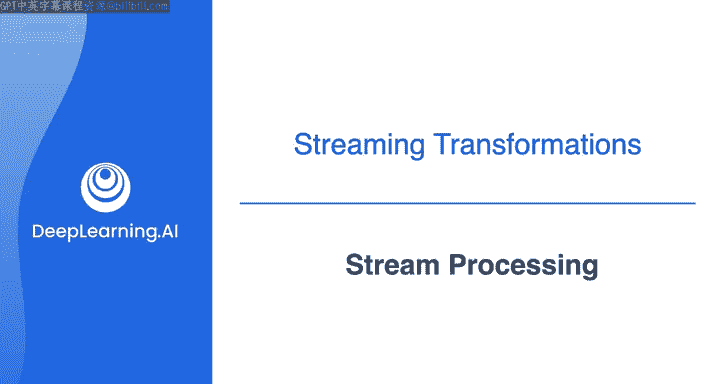
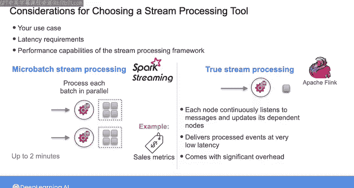
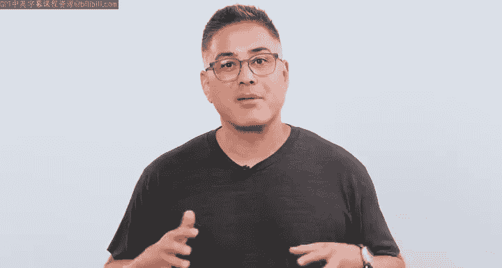

# 吴恩达《数据工程（数据建模、转换和服务）第4课，完结｜DeepLearning.AI Data Engineering》 - P32：31_流处理.zh_en - GPT中英字幕课程资源 - BV13mtpe7ESt

Back in course three， we discussed how you can apply queries to streaming data。

 and you practice writing those queries using Flink。

Those streaming queries can help your stakeholders perform real-time analytics on streaming data。

 but you can also use those queries to apply transformations to your streaming data Sting transformations aim to prepare data for downstream consumption by converting a stream of events into another stream by enriching it with additional information or joining it with another stream For instance。

 you might have an incoming stream carrying events from an IoT source these IoT events carry a device ID and event data and you might want to dynamically enrich these events with a device metadata stored in a separate database you can use a stream processing engine to query the separate database containing this metadata then you can generate a new stream of events by adding this metadata to the existing IOT events In fact you already have some experience with this in one of the previous labs you apply a streaming ETL to transform a stream of user session events by enriching each event with a timestamp representing the processing time and some additional metrics that you compute it from the data of each user。

As another example of streaming transformation， you can use window queries to dynamically compute rollup statistics on Windows and then send the output to a target stream and in terms of joining two streams you could for example。

 use streaming transformation to combine a stream containing website click stream data with another stream containing IoT data to get a unified view of the user activities and all of these examples events are typically stream to you by streaming platforms such as Kisesis data streams or Kafka and then you can process these events using a stream processor similar to batch processing。

 there are distributed stream processing tools like spark streaming and Flink that you can use when you have large data sets both of these tools are open source and allow you to write Python code or SQL queries to process large streams of data when choosing a streaming processing tool it's important to understand your use case。

 the latency requirements and the performance capabilities of the framework in question some of these tools like spark streaming process your data and a micro。

providing near real-time performance It accumulates small batches of input data anywhere from two minutes to seconds then processes each batch in parallel using a distributed collection of tasks similar to the execution of a batch job and Sp On the other hand。

 true streaming systems such as Flink are designed to process one event at a time Each node in the system is continuously listening to messages from other nodes and outputting new updates to its dependent nodes Tru streaming systems can deliver the process events at a lower latency than the micro batchch processing systems。

 However， this comes with significant overhead。 so depending on your use case and the acceptable latency。

 you may choose one over the other。 if you're collecting sales metrics published every few minutes microcro batchches are probably just fine as long as you set an appropriate micro batchch frequency On the other hand。

 if your ops team is computing metrics every millisecond to detect malicious attacks you might need true streaming to learn more about the underlying differences between Sp streaming and Flink。

includedcluded some optional materials that compare the architectures of both tools along with code examples showing you how to use Sar streaming Then after that you'll complete the final lab of this week or you'll practice performing streaming transformations by implementing a streaming change data capture or CDC pipeline you'll use thebeium as a tool to capture the changes from your source database then push those changes to a copy stream and process changes using Flink to get an overview of this lab you can check out the lab walkthrough or you can jump straight into the lab After that join me for a summary of this week's materials。

