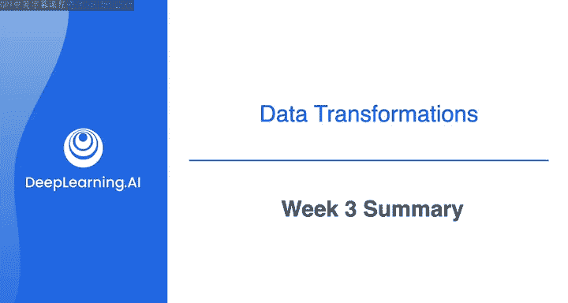
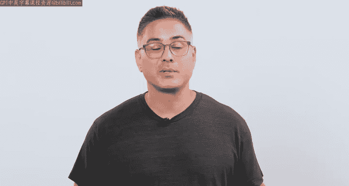
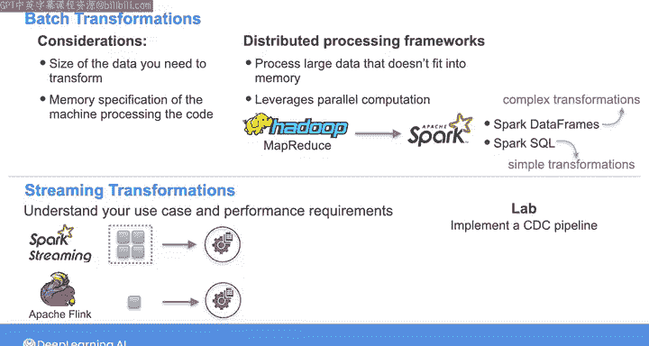

# 吴恩达《数据工程（数据建模、转换和服务）第4课，完结｜DeepLearning.AI Data Engineering》 - P33：32_第3周总结.zh_en - GPT中英字幕课程资源 - BV13mtpe7ESt

This week we looked at the details of transformations and the technical considerations for various data processing frameworks that you can use to transform your data。

 you saw that you can transform your data not only to model it according to your target schema but also to increase its value and quality by cleaning it and enriching it and keeping it updated in your data pipeline when it comes to batch transformation we discuss several considerations including the size of the data you need to transform and the memory specification of the machine that is running your code you saw how you can use distributed processing frameworks if the data you need to process doesn't fit into memory or if you want to leverage parallel computation and you learned how these big data tools such as Spark evolved from Hadoop mapred where intermediate results are stored on disk you got an overview of how Spark works behind the scenes and got the chance to practice coding with Sp data frames as well as sparkSQL while coding and SQL might be handy for simple transformations coding with data frames helps you implement more complex transformations and makes your code more modular。

Hence easier to maintain and test when it comes to streaming transformations understanding your use case and the performance requirements of system will help you choose between a micro batchch framework such as Bro streaming or a true streaming system such as Flink in the final lab of this week you implemented a log-based CDC approach using Dbeium and Apache Kafka and use Flink to process the database updates and with that we finish discussing the critical transformation stage of the data engineering lifecycle where you turn your data into something useful for downstream use cases next week you'll learn how to serve your transform data to downstream stakeholders as the final week of this entire program you also get the chance to put many of the data engineering concepts you learned throughout this program together in a capstone project I'll see you there。

