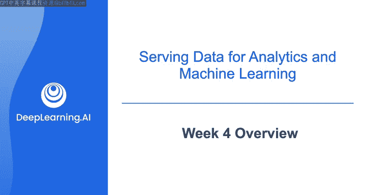
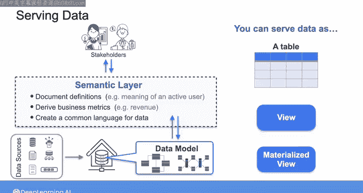
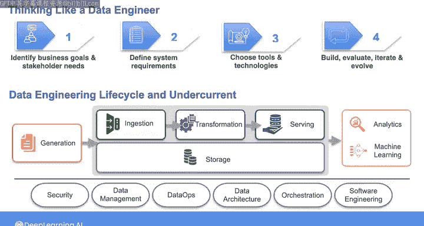

# 吴恩达《数据工程（数据建模、转换和服务）第4课，完结｜DeepLearning.AI Data Engineering》 - P34：33_第4周概览.zh_en - GPT中英字幕课程资源 - BV13mtpe7ESt

Congratulations on reaching the last week of this program throughoutout this course。

 you've learned how to model your data for analytics and machine learning use cases and what tools and technical considerations you should take into account when transforming your data In this final week we will take a look at serving data for various analytics and machine learning use cases For example。

 with a business analytics use case you might be serving data from a data warehouse or a data lake then your end users can use that data to create dashboards or reports or perform ad hoc analysis you could also serve data for operational analytics where your end users monitor immediate trends in the data to inform immediate action with operational analytics。

 you need to make sure that you serve data within the required latency and finally you could serve data for embedded analytics where your end users feed the data to a client- facingcing data product or dashboard when it comes to serving data for machine learning applications which are becoming widely adopted in all types of companies you will likely work with a data scientist or。

leearning engineer to acquire， transform and deliver the data necessary for model training in a format suitable for the target application Earl in the course。

 we looked at some examples of serving data to build a customer churn model as well as a recommendation system Additionally。

 you could incorporate business definitions and data logic through a semantic layer that you build after you model your data in the semantic layer you can document definitions such as the meaning of an active user and derive business metrics such as revenue to create a common language for the data you serve you can also serve your data as a table a view or a materialized view we'll go through all these concepts later in the week and you'll get a lot of practice creating views using DBT in the first lab after we go through the details of serving data I'll give you a summary of the data engineering concepts you learned in this program revisiting the framework of how to think like a data engineer as well as all the stages and undercurrents of the data engineering lifecycl and finally you'll see how all these concepts come together in the cap。

Join me in the next video to go through the different ways of serving data for analytics and machine learning use cases。

