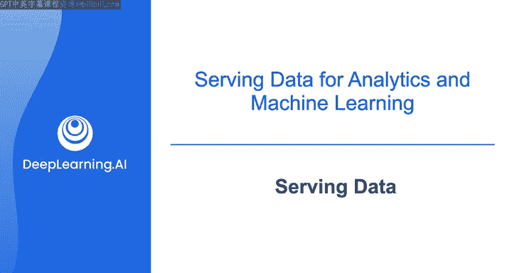
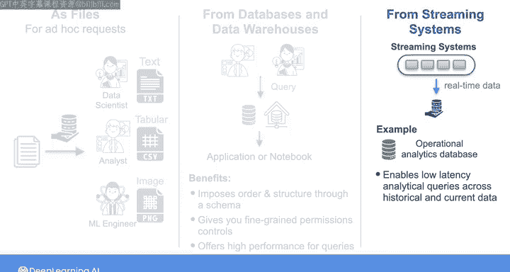
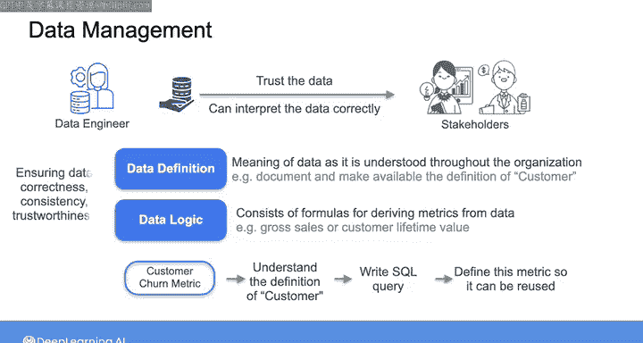
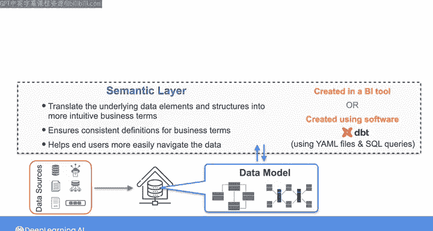

# 吴恩达《数据工程（数据建模、转换和服务）第4课，完结｜DeepLearning.AI Data Engineering》 - P35：34_为分析和机器学习提供数据服务.zh_en - GPT中英字幕课程资源 - BV13mtpe7ESt

There's more than one way to serve data to your end users sharinghar data as files is one common and straightforward way to serve data。

 A data scientist might need a text file of customer reviews to perform center analysis an analyst might need numerical data in a CSV file of invoices to perform some statistical analysis or a machine learning engineer might use images of products to develop a product classification system while of course you could serve text or numerical or image data using a database or object storage in some cases you might just share a file directly say through an email but it's difficult to manage the versioning of files this way using a data sharing platform helps you ensure a coherent and consistent version of the files you share it with your end users serving single files one at a time might be sufficient for certain ad hoc requests but this practice is very hard to scale and if you want to share large files of semistructured or unstructured data then you would need to share your data through object storage or a data lake to scale beyond sharing single files。

chohoose to serve data directly from your OAP database or data warehouse In this case。

 an analyst or data scientist can query the storage system using SQL or another query language and then export those results to a downstream application or analyze results in a notebook Ser data from a database has its benefits A database imposes order and structure on the data by enforcing a schema databases give you fine grain permission controls at the table column and row level。

 allowing you to craft complex access policies for various roles and modern OAP databases and query engines can offer highper for complex computationally intensive queries if you're working with streaming data。

 serving data and files may be impractical or impossible and databases on the own might not have the functionality you need In that case you'll need to work with streaming systems to serve data in real time So for example。

 operational analytics databases are becoming increasingly popular because they allow your end users to perform analyze queries with low latency across a large range of historical data。

And up to the second current data so when you serve data from these databases。

 you are effectively combining the features of an OLAP database with a stream processing system when it comes to data management。

 you need to ensure that stakeholders trust a data you serve them and that they can interpret it correctly and use it in a consistent manner and so you want to ensure the data encompasses proper data definitions in logic data definition refers to the meaning of data as it's understood throughout the organization for example。

 the definition of a term like customer should be documented and made available to everyone who uses the data data logic consists of formulas for deriving metrics from data。

 say growth sales or customer lifetime value proper data logic depends on proper data definitions and contains details of statistical calculations So for example。

 to compute customer churn metrics you would need to understand what the word customer means to end user then you can write a SQL query to define the metric once and it can be reused across the organization this helps avoid。

A messy and unmaintainable sprawl of SQL code so formally declaring data definitions within your organization goes a long way to ensuring data correctness。

 consistency and trustworthiness while you can model the data to help capture data definitions and logic you can also build a semantic layer on top of the data model to translate the underlying data elements and structures into business terms that are more intuitive and useful for your end users the semantic layer ensures a single consistent definition for each business term and helps your end users more easily navigate the data to find what they need the semantic layer can live in a B tool or you can create this layer using something like DBT with DBT。

 you can define your standard business metrics using Yaml file and SQL queries Once your end users receive the data they might use a visualization tool or business intelligence platform such as Amazon Quicks Apache superset or looker to create an analytics dashboard or a data scientist might use notebooks to explore the data engineer。

or train a model you might also be responsible for helping set up and manage the cloud platforms that are designed to handle cloud data science workloads such as Amazon SageMaker。

 Google Cloud vertex AI and Microsoft Azure Maine learning So those are several ways you can serve data for analytics and machine learning In the next video we'll dive into the approach for serving data from a database focusing specifically on using views and materialized views。

