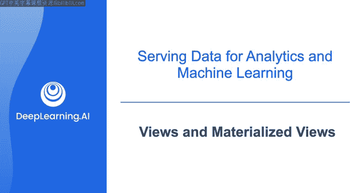
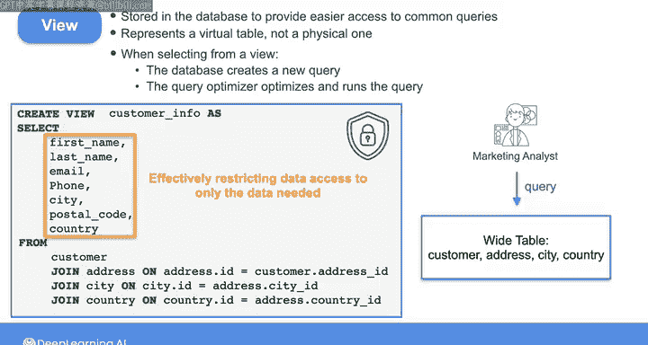
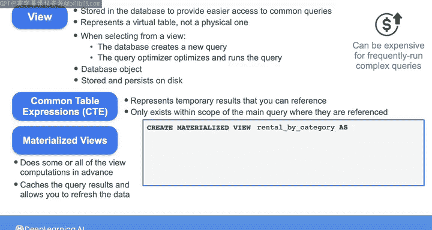

# 吴恩达《数据工程（数据建模、转换和服务）第4课，完结｜DeepLearning.AI Data Engineering》 - P36：35_视图和物化视图.zh_en - GPT中英字幕课程资源 - BV13mtpe7ESt

When you give downstream stakeholders direct access to a database。

 in addition to serving the data as tables， you can also serve data using table like objects such as views and materialized views。

You can create these objects during the transformation stage in your data pipeline or before you serve the data to your end users in the data consumption layer。

 a view is just a query that you can store in your database to give you in your stakeholders easier access to common queries and it can also help simplify the process of writing complex queries here's an example of how you can create a view you first type the keywords create view followed by the name of the view along with the as keyword I'm calling this view customer info and then you specify the query statement here I'm selecting the first and last name email。

 phone number and address fields from the customer address。

 city and country tables the view represents a virtual table。

 not a physical table that you or the end users can select from just like any other table when you select from a view the database creates a new query that combines the view with the query that referenced it and then the query optimizer optimizes and runs the full query suppose that a marketing analyst。

Need to frequently run a query on the results from joining the customer address。

 city and country tables When you create this customer info view。

 you are joining together the four tables into a wide table and so the marketing analyst can simply write queries that filter and perform agregs on top of this view rather than having to write a query to join these tables together to themselves every time you can also use views to apply security principles when serving your data for example。

 you can create a view that selects only specific columns and rows then when you serve your downstream stakeholders with this view。

 you are effectively restricting their data access to only the data that they need CTteE or common table expressions that you learn back in course 3 is a SQL concept that similar to views。

 remember that you can create a CTteE using the with clause followed by the name of the CTE and then a query andclo and parentheses but that query represents some temporary results that you want to reference in a subsequent SQL query So both CTEs。

Vis help organize the code by making it cleaner and easier to follow。 however。

 CTEs only exist within the scope of the main query where they're referenced。

 so once the main query is executed， the CTE is discarded and can be reference in other queries On the other hand a view is an actual database object that can be accessed by external database users so the body of the query that represents the view is actually stored in the database disk and it can persist in the database until you explicitly drop it so views can be referenced and used by your end user across different sessions and queries Now if View you can't perform and store any precomputation meaning that the query represents by the view needs to be executed every time the view is reference so using a view to store complex query that your end users need to run frequently can be extremely expensive a materialized view on the other hand does some or all the view computations in advance it then caches a query results and allows you to refresh the data periodically here's an example of how you can create a materialized view。

Start with the create materialized view keywords， then you give the materialized view a name followed by the as keyword I'll call this materialized view rental by category then you specify the query you want to represent with this materialized view for this example I want to join together the payment rental inventory film film category and category tables then I'm going to select the category name and the sum of the payments。

 then group by the category E query is executed and the results of the six table joins are saved in cache then when a user references this rental by category materialized view。

 their querying from the prejoin data a materialized view is useful when you can tolerate some amount of latency between the refreshes for the first lab of this week you'll work with the star schema model you saw back in the first week of this  course。

You'll create analytical views on top of the model using DBT。

After that you'll be ready to dive into the capstone labs in the next lesson I'll give you a summary of all the key concepts you learned throughout this program then I'll give you a quick walkthrough of the capstone before you jump into those labs I'll see you there。

