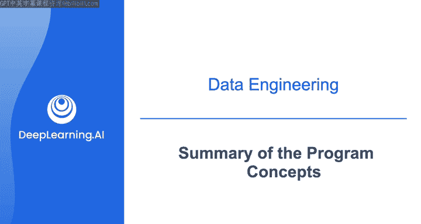
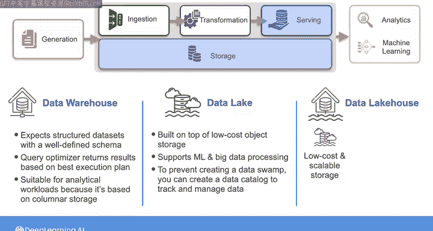
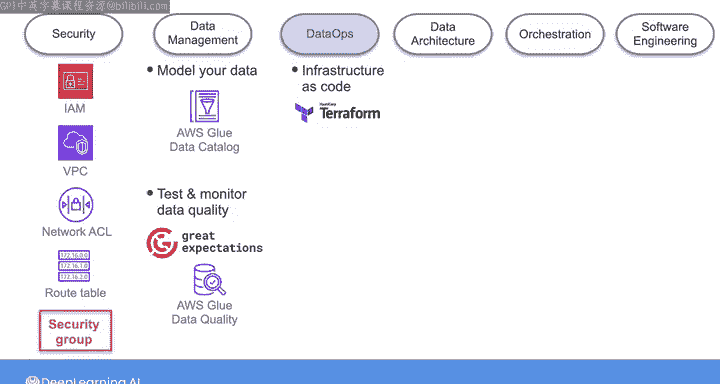

# 吴恩达《数据工程（数据建模、转换和服务）第4课，完结｜DeepLearning.AI Data Engineering》 - P37：36_课程概念总结.zh_en - GPT中英字幕课程资源 - BV13mtpe7ESt

In this program we've covered a lot of ground in the fundamentals of data engineering。

 we walk through the stages of the data engineering lifecycle and its undercurrents and explored technologies and best practices for building data solutions on the cloud you got handson practice with each of these data engineering concepts in the lab exercises and now you're ready to bring it all together in this video I'll quickly recap the major themes and concepts you've been learning about in these courses and after that we'll dive into the final capstone labs of these courses where you'll be applying everything you know we started this program by taking a look at a framework for thinking like a data engineer When you start a new data project you should always work backward by first identifying the needs of your stakeholders and how they will derive value from the data you serve them you can then translate those needs into system requirements and then choose the appropriate tools and technologies that can help you meet those requirements only then can you start building and iterating on your data systems when you focus on your end users and their data needs you'll be well on your way to adding value。

For your organization when building your data system。

 you will typically start by ingesting data from S systems how you'll ingest your data will always depend on the type of source system you're working with。

 for example， a database， a file residing in a file system or object storage or streaming system or an API you can ingest historical data from a file or database by following a batch ingestion pattern or you can use streaming ingestion to ingest data from streaming systems in realtime although batch and streaming ingestion or often discuss a separate paradigms they actually exist along a continuum that ranges from infrequent large batch data ingestion to a real-time streaming of individual messages as are generated。

 and in between you have a wide range of batch micro batchch and streaming approaches the ingestion approach you take should be guided by your stakeholders' needs and your system's requirements both batch and streaming ingestion can serve as the extract phase in an ETL as well as an ELT process with ETL you apply some inf chance。

to data before loading it into the target system or you could follow an ELT process where you apply the data transformations after you load the data into your target system The choice between these two patterns will depend on what transformations you want to apply to the data。

 the hardware specification of your processing tool in your target system and the size of your data transforming the data encompasses cleaning and combining data from multiple sources as well as converting the data into a target schema and the target schema depends on the data model you created if you're serving data for analytics then you might choose to model your data on a star schema or one big table these models can help your end users more easily and efficiently write analytical queries if you're serving data for data science or machine learning and how and how much you process the data will depend on your organization and whether your end users want to explore the data use the data to train a machine learning model。

 make predictions or something else to apply transformations you could issue simple SQL queries or write flexible and。

la code in a nonnularative language like Python and depending on the size of your data。

 you could process your data using a nondistributed processing tool such as pandas or a distributed framework such as Spark you also learned that for analytical use cases you could process large amounts of data inside a cloud data warehouse to leverage the massively parallel processing power of cloud computing Trans tools such as DBT also facilitate data modeling inside a data warehouse like relational databases a data warehouse expects structured data sets with a well-defined schema when your end users issue analytical queries to your data warehouse its query optimizer looks for the best execution plan and then returns results based on this plan data warehouses are more suitable for analytical workloads because they are based on columnar storage which makes it more efficient at aggregating queries than transactional datas that are roworiented On the other hand you can use a data lake built on top of lowco object storage to support applications such as machine learning。

Big data processing that require massive amounts of structured and unstructured data and to prevent data lakes from becoming unusable data swamps you can create a data catalog to track and manage data storage in your data lake you also learned about the data lakehouse architecture which combines the low cost and scalable storage of data lakes with the superior structured querying performance and data management features of data warehouses to provide a unified platform for serving both low latency analytics and machine learning as data warehouses adapt lakelike features and data lakes incorporate warehouselike capabilities the alliance between data warehouses。

 data lakes and data lakehouses are blurring in terms of the data engineering undercurrents you use IM to ensure the security of your data systems on the cloud by preventing unauthorized users from accessing your data and resources networking concepts such as VPCs routetables。

 network ACLs and security groups can also help secure your resources you practice good data management by modeling your data。

Using data catalogs and properly organizing your data storage to make your data easier to find by your end users your end users also need to trust your data by testing and monitoring the quality of your data using tools like great expectations and glue data quality throughout your data pipeline you ensure that your serving data that can deliver value to your stakeholders you also apply the automation pillar of data ops by using infrastructure as code tools like terraform to automate the creation and management of your data pipeline resources and use airflow to orchestrate entire data pipelines and so you now know how to design and build data engineering solutions that encompass each stage of the data engineering lifecycle and incorporate the key undercurrents of data engineering in the final lab of this program you will get a chance to work with an end-to end data pipeline to put all these concepts together the capstone lab consists of two parts in the first part you will create and configure the resources of your data pipeline in the second part you'll integrate data quality checks and orchestration to the。

me data pipeline to help you prepare for the capstone lab join me in the next video to go through some example code and additional materials that can help you complete the lab after that feel free to start the lab or watch the lab walkthrough if you'd like to get an overview of the lab tasks before starting the lab。

