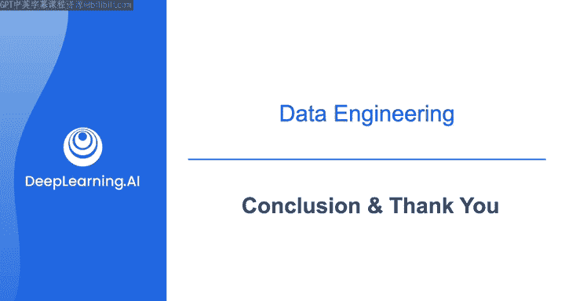
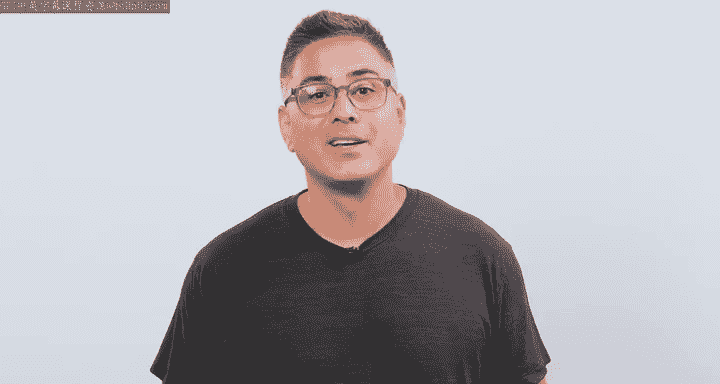
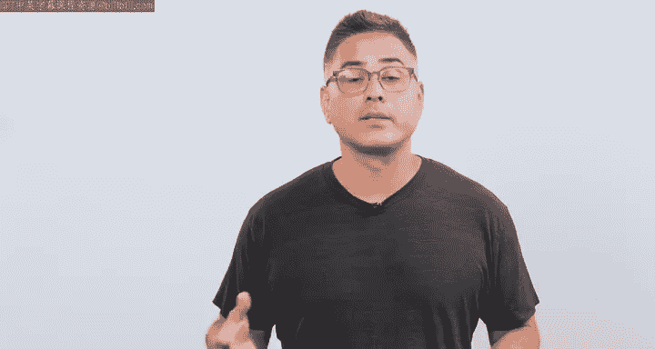
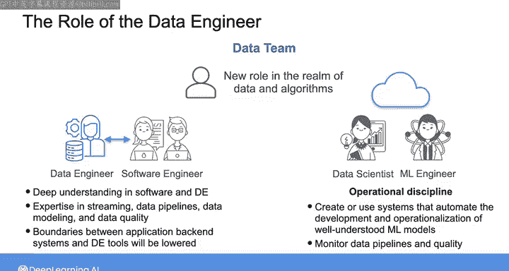
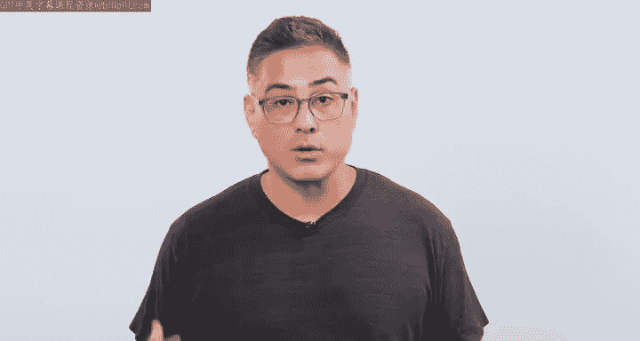
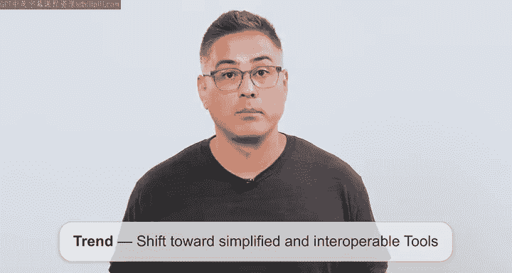
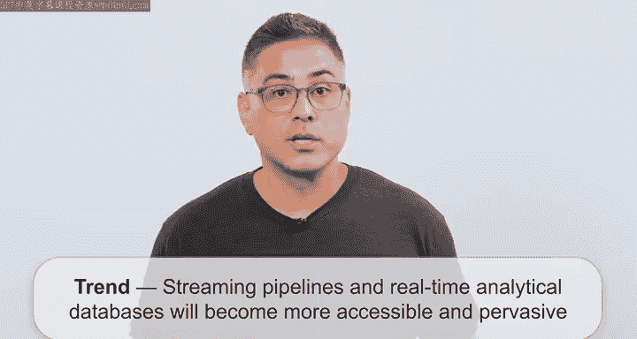
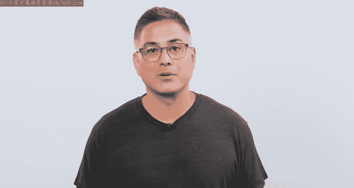

# 吴恩达《数据工程（数据建模、转换和服务）第4课，完结｜DeepLearning.AI Data Engineering》 - P38：37_课程结束.zh_en - GPT中英字幕课程资源 - BV13mtpe7ESt

Great job on completing this data engineering professional certificate program I hope you've fallen in love with data engineering and are feeling confident in your abilities to apply what you've learned in your own work as a data engineer in this final video I'd like to share with you my thoughts on how I think this field is changing and some personal advice that might help you as you continue to explore data engineering in this program you've been learning about data engineering in the context of the lifecycl and undercurrents that Matt Hsley and I described in our book。

Our goal in defining the lifecycl stages and undercurrents as we did was to percent a framework that will stand the test of time。

 even as the underlying tools and technologies that support each stage of the lifecycle continue to change and evolve throughout these courses we've been looking at the role of the data engineer in the context of other roles in the data team like software engineering。

 data science and machine learning however， the boundaries between software engineering。

 data engineering， data science and machine learning are growing increasingly fuzzy as data becomes more tightly embedded in every business process new roles will emerge in the realm of data and algorithms it's impossible to predict the future but one possibility is that data and machine learning engineering will blend together as machine learning tools sets become easier to use and manage cloud machine learning services grow in capabilities machine learning is shifting away from ad hoc exploration and model development to become an operational discipline。

 the primary goal of this blended role will be to create。

or utilize the systems that automatically train models。

 monitor performance and operationalize the full machine learning processes for model types that are well understood。

 they will also monitor data pipelines and quality overlapping into the current realm of data engineering Today's machine learning engineers might become more specialized to work on model types that are closer to research and less well understood another area in which titles Ma Morf is at the intersection of software engineering and data engineering data applications which blend traditional software applications with analytics will drive toward this trend So engineers will need to have a much deeper understanding of data engineering they'll develop expertise and things like streaming data pipelines。

 data modeling and data quality and data engineers will be integrated into application development teams and software developers will acquire data engineering skills the boundaries that exist between application backend systems and data engineering tools will be lowered as well with deep integration through streaming and event- drivenven。

As data technology continues to evolve at an exhausting pace what's next for data engineering when it comes to tools and technologies a major trend I see continuing in the field of data engineering is a shift towards simplified and easy to use tools and toward interoperability across applications and systems abstraction streamlines and development process and allows engineers to focus more on solving complex and value- added problems rather than managing low-level infrastructure and code So if tooling becomes easier to use data engineers will move up the value chain to focus on higherlevel work I also think that streaming pipelines in realtime analytical databases will become more accessible and pervasive while these technologies have been around for some time you'll be able to deploy them more easily with rapidly maturing managed cloud services in conjunction with a clearer focus on the business use cases of streaming data Of course batch transformations won't entirely go away batchch will still be useful for model training quarterly reporting and more but streaming transformation will become。

The normNow what about the hot topic of integrating AI and your workflow as a data engineer Every company seems to want to do AI I mean whatever that means when I dig into actual AI use cases that can move the needle stuff like Github Copit comes to mind as a gateway drug for many companies to get value from AI It's like staffing your engineering team with interns and junior levelvel engineers who are super convincing and often need their code rewardworked but for the most part the code output as passable or at least eventually usable but there's a catch。

 I don't expect AI enabled workflows to replace handwritten code anytime soon as engineers will still prefer writing code engineers want to engineer。

Clanking on a keyboard is a very tactile and cathartic experience for engineers AI coding assistance and agent workflows just make it easier most of the time to get work done so these are some trends I expect to see in the field of data engineering in the near future Finally I want to leave you with a few words of advice As you continue to explore this field on your own and work on building your data engineering skills and foundation I encourage you to work in your own data engineering projects in the resource section you'll find links to some examples of data engineering projects that can serve as inspiration and blogs that you can dive into to continue educating yourself about data engineering Also I encourage you to continue the conversation as part of a community participate in meetups ask questions and share your own expertise you should also keep up to date with the latest developments by reading books。

 blog posts and papers and listening to talks by domain experts who can help you uncover the strengths and pitfalls of trendy technologies and practices This is the end of the course and you've made it。

But if you're interested in hearing more insights and career advice from industry experts check out the final and optional lesson in this course there you'll find interviews I recorded with some of my friends including Jack Wilson。

 Carly Taylor and Ben Rojan where they talk about what it's like to start a career and data and provide their own personal tips and advice Thank you for joining me on this journey through data engineering I wish you all the best in your career and I can't wait to see what you build by applying what you've learned in this program。

