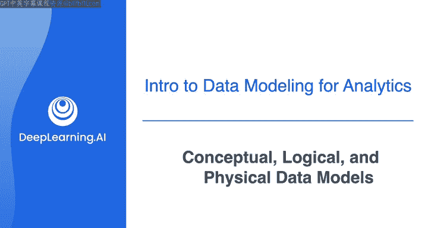
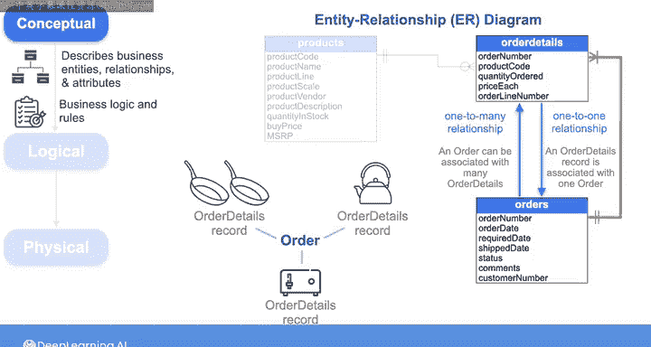
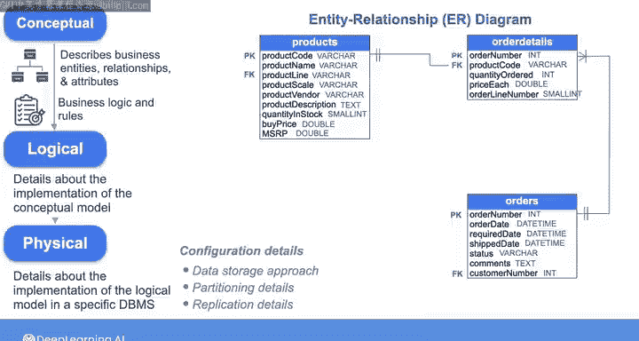

# 吴恩达《数据工程（数据建模、转换和服务）第4课，完结｜DeepLearning.AI Data Engineering》 - P3：2_概念性、逻辑性和物理性数据建模.zh_en - GPT中英字幕课程资源 - BV13mtpe7ESt

As a data engineer， you can add value by building and maintaining a data model that promotes communication and shared understanding across your organization but where should you start Well my suggestion is to start with a high-level conceptual data model that describes the business entities then you can fill out more of the details to create a logical data model and finally you'll create what's known as a physical data model where you'll decide on the database or other storage systems that you use to store and serve the data as well as outline the implementation details。

 meaning the actual tools you'll use to implement these storage systems in your data pipeline。

 zooming in on the conceptual model， it should focus on the high-le business entities。

 the relationships between them and the attributes of each entity。

 it should also reflect the business logic and rules For example。

 for tabular data the description could include the tables relationships between the tables and column names when you create a conceptual model you can visualize it with an entity relationship or Er diagram。

 which is a standard tool。Visualizing the relationships among different aspects of your data like customers。

 products or events。 Here's part of the Er diagram of the classic models data set he worked with in course1。

 As you can see， it contains data about products and order details for each order it encodes a connection between product data and order details using these symbols。

 This symbol stands for one and only one， meaning that each order details record can be associated with one and only one product it's common to call this relationship from order details to product a one to one relationship。

 This symbol over here stands for zero or many， meaning that a product can be associated with zero order details if no one purchase that product or it can be associated with many order details if it was purchased many times So this relationship from products to order details is a zero or one too many relationship or more commonly known as simply a one to many relationship meaning that one product can be associated with。

Many order details notice that the relationship changes depending on the direction you take when viewing the relationship This Er diagram also shows that the relationship from order details to orders is one to one。

 meaning that one order details can only be associated with one order and the relationship from order to order details is one to many meaning that one order can be associated with many order details So for example。

 if a customer brought a bunch of products within the same order then there would be many order details one for each kind of product purchased each of these order details would be associated with only one order。

 but the order would be associated with many order details the next level after the conceptual model is the logical model where you add more details about how you'll implement the conceptual model For example。

 you would add information on the types of columns for each table and map out the primary and foreign keys。

 then finally you create the physical model where you choose the specific。

BMS and define how you'll implement the logical model in that system This physical model should define the configuration details describing how data is stored such as on disk or RAM or using a hybrid approach and how processes like partitioning and replication are implemented so when you model your data you'll move along this continuum from abstract modeling concepts to concrete implementation Next up let's dive into the details of data modeling starting with an in depthepth look at normalization。

