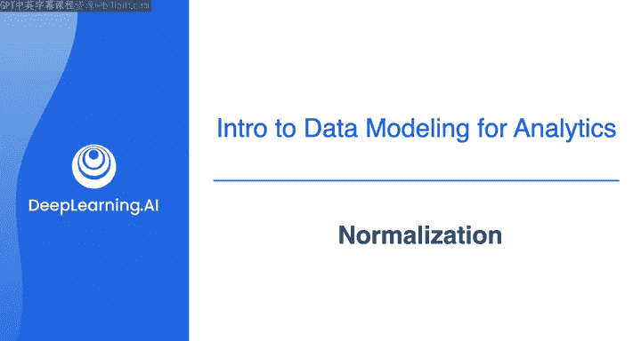
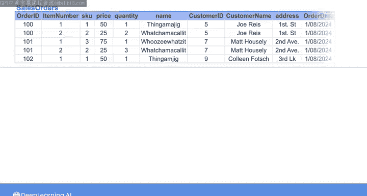
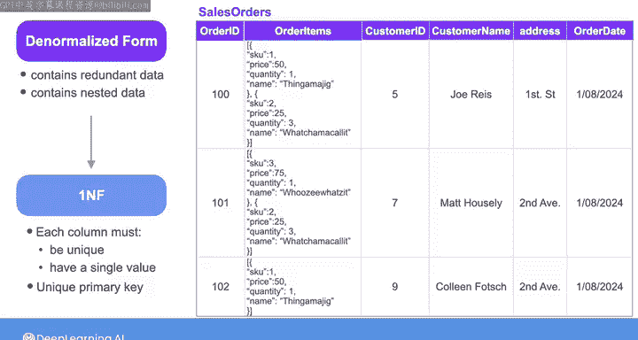
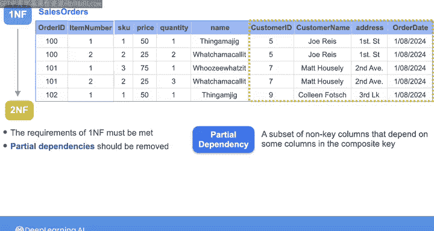
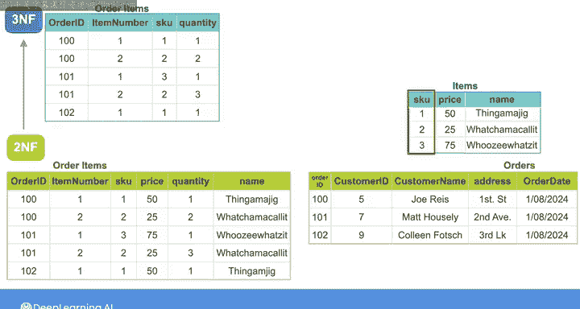
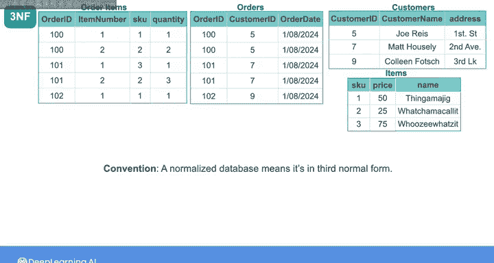

# 吴恩达《数据工程（数据建模、转换和服务）第4课，完结｜DeepLearning.AI Data Engineering》 - P4：3_规范化.zh_en - GPT中英字幕课程资源 - BV13mtpe7ESt

Back in course two， when we discussed relational databases as source systems。

 he learned how normalization can reduce the duplication of data and improve data integrity in this video we'll revisit this topic and discuss the various forms of normalization so normalization as a data modeling practice that's typically applied to relational databases to remove the redundancy of data within the database and ensure referential integrity between database tables it was first introduced by a relational database pioneer AgriCOd in 1970 and here are some of the normalization objectives that Cod outlined at that time to free the collection of relations from undesirable insertion update and deletion dependencies as well as to reduce the need for restructuring the collection of relations as new types of data are introduced and thus increase the lifespan of application programs to better understand Co's normalization objectives let's take a look at this example where sales order data is represented in two different ways the first model represents the data in one giant sales。

Order table and the second model represents the same data， but spreads it across multiple tables。

 The first model is less normalized in the second one。

 meaning that the large sales order table contains more redundant data than the smaller tables in the second model So for example。

 if you want to update the address of a customer let's say for Joe Reese here you would need to update every single row that corresponds to Joe Reese in this first table in the second model on the other hand。

 the customer data is stored in a different table So whenever you want to update the address of a customer you only need to change a single row in the customer table Now let's say you want to add the orders shipment information in the less normalized model you would need to change the structure of the table by adding new columns for the shipment information but in the more normalized model you can simply create a new table for the shipment data then use the order I as the forum key to link this new table to the existing orders table and this way you won't have to make changes to any other tables the first model。

that is less normalized is called the first normal form and the more normalized model here is called the third normal form on the spectrum of normalization there's also something called the deormalized form and second normal form as well Each form contains a different level of redundancy and incorporates the conditions of prior forms using the same sales order example let's start with the deormalized form and transform it step by step to turn it into third normalmal form So here's the deormalized table that contains the details of each order placed by a customer it contains six columns with the order ID as the primary key a deormalized form contains contains not only redundant data。

 but also nested data in this example， the order items column contains nested objects where each object contains information such as the items skew number price quantity and name to convert this deormalized table to first normalmal form which I'll denote here as one and f you need to make sure that each column is unique and has a single value meaning no。

Nest data and the table must have a unique primary key So let's unns the order items column and replace it with four columns。

 In this case， the item s price， quantity and name or the new columns Now each row represents an item in a given order and because an order can contain several items the order ID is no longer a unique primary key for this table to create a unique primary key let's number the items in each order by adding a column named item number so now the composite key consisting of order I and item number together represents a unique primary key for this table but this form still contains redundant data and can be further normalized by converting it into the second normal form which I'll denote here as two NF for the second normal form the requirements of first normal form must be met and any partial dependencies should be removed a partial dependency occurs when there is a subset of non-key columns that depend on some columns in the composite key。

SoFor example， the customer ID， customer name， customer address and order date are non-key columns that all depend on the order ID。

 meaning that if you know the order ID， you can uniquely identify the information in these last four columns and so you can split the sales order table into two tables and order items table and an order table the composite key consisting of order ID and the item number is now a unique primary key for the order items table while order ID is a primary key for the order table。

 So now there are no more partial dependencies in these tables。

 but they have another form of dependency called a transitive dependency a transitive dependency occurs when a nonkey column depends on another non-key column So for example in the order items table。

 the price and the name of an item depends on its sw and in the order table。

 the customer name and the address depend on the customer ID while the type of dependency can exist in a table that's in second normal form。

A table in third normal form needs to meet all the requirements of second normal form and have no transitive dependencies。

 so to convert these tables from second normal form to a third normal form。

 you can remove the transitive dependencies from the order items table by creating another table called items that contains a name。

 price and sw for each item the ske is now a unique primary key for the items table let's also remove the transitive dependencies from the order table by creating another table containing the customer name and customer address of each customer the customer ID is now a unique primary key for the customers table database is usually considered normalized if it's in third normal form and that's what we'll be using as a convention in this course as a data engineer you might ingest data from source databases that are normalized especially if they represent a transactional system or you might work with a data warehouse that contains normalized data when you model your data the degree of normalization that you should apply to your data depends on your use case。

One size fits all solution and you might encounter cases where deormalization actually has performance advantages because it doesn't require you to perform any join operations between tables in other cases you might prefer the normalized form to ensure efficient read and write operations and better data integrity in the first lab this week you'll get a chance to practice creating a normalized data model similar to the exercise we just did together in this video you'll be given a denormalized table and have to apply several normalizedization steps to convert it to third normal form I'll see you after that to continue our discussion on data modeling。

