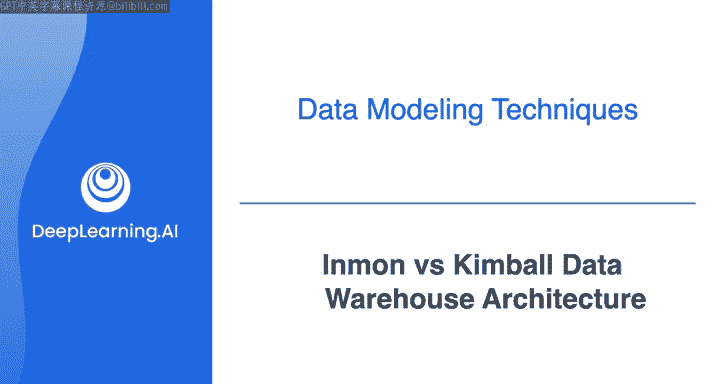
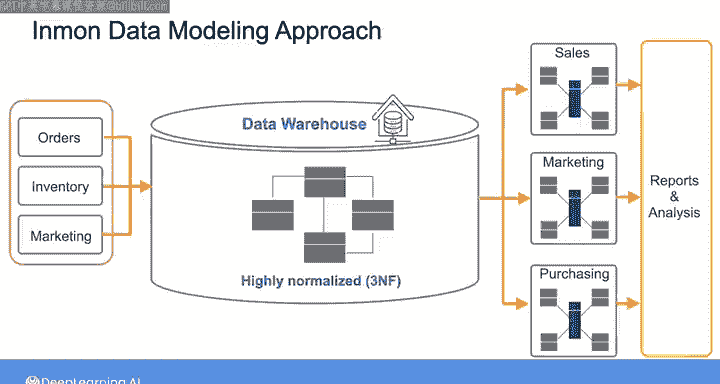
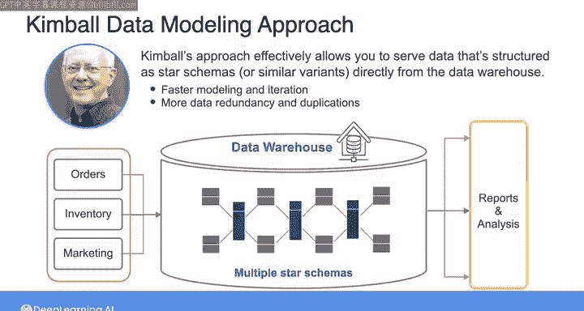
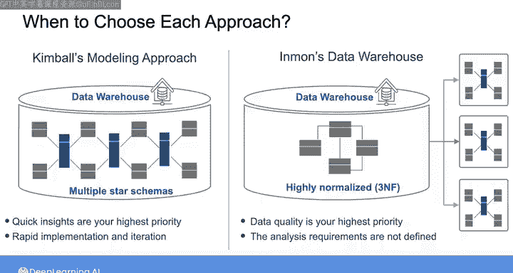

# 吴恩达《数据工程（数据建模、转换和服务）第4课，完结｜DeepLearning.AI Data Engineering》 - P6：5_Inmon与Kimball数据仓库数据建模方法对比.zh_en - GPT中英字幕课程资源 - BV13mtpe7ESt

Back in course3， we discuss data warehouses as a storage system that you can use to separate transactional systems from analytical systems。

 but we didn't discuss how the data is actually modeled within the data warehouse to support this there are many approaches to modeling data for data warehouses and the big ones you will likely encounter in your work as a data engineer or the Kimball Inmin and data vault modeling approaches in this video we'll go through the Inmin and Kimball approaches and then later this week will look at datavault and other data modeling techniques my good friend Bill Inman who is widely known as the father of the data warehouse created his approach to data modeling for data warehouses in 1989 with the goal of separating the So system from the analytical system as you've seen in course3 Inman defines a data warehouse as a subjectoriented integrated non-volat and timevari collection of data in support of management's decisions Here's a continuation of the definition the data warehouse contains granular corporate data。

Data in the data warehouse is able to be used for many different purposes。

 including sitting and waiting for future requirements。

 which are unknown today The subjectoriented and granularity aspects of this definition mean that an inmin model organizes data into the major subject areas of the business and includes all the details is related to those subjects For instance。

 in an ecommerce-commerce company， you can have subjects such as products， orders， customers。

 shipments and so on and for each subject the data model must contain all the details such as business keys。

 relationships and attributes so with the inmin data modeling approach you need to consolidate data from various data sources and model the data into a highly normalized form that is then stored in a data warehouse you can then serve the data for downstream reports and analysis via department specific data mars with this approach the data warehouse represents a single source of truth that supports many data use cases even。

Current analytical requirements are not yet defined This strict normalization requirement in the data warehouse reduces data duplication leading to fewer downstream analytical errors。

 better data integrity and consistency here's an example of how you can apply the inmin modeling approach to ecommerce-commerce data let's say that the business stores information about orders inventory and marketing and separate source systems you can ingest a data from these sources and store it in the data warehouse in a highly normalized third normal form to meet department specific data needs you can then take this data from the data warehouse。

 model it into various star schemas or other appropriate models and place them in downstream data marks for sales。

 marketing and purchasing with each department having its own data structure that's unique and optimized to its specific needs this way data users from each department can easily query the data for their use cases unlike the inmin modeling approach that uses a data warehouse to store data across a business that's been modeled into a normalized form and then serves department specific analytics through data Mars the Kimball modeling approach。

Fusees more on modeling and serving department specificific analytics directly in the data warehouse without first normalizing the data created by Ralph Kimball in the early 1990s this approach effectively allows you to serve data that structured as star schemas or similar variance directly from the data warehouse itself incorporating data marks into the overall warehouse architecture here's an example of how a Kimball data warehouse can be used for e-merce after you ingest the data from the orders。

 inventory and marketing store systems， you model the data into multiple star schemas to address the different facts of the business and then store them directly in the data warehouse Kimball's approach enables faster modeling hence quicker iterations and inman's approach but with the tradeoff of potential data integrity issues because you're storing star schemas that have more data redundancy and duplications directly in the data warehouse so if your organization prioritizes quick practical insights into specific business processes and is looking for rapid implementation and iteration of the data warehouse then I suggest you adopt Kimball's approach。

Da modeling on the other hand， if data quality is your highest priority or if the analysis requirements are not yet defined。

 then I suggest you choose Inmin's data modeling approach that treats a data warehouse as a single source of truth all data marks are then built on top of the highly normalized data warehouse to ensure data consistency and integrity depending on your organization you might need to apply both the Nmin and Kimball modeling approaches when modeling data for different data warehouses so it's important that you understand how to handle data that is highly normalized and data that's in the star schema and so before we discuss another approach to data modeling join me in the next video to learn how you can convert a normalized data model that's in third normal form into a star schema。

