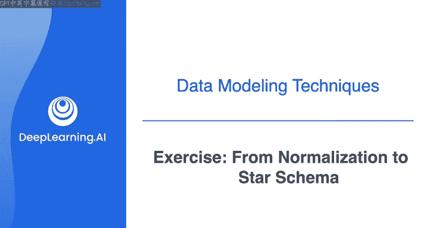
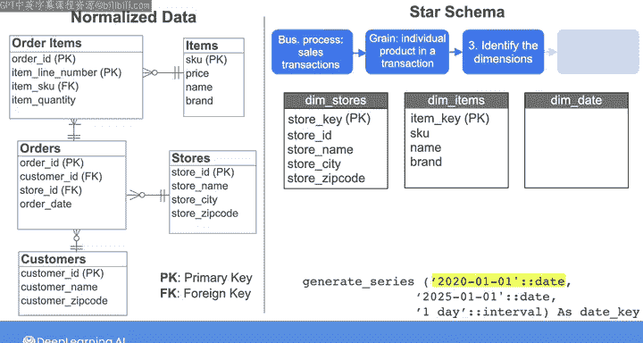
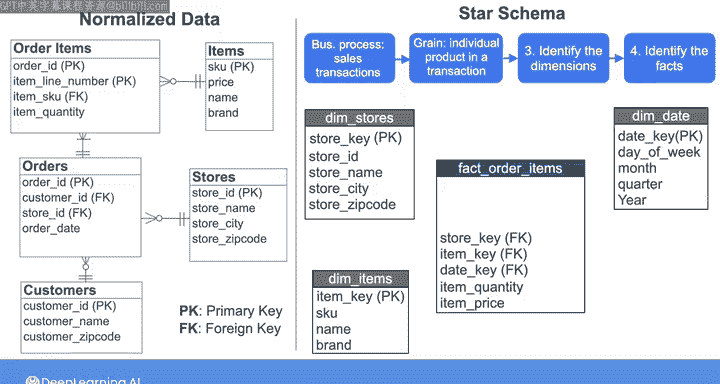
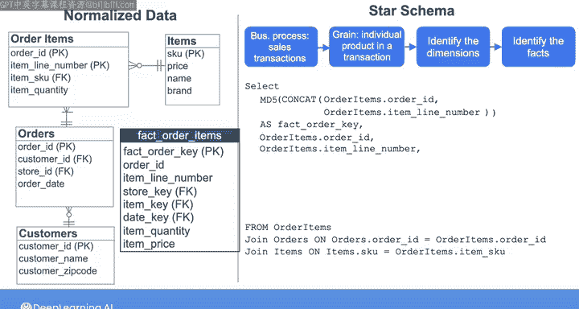
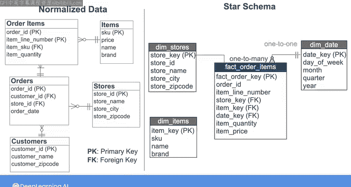
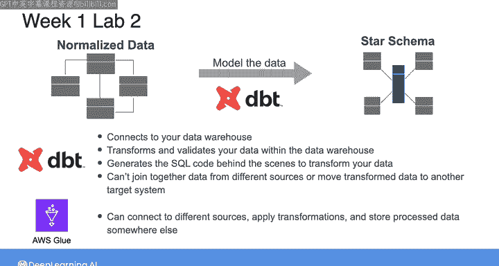

# 吴恩达《数据工程（数据建模、转换和服务）第4课，完结｜DeepLearning.AI Data Engineering》 - P7：6_练习：从规范化模型到星型模式.zh_en - GPT中英字幕课程资源 - BV13mtpe7ESt

As a data engineer， there is a good chance you'll need to transform data that's stored in a normalized schema into a star schema。

For example， you might need to extract normalized data that's stored in a relational database and model the data into a star schema so it's easier to query before loading it into department specific datamars。

So let's walk through an example where we convert normalized data that's in third normal form into a star schema。

 Here's the ER diagram of the normalized data we obtained in an earlier video by applying the normalization stages it consists of four tables customers orders is placed by the customers the items that make up each order and the characteristics of each item I'll add another table here to represent the stores where each order was placed in this diagram PK means primary key and fK means foreign key let's say your're tasked with modeling this data into a star schema to serve to the data analyst in your company will follow the four key steps Kim will propose for designing a star schema First you need to understand the needs of the business This help you identify which business events or processes you want to model in the fact tables and itll help you declare the grain meaning the level of detail you want each row in the fact table to represent then you can identify the business measurements or facts that are generated by the business。

and are associated with the grain as well as choose the dimensions to provide the needed context for the facts。

 let's say you did some requirements gathering by talking to a data analyst and learn that they are interested in analyzing the sales data to understand which products are selling in which stores on a given day if there are any differences in sales between stores and which product brands are most popular from this you've determine that the business process that needs to be modeled is the company's sales transactions So you could decide to represent the total sales transactions on a particular day in each row of the fact table or you could represent a single sales transaction or even an individual product item in a sales transaction in each row when deciding on the grain like I mentioned earlier。

 I encourage you to choose the atomic grain to capture the lowest level of detail of the sales transactions this way you'll be able to keep your system flexible enough to handle unpredicted user questions in the future So let's declare the grain to be an individual product item in a。

ranaction Next you want to select the dimensions Since the data analyst is interested in analyzing the sales with respect to the stores dates and brands。

 you can have one dimension table that represents the stores another dimension for the items features and another for the date dimension So let's write a S statement to create the stores dimension table you want to select the store ID store name store city and store zip code from the store table and you also need a primary key for this table like I mentioned in an earlier video。

 you typically want to generate surrogate keys and use them as a primary keys for your dimension and fact tables This guarantee is that each row in your star schema can be uniquely identified by the primary key of the fact and dimension tables。

 regardless of changes that might happen to your store systems to generate the surrogate key for the store dimension table you can create a sequence of integers starting from one and assign one integer to each store or you can use a hash function that takes in the natural primary key and。

s a unique surrogate key for each store。 popularular database management systems such as PostgressqL and MysqL support several hash functions。

 For example， M5 is a hash function that encodes a string into a hash output。

 So assuming that the store ID from the production database is a string I can apply the M5 hash function to the store id to generate a surrogate key for each row。

 and I'll label the surrogate key as store key。 If the store id is actually an integer value。

 Then you'll need to first convert it to a string。 So with this SQL statement。

 you'll end up with this stores dimension table。 noticeice that it contains both the surrogate store key and the natural store ID for ease of reference and interpretability purposes。

 Next let's create the items dimension table by selecting the Skew name and brand from the items table。

 Then for the primary key， you can apply the M5 hash function to skew assuming that Skew is a string and then label the surrogate key as item key you'll end up with this items。

Dimmension table Finally， let's create the date dimension table The idea behind the date dimension is that for each date you can create columns that specify the corresponding day of the week。

 month， quarter and year like you see here This will help the data analysts answer questions like what are the total sales in the first quarter of 2022 what products are most popular on the weekends to create the date dimension table you can generate a series of sequential dates covering a desired period of time。

 here's one way of generating a series of daily dates in Postgres SQL first itll generate a series of dates from January 1 2020 all the way to January 1 2025 then you'll extract the day of the week month quarter and year from each date so that takes care of the three dimension tables Finally。

 let's create the fact tables Each row in the fact table must represent a product within a sales transaction the facts associated with each product or the quantity sold which you can get from the order items table and the price of each item which you can get from the items table additional。

The fact tables must contain the foreign keys that connect it to the dimension tables In this case those are the store key item key and date key。

 which are the surrogate keys created for each dimension table and of course the fact table must contain a primary key to uniquely identify each row you could create a composite key consisting of order ID and item line number but the better practice is to generate a surrogate key from the combination of these two natural keys so the fact order item table should look something like this now let's write the SQL query to create this fact table for the primary key you'll select the order ID and item line number from the order items table and then concatenate them so you can apply the M5 hash function to the concatenated string to generate the surrogate key you'll label this as fact order key you'll also include the order ID and item line number natural keys in the fact table for reference then you'll join the order table and then the item table so you can create the rest of the attributes for the foreign keys let's apply the hash。

to the store ID from the orders table to create the store key that links to the store dimension table。

 then let's apply the hash function to the item s from the order items table to create the item key that links to the item dimensions table and finally let's select the order date from the order table to create the date key that links to the date dimension table and don't forget we need to add the two facts so let's select the item quantity from the order items table and the price from the items table Here's the ER diagram of the star schema we just created Since an item in an order is purchased on a particular date Each row in the order items fact table can only be associated with one row in the date dimension table So the relationship from the order items fact table to the date dimension table is one to one and is denoted by the symbol here on the other hand a particular date can be associated with no orders if no one purchase anything on that date or it can be associated with many orders if multiple orders were made that day。

The relationship from the date dimension table to the order items fact table is zero or one to many or more commonly known as one to many。

 Similarlyly， an item in an order is purchased at a given store and corresponds with single item so each row in the fact table is associated with one row in the store dimension table in one row in the item dimension table and the relationships from the fact table to these dimension tables are one to one but any store and any item can be associated with more than one order so the relationships from these dimension tables to the fact table or one to many so that's how you can convert a normalized model into a star schema if you want more practice I have included another modeling example in the reading item that follows this video in the last lab of this week you'll also get a chance to model normalized data into a star schema while you can write your own code to transform the data like you've done in the previous labs at AWS glue in this lab you'll use a popular data transformation tool called DBT which helps you model。

Data by abstracting away a lot of the heavy lifting with writing pure SQL code DBT allows you to connect to your data warehouse and then transform and validate your data within the data warehouse itself。

 It treats a modeling process as a transformation task and generates a SQL code behind the scenes you transform your data although DBT simplifies the transformation step for you it can only connect to a single target。

 meaning you can't use DBT to join together data from different sources and you can't move the data to another target system after it's been transformed to join the data from multiple sources。

 you need to first bring the data inside the same target system AWS glue on the other hand。

 allows you to connect to different sources， apply transformations and store the process data somewhere else So if you need to perform transformations on data that will be moved around you should choose AWS glue or a similar ingestion tool over DBT So after you get more practice with theal modeling in the reading item that follows join an optional video or I speak with Dr Bannon the co-foer of。

Then after that， we'll take a look at another modeling technique called datavault。

 I'll see you there。