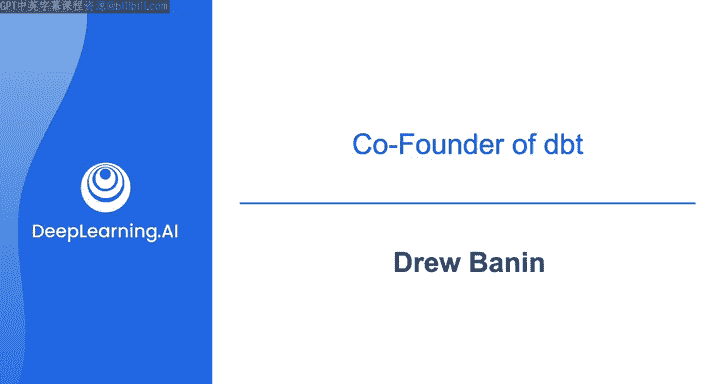

# 吴恩达《数据工程（数据建模、转换和服务）第4课，完结｜DeepLearning.AI Data Engineering》 - P8：7_可选：与Drew Banin讨论dbt.zh_en - GPT中英字幕课程资源 - BV13mtpe7ESt

How's it going through。They do。He good so yeah today we have Drew Bannett。

 a cofounder of DBT Las but for people who don't know who you are do you want to give a quick intro Yeah。

 sure thing my name' is Drome one of the cofounders at DBT labs you say I'm based out of Philadelphia PA and we've been working on DBT for about eight years now've been we've been doing this So first question I'm sure the learner might be wondering what is DBT。

😊，Great question。 I do an onboarding session for all of our new employees and we call it what is DBT and the funny thing about this session is that it's an hour long and I spend the first 50 minutes talking about everything but DBT And so I like to set the stage for you know a modern data platform。

 And so that involves a data warehouse or something like it B tools connected to your data platforms So data warehouse data ingestion and kind of getting all your data in one place then only once we've introduced all of this we talk about DBT So I'll circuit I' short circuit that like 60 minute talk and try to do it like one minute if that's okay。

😊，I would say the DBT is the thing that applies business logic rules to your data to convert that data into do information。

So if we think about data， it's numbers， it's strings， it statess。

 but are the timestamps in UTC or Pacific time and are the numbers that are present revenue in US dollars or Canadian dollars or euros and so if we think about business logic as right these are rules so with DBT。

You can codify those rules in SQL and Python， you can version control that logic and adopt a software engineering based workflow for managing changes to the logic over time。

And then DBT will help you apply that logic to your data inside of your data platform so we don't take your data out of you know your data warehouse just say and transform it and put it back in what we do is we instruct the data warehouse to transform your data in place and so folks like this because it's kind of better secured and governed with the data not leaving you know your data platform。

So that's the 30，000th of view， there's so much we could talk about beyond that， but at high level。

 it's about business logic。😊，For sure and for the learner。

 maybe given some perspective on what life was like before DBT came on the scene。

 what was the workflow like for an analyst or a data engineer or an analytics engineer， Oh yeah。

 so you know the wordlytic or the job description or titles depending on how you think about it。

 analytics engineer kind of came out of DBT and the paradigm that we promote with DBT。So preDBT。

There were kind of two things that happened and the first one was the Wild West so this was people with random SQL scripts stored on their hard drive and in fact one place I used to work when our one data analyst lefts the company he sent a zip file of 50 or something like that SQL scripts to his boss who is the CFO and so that's like not a good offboarding plan right like that is kind of chaotic。

So preDBT， people would just kind of do this stuff ad hoc， you'd create tables。

 you'd run random insert and delete statements to fix data。

 and there wasn't really like an audit trail of all the transformations applied to your data to apply them when it just happened live in the warehouse。

U。Post DBT。What we see happening is that people will you know better version control their code and we've sort of made a community of practice or at least help facilitate a community of practice around this work and so these are folks who call themselves analytics engineers and you we affectionately call them purple people where we think of you the red people or the engineers and the blue people or the business folks and as a good analytics engineer you're right in the middle so you understand the business context you understand the technology and you can help these you know two groups come together and create the right data that helps you solve the right problems the right time。

Yeah， and that's something I think that the movie learners takeaway is that the world。

Before something like DBT， I've worked in that world， it was very cumbersome。You know。

 you version control SQL scripts， but somebody changes somebody else changes SQL script and pretty soon you have。

 I don't even know how many SQL scripts out there and it just got to be a big mess so thanks for doing that。

That's awesome so in terms of how learners should think about approaching DBT。

 you know if they're new to it， what are some recommendations that you have？Well。You know。

 I'll tell you， we've always sort of thought about。

DBT as being analogous to something like Ruby on railils if you're if anyone's familiar。

 and so the idea is。It is very much a framework for applying this business logic there's a lot of I'm going to say convention in the same way that there's convention in ver beyond rails figure a little bit less than ver rails。

 but the idea is if you like follow the DBT way then easy things will be easy and hard things will be possible that's kind of how we think about it。

😊，So it'd say if you find that you're really fighting against DBT at the outset。

 it might be like a signal that you should check up on our documentation or of course the course and make sure that you're kind of using the right mental model to approach DBT and now inevitably what happens is you need to break outside the confines of the framework because data is complicated and every business is different different。

So we do have a lot of escape hatches where you can inject your own logic and do custom stuff along the way。

 but obviously as a starting point， it should be really easy to get started with DBT。

 you make one SQL file， you type DBT build you're off and running and then from there you can start to think about testing your data and writing documentation and eventually the semantic layer and things like that kind of built on top of that core model and capability but would just start with models and maybe test from there and go from there。

What are there some best practices you recommend in terms of building models and maintaining models in DBT？

Sure， I mean if folks are doing this kind of at scale in an organization we always recommend using a SQL style guide or something like it。

 so the goal there is to make sure that everyone's code regardless of team or who the individual is everyone's code looks pretty similar having conventions for how you name columns and how you split apart logic into sort of staging tables and then maybe intermediate transformations and then more like Mars or dimensional models。

 that can be really handy for keeping things organized at scale。嗯。

Beyond that I would say you know a lot of software engineering best practices just apply in general。

 so keep your code relatively modular， don't try to do too much stuff in one file you know because we kind of think of a SQL model as like a function so don't try to do too much stuff in one function or file。

Make sure you test your code as you go and especially you know we just really support for unit testing so there's actually new types of ways that you can write tests in DBT。

But yeah， modularity， you know getting the habit of making pull requests and kind of reviewing your code before it goes up to fraud set up you know CICD or something like that so deploys are automated these are things we can help with in DBT cloud and then there are also things that you can kind of roll your own way if you need to。

Interesting， this brings up an interesting question I'm sure that learners will have as well but。

You keep mentioning software engineering practices， was a software engineer。

 so of the things you're mention is familiar testing and deployment and so forth。

 how much do you think a learner should actually go and maybe study some of the principles of software engineering？

U。Ge。It's always a funny question because I studied computer science in college and I wouldn't recommend it mostly kiding。

Yeah， listen， I mean， some of these fundamentals， they're kind of invariant over time and trends and so。

Like SQL is a decades old technology， of course it's evolved。

 but the fundamentals are still about the same。In software。You know。

 Git is relatively new as technologies go， I think what， gosh。

 I'm going to feel bad if I get this way wrong， but isn't like less than 20 years old。

I think it is I think yeah， last tourrval like rolled it out randomly one day。

 I think it's a little Yeah great But like there was version control before Gi and the same kinds of rules applied。

 like keep your changes pretty small， make them testable like write your code in a way that you can test it and to be honest with you this actually isn't something that they teach when you study computer science in college at least they didn't where I did。

 sometimes they put it in kind of a different set of classes and they call it software engineering and it's a lot more about the testing and the methodology and the scaling。

 So it's not something I have a tremendous amount of formal experience with myself。

 But I do know that if you've written code in any capacity before you can kind of understand when things are like spaghetti in a big mess or sort of well architected and and really the punch line is think hard about what you're trying to do upfront and make sure you're solving the right problems。

 I think people get in the trouble when just start writing code and then as they say。😊。

10 hours of writing code can save you one hour of planning so you know keep that in mind' such a good quote。

Is there anything else you would like learners to know about DBT？Yeah， I mean。

 we're so big on community a lot of。A lot of the energy behind DBT you know comes from the community and so we've got meetups all across the globe we've got places like our community Slack we have a conference in October every year but we call coalesce community conference so I would say you know beyond the course itself if you're looking for ways to get connected to other people doing this work definitely check out the DBT community and and feel free to join we'd love to have you。

Awesome。😊，Well， thanks for your time， Joe， it's been a great talking to you about DBT and hopefully the learners have learned something new about DBT yeah。

 thank you Joe， it's my pleasure。😊。