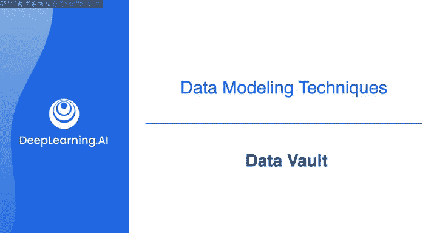
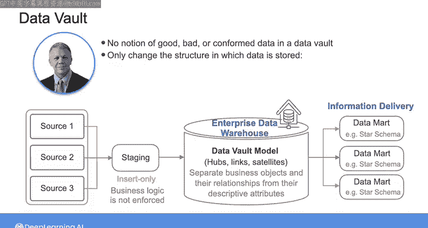
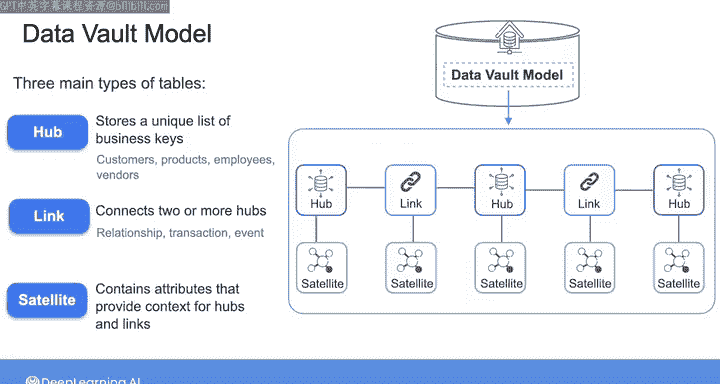
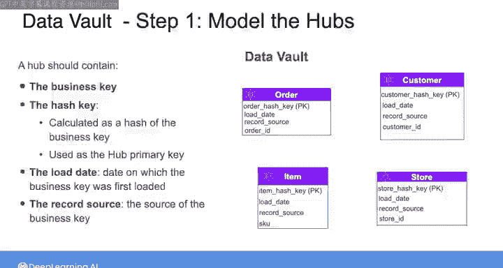
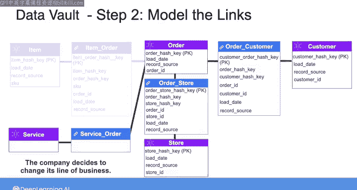

# 吴恩达《数据工程（数据建模、转换和服务）第4课，完结｜DeepLearning.AI Data Engineering》 - P9：8_数据仓库.zh_en - GPT中英字幕课程资源 - BV13mtpe7ESt

The Inmin and Kimball modeling approaches focus on the structure of business logic in the data warehouse。

 whereas another modeling approach called Datavolt focuses on separating the structural aspects of data。

 meaning the business entities and how they're related from the descriptive attributes of the data itself。

It uses separate tables to represent core business concepts。

 the relationships between those concepts， and the descriptive attributes about those business concepts。

You can follow a data vat model to allow for a more flexible。

 agile and scalable data warehouse structure by keeping the data as closely aligned to the business as possible。

 even while the business in its data are changing Dan L said introduce datavault in the 1990s as a different approach to modeling data in the data warehouse and this approach has evolved over time Nowadays the datavat architecture consists of three layers the staging area。

 the enterprise data warehouse layer and the information delivery layer。

 you can load raw data from source systems into the staging layer and insert only manner。

 meaning you don't alter the data or enforce business logic except to ensure that the expected data type is ingested Next you model the data in the enterprise data warehouse layer using hubs。

 links and satellites to separate business objects and the relationships from the descriptive attributes We'll dive into this layer in more detail later。

 then finally in the information delivery layer you load the data into downstream data mars that can be modeled as star schemas。

Other structures to support various business areas so operations like aggregation and grouping which modify the meaning of the data to meet user needs or apply it in the information delivery layer。

 unlike other data modeling approaches you've learned about so far there is no notion of good bad orcon data in a data vault。

 you only change a structure in which the data is stored this way you can easily trace the data in the data warehouse back to its source and you can avoid having to restructure the data in the warehouse in case business requirements change let's take a closer look at the model in the enterprise data warehouse layer the data vault model consists of three main types of tables as I mentioned before these are hubs。

 links and satellites In short， a hub stores a unique list of business keys to represent a core business concept such as customers。

 products， employees， vendors and others a link connects two or more hubs to represent the relationship transaction or event between two or more business concepts the links and hubs don't contain descriptive。

That's actually stored in the satellite tables。 a satellite contains the attributes that provide the descriptive context for the hubs or other links a user will query a hub which will link to a satellite table containing the query's relevant attributes Let's go back to our ecommerce-commerce example and model the data as a data fault model by following three key steps First you need to model the hubs which contain business keys to identify the business keys。

 you can ask yourself what is the identifiable business element How do users commonly look for data。

 A business key can be a column or a set of columns that the business uses to identify and locate the data and it must not be a key generated in or tied to a particular source system This way you can easily integrate these business elements from different source systems in our ecommerce-merce example the business concepts you can model as hubs or a customer order store and item The business keys are a customer I for the customer hub order ID for the order hub store ID for the store hub and skew。

Itemh these keys uniquely identify each business element and I assumed that the store ID customer ID and order ID are keys generated by the business rather than being tied to the source system In addition to the business keys a hub must also contain three additional standard fields the hash key which is a calculated column consisting of a hash of the business key column and use as a hub's primary key the load date which represents the date on which the business key in a given row was first loaded into the hub and the record source which represents a source from which the unique row is obtained。

 The next thing you need a model are the links you use a link table to connect two or more hubs to capture the relationships between the business keys of the hubs So let's say you want to model the event of a customer placing an order you can add a link table to connect the order hub to the customer hub to show which customer placed the order then you can add a link table to connect the item hub to the order hub to show which items were ordered and finally you can add a link。

To connect the order hub to the store hub to show which store the order was placed in。

 each table must contain the primary and business keys from its parent hubs。

 the low date of a row and the source for the record for each table。

 the primary key consists of a hash calculated based on the business keys of the parent hubs with link tables you can easily add new relationships or update a current relationship without having to reengineer the data vault。

 For example， let's say the company decided to completely change a sda business and instead of selling items these sites to sell services In this case。

 you can create a new service hub table and a new link that connects this service hub to the order hub and then stop using the old item hub and item order link。

 Moreover， the link tables can model a many to many relationship。

 So let's say the organization changes a rule and now allows more than one customer to contribute to the same order you can use a link table to model this many to many relationship between the customer hub and the order hub so you don't need to change anything in the design。

Now to give meaning and descriptive context to the hubs and links in the third step。

 you can create satellite tables in this example I created a satellite table for the customer hub and added some customer information such as customer name and customer zip code you can add satellites for the store order and item hubs as well I also created a satellite table for the item order link to add context to this relationship。

 namely the quantity of that item placed in the order Each satellite table must also contain the record source and for the primary key it should consist of a hash key of the parent hub and the load date So there you have an overview of the datavaultt model Datavault provides a flexible design that decouples the structure of your data from the source systems enabling you to easily adapt as a business evolves and with that we covered the basics of a three most popular data modeling approaches for data warehouses Inman Kimball and datavault however the coverage hardly does justice to their respective complexity and nuance and the resource section I have listed some books from the creator。

of each modeling approach that I highly recommend you read to further understand how and why data modeling essential to batch analytical data in recent years。

 an approach known as one big table has emerged to model data for analytical use cases。

 join the N video to explore one big table as the final data modeling approach we'll cover this week。

