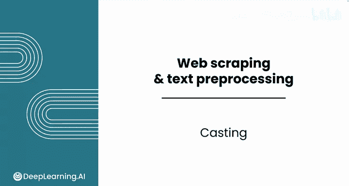
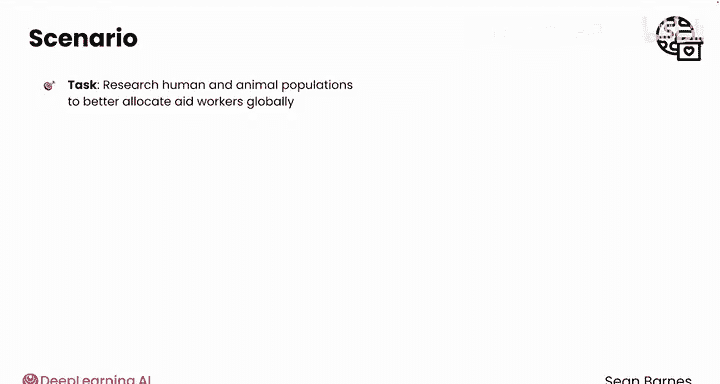
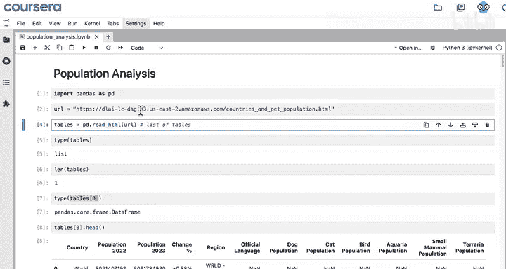
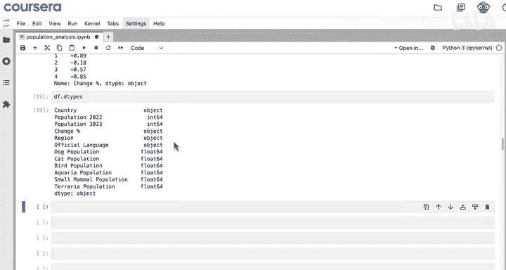
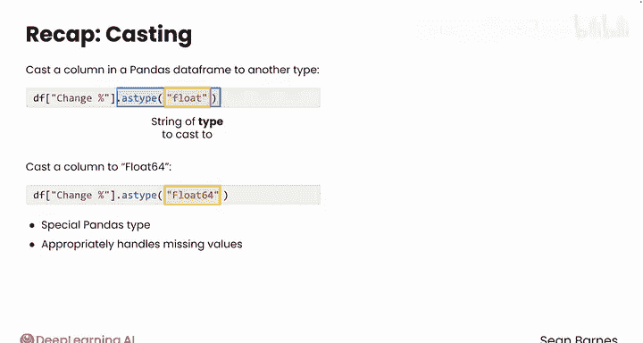

# 吴恩达《数据输入／输出与预处理（Python 和 SQL）Data I／O and Preprocessing with Python and SQL》中英字幕 - P10：9_类型转换.zh_en - GPT中英字幕课程资源 - BV1sZEzzQEkF

In the previous video， you saw your first text processing method for data cleaning replace。

 but you have a lot more tools available to you in this video。

 you'll learn how to convert data from one type to another in Python for data analytics。

 you learn that the type of a piece of information， dictates what operations can be performed on it。

 For example， the operation 400 divided by two works fine at ins。

 but results in an error with strings。 Sometimes data comes to you in one type。

 but you need to work with it in another。 you can change data types by casting。 It's a common task。

 especially when working with data from webs scraping or text heavyavy data sets。

 You've actually already encountered casting in Python the PD to datatime function。

 convert strings into day types。 Even though you didn't change the information at all， just its type。

 This function opened up new possibilities like being able to use the weekday method to find a date's weekday。

 Let's take a look at casting in action。😊。

Just to recap in your role as a data analyst at the International aid Or。

 your task is to research international human and animal populations to better allocate aid workers globally。

 You've scraped a useful data frame of all the countries in the world and their population sizes to perform your analysis。

 You've been working in this notebook where you've scraped a table of world populations save it in the variable Df。

 you also remove the percent sign from this change percent column so that it's ready for casting At this point。

 the data in this column is still an object Just text。

 trying to calculate the mean percent change will still generate an error。😊。

But you can cast this column using the ast method。As T takes one argument。

 a string representing the type you want to cast to what type is appropriate for percent change。

 the most appropriate type is floating point， which you can indicate with the string floatloat 64。

 Float 64 is a special pandas type for floating point numbers that also allows missing values It's super useful here because missing values or NNs are really common in scrap data and floatloat 64 will handle them 40。

Like many of the methods you've already seen， as type does not automatically change your original data frame。

 so make sure to save this column back into the original one。Cool。

 no errors run DfChas percentage dot head， and these values look nice and clean and the type is F 64。

 which is just a floating point number Finally you can calculate the average growth rate。

That would be right around 1% year over year， checking out the data types again。

 are there any other columns you could cast？For the most part， everything else looks good。

 The only option you might consider is casting these population columns to integers rather than fls。

You learn in this video that you can cast a column in a pan's data frame to another type using the as type method。

 which takes one argument， a string of the type you want to cast tube， you cast a column to float 64。

 a special panda's type that appropriately handles missing values。

 which you already identify in your initial examination of the data。

You saw in this video that planning for missing values is crucial during data preprocessing data from the web often has a lot of them in the next video you'll see common techniques for dealing with missing data。

