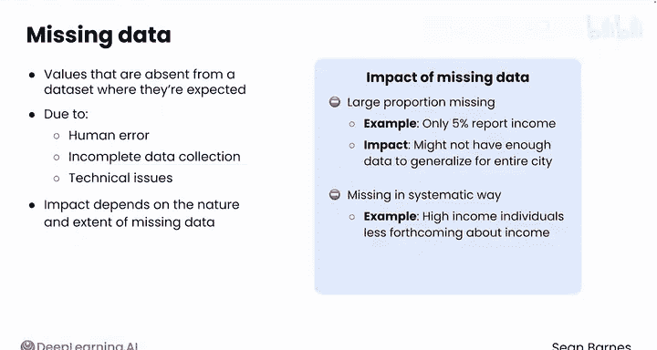
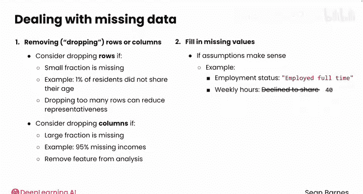
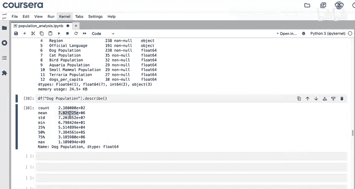
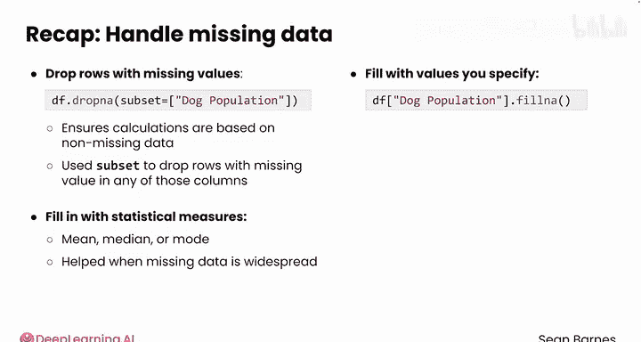

# 吴恩达《数据输入／输出与预处理（Python 和 SQL）Data I／O and Preprocessing with Python and SQL》中英字幕 - P11：10_缺失值处理.zh_en - GPT中英字幕课程资源 - BV1sZEzzQEkF

In the last few videos， you learn how to extract information from tables scraped from the web。

 Often the data you extract is incomplete。 In fact。

 missing values are a common issue when working with real-worl data sets and they can impact the accuracy of your analysis。

 missing data refers to values that are absent from a data where they're expected data could be missing due to human error。

 incomplete data collection or even technical issues。

 the impact of missing data on your analysis depends on the nature and extent of the missing data。

 if a large proportion of your observations is missing。 your analysis may not be generalizable。

 say you're collecting demographic data about residents of the city but only 5% of all respondents reported their income。

 you simply might not have enough data to generalize the results to the entire city even with inferential statistics。

 Secondly， data is often missing and a systematic rather than random way In the case of demographic data。

 high incomecome individuals tend to be less forthcoming about their income So your data is more likely to be missing incomes in the higher range that could bias your analysis to conclude that average income in the city is lower than it truly is。

To handle missing data， you have a few options。 One option is to remove rows or columns with missing values。

 This process is often called dropping rows or columns。

 consider dropping rows if only a small fraction of your data is missing。 for example。

 if your analyzing demographics and only 1% of residents did not share their age you could consider simply removing those residents from your analysis of age。

 however， dropping too many rows can reduce the representativeness of your data consider dropping columns when a large fraction of your data is missing in the case of 95% missing incomes。

 you may choose to remove that feature from your analysis。

 Another option is to fill in missing values， you should fill in values cautiously and only if your assumptions make sense。

 For example， in your demographic data say you ask for employment status and weekly hours worked。

 If a person answered employed full time but decline to share their weekly hours you could consider filling in missing values with 40 an invalid approach would be to fill these missing values with zero which doesn't logically follow from assumptions about the data So more sophisticated approaches fill missing values with descriptive statistics。

The mean or mode or even use regression on machine learning to fill in the best values Let's take a look at handling missing values in a notebook。

 recall that up to this point you've scraped this table of population data from the web and cast the values to floats where appropriate don't forget that you can use the practice lab item to follow along with the demos say you've been asked to estimate how many volunteers are needed to handle the dog population for each county using Df info you already notice that there are 200 missing values for this column if you want to just analyze the hard data you have you can use the drop in any method to drop only rows that are missing the dog population you can use the subset named argument which should be a list of columns so subset equals a list with one item dog population save that into the variable Df with dogs Now check out info。

You only have 38 total countries and no missing values for dog population。

 though you still have some for the population of other animals。

 so you could continue your analysis from here to estimate the aid workers needed in these countries。

 That's one approach。 but what would be a more sophisticated option that allows you to create estimates for all countries。

 Well， one idea would be to fill in these missing values in the original data set with the reasonable guess。

 For example， you could calculate the mean dogs per capita for each country。

 then fill in the mean per capita rate times the population of each country。 Let's give it a try。

First， create a new column in the original data frame dos per capita。

 that's just the dog population divided by the 2023 population。

Use dot De to get some basic stats about this column and you'll see that the mean value for dogs per capita is 0。

137， so let's take that proportion to fill their missing values So DF dog population do fill in a。

 you want to fill those missing values not drop them and what should you fill them with the population 2023 times the mean value 0。

137。Fil and A is useful here because it will preserve any existing values and only fill missing ones Great。

 take a look at DF infofo again and there are now 238 non null values and with DFdogpopulation described。

 you can see the mean and standard deviation， which might help you estimate the number of aid workers needed。

In this video you learn that to handle missing data you can drop rows of missing values using the D NA method。

 which ensures that calculations are based on non-missing data you use the named argument subset with the list of column names to drop any rows with the missing value in any of those columns you can also fill in missing values with statistical measures like the mean。

 median or mode， which is helpful when missing data is more widespread you saw that fill and A will fill only missing values with the value you specify。

Even though missing values can complicate your analysis。

 you now have several good options for dealing with them in the next video you'll learn a new text processing method contains。

