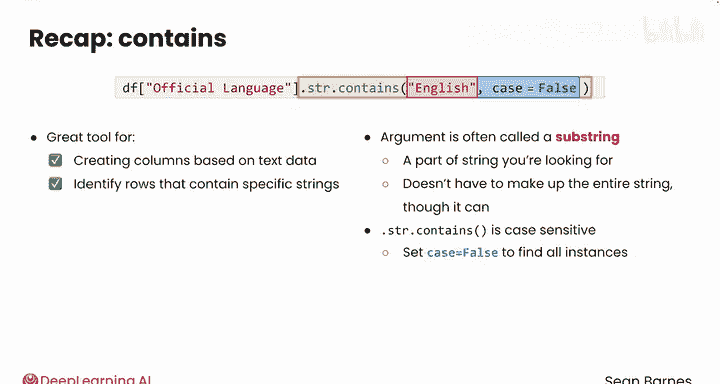

# 吴恩达《数据输入／输出与预处理（Python 和 SQL）Data I／O and Preprocessing with Python and SQL》中英字幕 - P12：11_字符串处理：包含检测.zh_en - GPT中英字幕课程资源 - BV1sZEzzQEkF

One common data cleaning approach is to identify patterns within your data。

 like searching for specific words or phrases in a text feature。

 Let's say you're working with the International aid organization to identify countries where you can most easily deploy aid workers。

 your largest pools of aid workers speak English or German。

 So you'd like to filter your analysis to those countries first。

 That is countries where English or German is mentioned in the official language column。

 Let's go over to the notebook to see how Just to recap on the great work you've done so far。

 You've read in a table of population data into the variable Df cast the types appropriately and fill missing values in the dog population column。

 Let's first create a new column English。 This column should contain true if English is one of the official languages。

 One approach is to check whether the official language is English using just to check for equality。

 Let's try that。😊。

Okay， no errors at least。 however， let's do a manual check to validate the data。

 If you look at dfeng do head。 you'll notice that the row at index1 is false， but that's not right。

 is it checking out the data that's India， which has both Hindi and English as official languages So you'll need to use a strategy that checks whether English is somewhere in this string not just if this string equals English。

 you can use the pans Sr do contains methods。 That looks like Df English you can just overwrite the initial values。

 do Sr do contains。 you need the dor accessor just like you use for dot replace。

 and then the text you're looking for is English。 Great。

 Now check out that column and you can see that the value for row 1 is true。

 which matches your expectation since one of the official languages of India is English。

 Now you can filter this data frame for only columns were English equals true。 Sa that in English Df。

The link of this data frame is 56， so there are 56 countries where English is an official language and you can do other useful operations like summing the population of all these countries。

 over 3 billion people live in Englishlishspeak countries， a quick note that dostrr。

 contains is case sensitive as a quick demonstration you can check the number of countries with an official language that contains capital E English by summing the result of this call that's 56 same as before then the number of countries that contain lowercase E English。

Zero and all caps English。Also zero， so this data is relatively clean when it comes to case。

 but if you want to be extra sure， you can add one other argument， case equals false。

By setting case equals false， you ensure you are capturing all instances of English。

 regardless of the way it's formatted， you can double check your results by summing the English column。

 and it will show that there are still 56 countries that have English as an official language。 Now。

 you can create an additional column in the same manner for German。

 There are six countries with an official language of German。

In this video you've learned that the dot STR do contains method in pandas is a great tool for creating columns based on text data。

 it allows you to identify rows that contain specific strings。

 The argument it takes is often called a substr a part of a string you're looking for It doesn't have to make up the entire string though it can't you also learn that dot STR dot contains is case sensitive you can set an additional named argument case equals false to guarantee that you find all instances of a substr。

 even if it's in a different case。

Great work in this video you've added a powerful tool to your data cleaning toolkit by learning how to filter tax data effectively Next we'll take it a step further by exploring techniques to clean。

 transform and extract insights from text based data。

