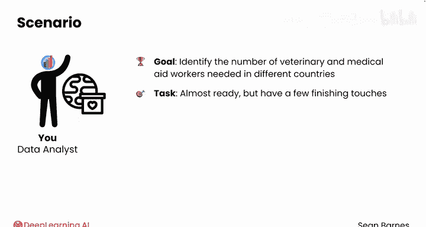
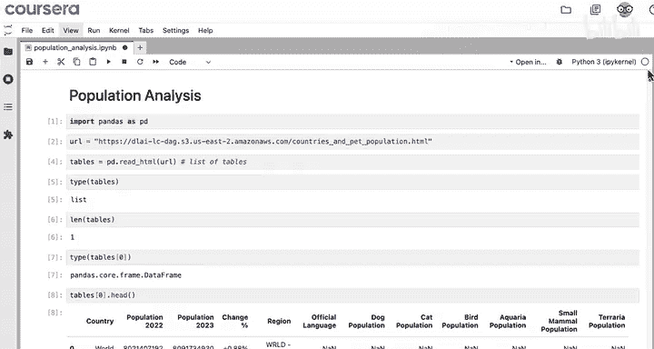
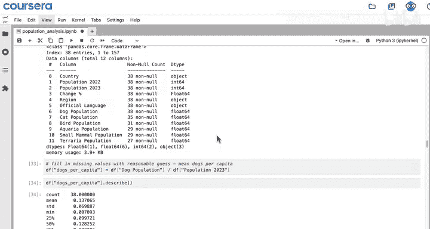
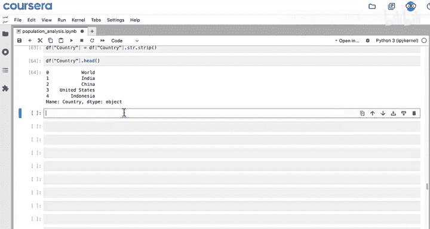
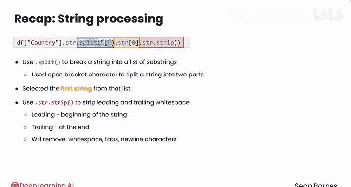

# 吴恩达《数据输入／输出与预处理（Python 和 SQL）Data I／O and Preprocessing with Python and SQL》中英字幕 - P13：12_字符串处理：分割与修剪.zh_en - GPT中英字幕课程资源 - BV1sZEzzQEkF

In the last video you learned about the pandas contains a method and its applications in data cleaning。

 you'll often find yourself needing to both split strings and remove white space。

 Let's see how just to recap， you've been working with an international aid organization to identify the number of veterinary and medical aid workers needed in different countries。

 You're almost ready to create your final report that you have a few finishing cutes first。

 just to recap on the great work you've done so far。

 you've read in a table of population data into the variable Df cast the types appropriately and filled missing values in the Do population column you also created columns for countries with English and German as official languages。

 Take a look at the head of this data。 What do you notice about the country in the Ro index2。😊。

It has some extra text， doesn't it， The original website had some footnotes that explain particulars about certain countries like whether the listing contain certain territories。

 These footnote references aren't needed for your analysis and clutter up the data。

 You'll want to clean that。 your instinct might be to try to remove them using SR replace。

 Like you did in an earlier video。 That's a great instinct but your problem is a bit more complex because each footnote reference is a different letter to get rid of these footnotes。

 you can use the split method， which devise a string into parts at a specified character。

 For example， let's say you have the string。 China with a and brackets in the variable text。

 You can use the command text dot split and add your parentheses。

 You want to split on the open bracket character。 Sa this in a variable substrs。

 You'll see why in a moment。 If you check out substrings。

 It's actually a list of link too you've split the string and now you've gotten back the two hs。

 notice that the character you split by the open bracket has been removed。

 So what command could you use to access just the first half China。 you could use substrs 0。😊，Now。

 let's apply this to the entire column。 As with the other string methods you learn so far。

 like replace and contains， you'll need to use the dot STR accessor。

 You should see what it looks like before saving it back into the column Start with Df country dot StR do split with the open bracket and quotes that gives you a list for each row in the data。

 Not the brackets。 That's not what you want And accessing the item at index0。

 just gives you the first value in this column， which is still a list。 Let's ask the LLM。

 I'm trying to remove footnote references by splitting strings like China with A and brackets at the open bracket。

 Here is my code。 How can I access the first value of each list and save it back into the country column。

 So the LLM says you need to use the dot StR accessor again， and it writes a code snippet。

 Give it a try。😊，Cool， let's first use dot SR dot containss to check for any brackets。

 Let's try the closed bracket。 There are zero of them in this column awesome。

 one final housekeeping note。 Check out the country column。 What do you notice about China。

It's got some extra white space， which was left over from the way you split the string to clean up this white space。

 you can usesr。 stripip， which removes leading and trailing whitespace Make sure to assign your results back into the country column。

hThat's so much better。 Now you've removed all the reference notes from the country column。

To recap， you learn how to use the split method to break a string into a list of substrs。

 you use the open bracket character to split a string into two parts。

 then selected the first string from that list using Inex 0。

 This method enabled you to remove footnotes from the country column。 Finally。

 you use the STr dot strip method to strip leading and trailing whitespace from strings。

 which is a common text processing step leadingad means at the beginning of the string Trailing means at the end dot stripip will remove whitespace tabs and new line characters Great work with text processing。

 you've seen many of the core methods for dealing with text data in Python All in the context of webs scrap it and the next module。

 you'll start working with more complex data scraped from the web。

 Once you completed the practice assessment and practice lab for this lesson。

 I hope you'll join me there。😊。

