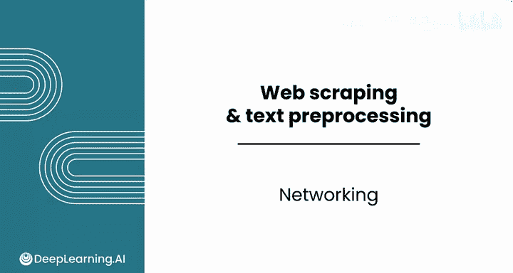
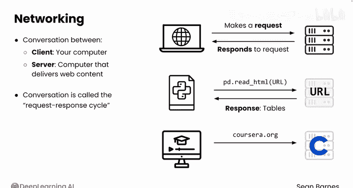
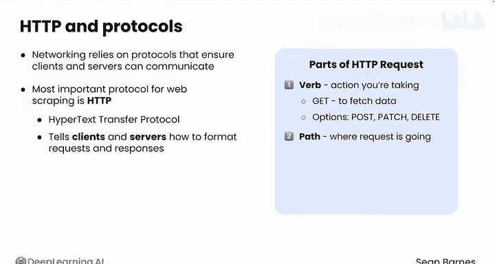
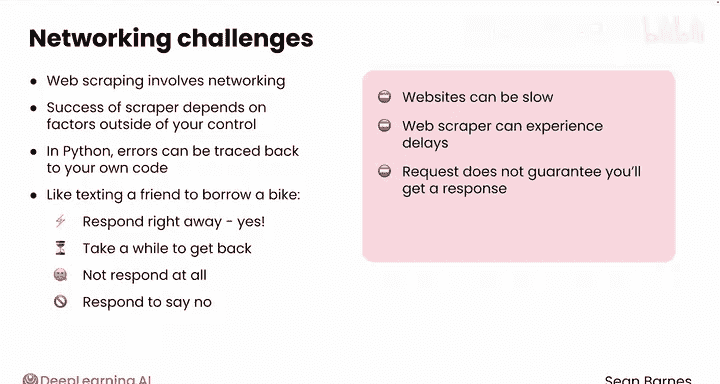
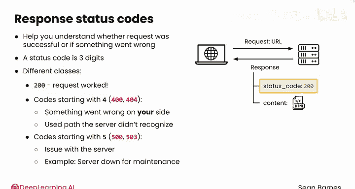

# 吴恩达《数据输入／输出与预处理（Python 和 SQL）Data I／O and Preprocessing with Python and SQL》中英字幕 - P14：13_网络请求.zh_en - GPT中英字幕课程资源 - BV1sZEzzQEkF

Now that you've scraped data from a web page and preprocessed it for analysis。

 let's take a step back to look at this new paradigm of coding networking Networking is kind of like a conversation between your computer also known as the client and a server which is a computer that delivers website content The client makes a request to the server then the server responds to that request this conversation is called the request response cycle for example。

 when you use the function p。readhm to scrape a webage your computer the client send a request to the URL you specify the server responded by sending back the tables you ask for networking happens in your browser as well not just in a Python notebook when you go to Cosera。

quirk you're sending a request to Cora's server which responds with the content of their homepage networking relies on protocols or standardized rules that ensure clients and servers can communicate the most important one for web scraping is called HttP which stands for hypertext transfer protocol This protocol tells clients and servers how to format requests and responses an HtTP request typically has two parts。

First part is the verb， which defines the action you're taking for web scraping。

 you're usually using git to fetch data， but there are other options you may use situationally too like post。

 patch and delete the second part of the request is called the path which is where the request is going For example the URL you use as an argument to the PD read hm function served as the path to the data you want it and the programming you've done so far。

 every variable and function has been within your control。 However。

 web scraping involvess networking interacting with the internet this process introduces new challenges because the success of your scraper depends on factors outside your direct control Unlike when you're working in Python and you can be pretty sure that any errors in your program can be traced back to your own networking introduces several challenges and program you can think of it like texting a friend asking to borrow their bike they might respond right away with an enthusiastic yes or they might take a while to get back to you they might not respond at all or they might respond to say no sorry my bike is being repaired right now you'll encounter the same types of hangups with websites。

Websites can be slow asideside from perhaps creating very large visualizations。

 your python code to this point has likely run virtually instantly。

 but I'm sure you've had the experience of visiting a website that takes forever to load a web scraper can experience the same delays more than that just because you make a request doesn't guarantee you'll get a response In fact。

 websites often implement different measures to protect themselves from unwanted scrap even if you get a response it might be just to let you know that the page you asked for doesn't exist when a server processes your request。

 it sends back a response including a status code these codes help you understand whether your request was successful or if something went wrong。

 a status code is three digits and there are a few different classes of codes code 200 means your request worked and you got what you needed code starting with a like 400 or 404 means something went wrong on your side often that you use the path the server didn't recognize code starting with5 like 500 or 503 mean there is an issue with the server It's not you example it's possible。

Server was down for maintenance at the time you sent the request。

 although you won't usually code every detail of the request response cycle。

 you should understand how it works when scraping the web。

 follow me to the next video to begin a new task with more complex web scraping。

