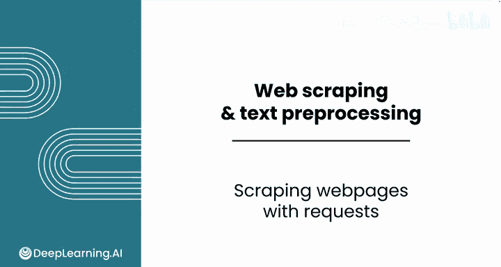
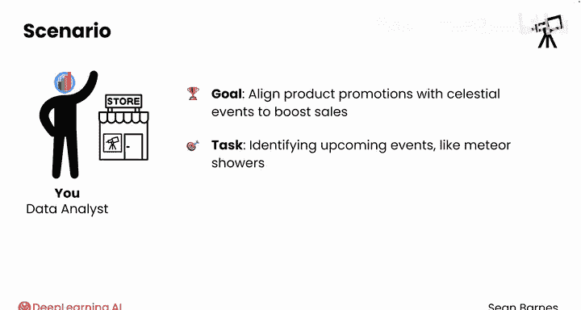
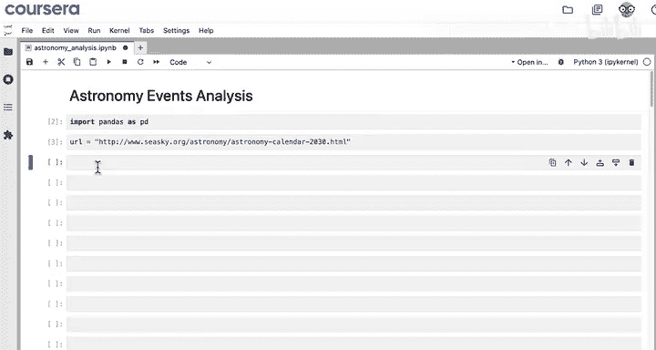
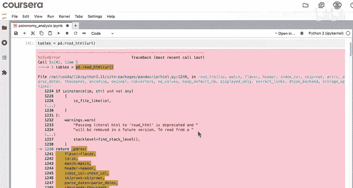
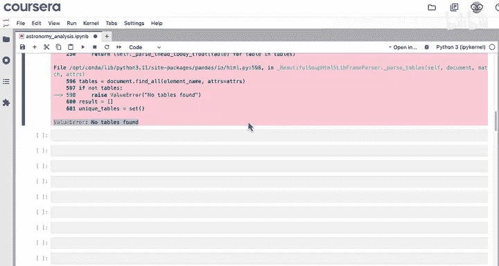
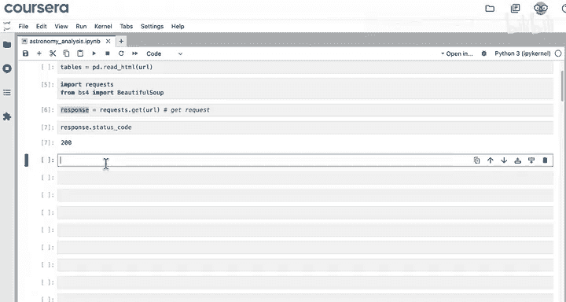
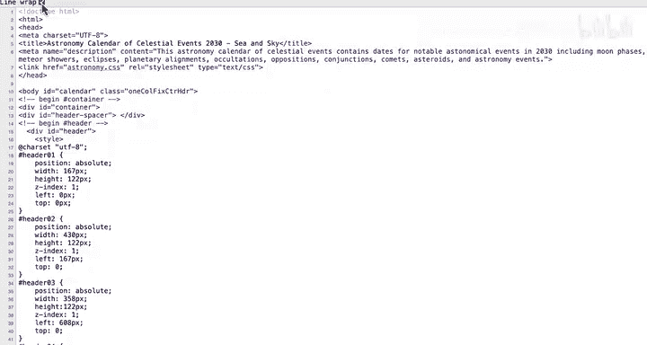
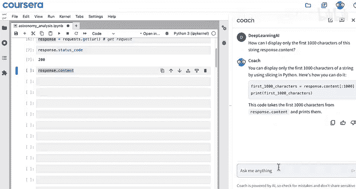
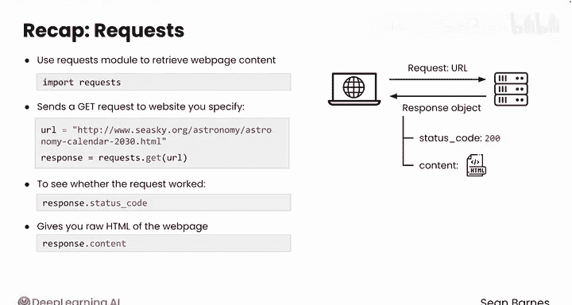

# 吴恩达《数据输入／输出与预处理（Python 和 SQL）Data I／O and Preprocessing with Python and SQL》中英字幕 - P15：14_使用requests库抓取网页.zh_en - GPT中英字幕课程资源 - BV1sZEzzQEkF

In the previous lesson， you took potentially your first steps into preprocessing data scrape from the web。

 but the data you want won't often come in neat tables like you saw。 Instead。

 you'll need to get creative to extract the info you need from complex formats。 In this lesson。

 you'll act as a data analyst at a retailer specializing in astronomy equipment such as telescopes。

 Your company aim to align product promotions with celestial events to boost sales to plan for 2030。

 your manager has tasked you with identifying upcoming events like meteor showers。

 Custom can then be given coupon codes that are themed based on each event。 In your search。

 you discover this site。 The astronomy calendar of celestial events with an extensive list for 2030。

 Great。😊。

Events like the Meteor Show in January would work great for your marketing promotions。

 You'd like to extract the date， the event and the description from this site。

 taking it over to a Python notebook。 first import pans。 By the way。

 remember that you can use the practice lab item to follow along with the demos。

 save the URL for the Sea Sky website。 Now， you might think to try P Dt read HTML first。

 try saving the result as tables。 But you get an error。😊。

Remember to scroll all the way to the bottom of the air。

 The bottom of the air is the most recent problem， and you get value error。 no tables found。

 That's expected since upon examining the website， you didn't see any tables。 So PD。

 read HTMLl is great when you've got tables， but pretty much useless without you'll need to do some proper web scraping for this website。

To scrape the data you need， you'll need two new modules requests to get the web page and beautiful soup to parse it parse just means finding and formatting the right information previouslyly Padas was doing both of these steps for you。

 requesting the page and parsing it Now you'll need to do these steps separately yourself importport these modules Now you can use the request module to send a get request to this URL remember a get request means you're asking for some information back saveve the response in a variable like response。

Remember， you can name this variable Anything that makes sense to you running the cell didn't produce any errors。

 But remember that networking requests can fail in different ways。

 Use response do status code to check the status code directly。

 Notice that the status code is an attribute， not a method。

 It's a quick question about this response。 The result is status code 200。

 which you saw earlier means you got a response back without any error。

 Now you can print out response do content to see what information the website sent back。 Wow。

 that's a lot of text。 It's essentially the same website code you would see if you went back to the original page and clicked view source。

Burried in this text is all the data you need notice that this response content starts with this text and angle brackets that says dot type HTMLml This response is an HTML document In other words。

 it's the contents of a dot HTML alpha a quick note if you're bothered by all this text in your notebook you can always ask the LLM for ideas for how to shorten it。

 how can I display only the first thousand characters of this string response dot content。

Just to recap， you've seen how to use the request module to retrieve webp page content。

 The key function here is request do git， which sends a git request to the website URL you specify。

 you input the website's URL as a string and it returns a response。

 You use the dot status code attribute on the response to see whether the request works。 Finally。

 the dot content attribute gives you the raw HTMLm of the webp page。

 which is essentially the full website code。

Now that you've seen how you can get the content of a website using the request module。

 you'll need to better understand how this content is structured web scraping typically involves working with HTML files。

 follow me to the next video to learn how they work。

