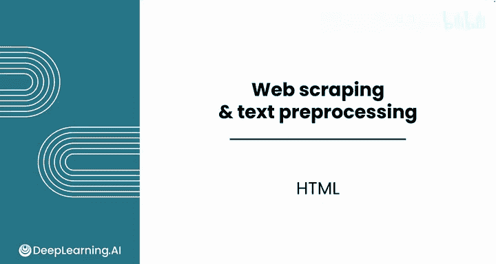
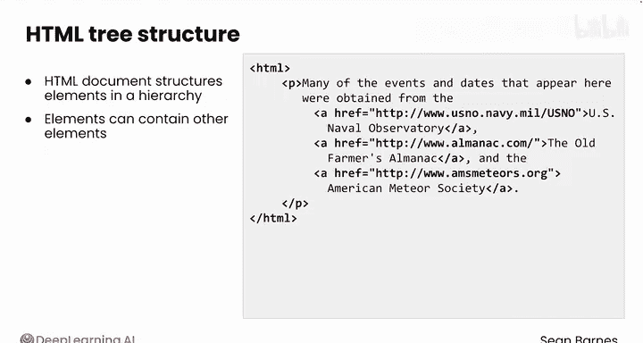
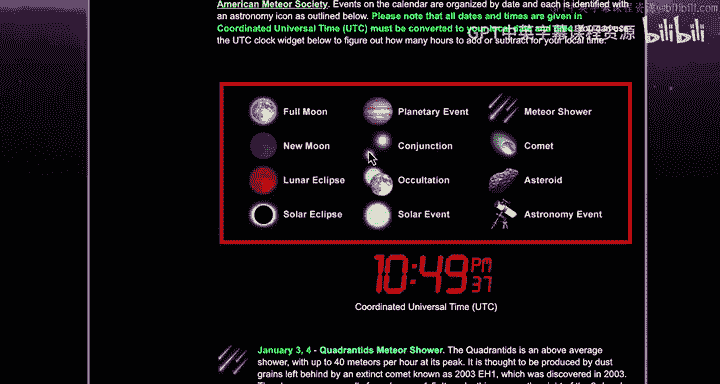
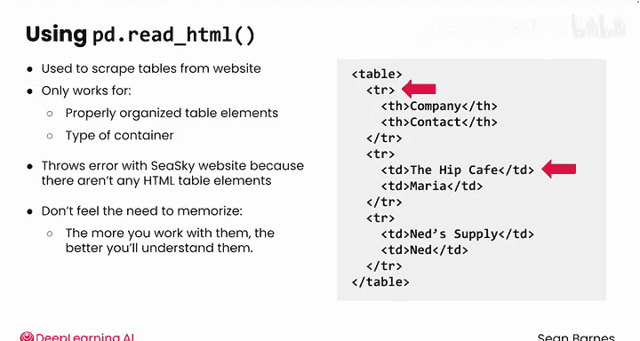

# 吴恩达《数据输入／输出与预处理（Python 和 SQL）Data I／O and Preprocessing with Python and SQL》中英字幕 - P16：15_HTML基础.zh_en - GPT中英字幕课程资源 - BV1sZEzzQEkF

Previously， you used the request module to get a web page and what you got back was an HTML document in this video。

 you'll explore how HTML is used to structure web pages and how that structure affects web scrapping。

 Nearly all web pages use H hypertext markup language you can think of HTML as text enhanced with tags that provide additional information tags typically open and close wrapping around some content For example。

 the C sky website you saw in the previous video included the page title astronomy calendar of celestial events for calendar year 2030 This text is wrapped in an H1 tag H1 means level1 heading the largest heading type so the browser displaying this web page knows to format it as a large heading notice that the closing tag includes a forward s This entire block including the tags and content is called an element So this title is an H1 element you'll commonly see elements like H1 H2 all the way to H6 for headings P for paragraph A which stands for anchor for links to other pages and so on。

😊。

Most elements have both opening and closing tags like this one HTML also includes a few self- closingsing tags that do not need a separate closing tag。

 The most common self closinging tag is IG for images。

 Hml tags can also have attributes additional information about an element like its size color position or content source These attributes go inside the angle brackets of the opening tag。

 One of the most common attributes is H reff and the a tag。

 which creates a URL link the H ref attribute which stands for hypertext reference specifies where the URL link should take you when the element is clicked。

 For example， this a tag from the C sky website contains the content USnaval observatory and links to their website at USn nam usN without the Hre attribute this a tag wooden link anywhere。

 Take a look at this image tag from the C sky website it contains four attributes SRC alt width and height SRC stands for source and specifies the URL or file path of the image to display。

This image is displaying the calendar legend。 jpeg image from the C sky website All stands for alternative text。

 What shows up if the image fails to load width and height tell the browser how large the displayed image should be each HTML element not just images takes up some space on the page defined by its height and width This element explicitly tells the browser how large the image should be HTML classes are a special type of attribute that allow you to group elements together and apply consistent styling or functionality to them a class is defined using the class attribute inside an HTML tag and is commonly assigned to multiple elements for example。

 notice that each date in the C sky website is formatted in bold and green rather than setting the color and style for each individual element the C sky website groups these elements in the same class D text using classes to group elements make some web scraping easier In this case you can use one class attribute date text to find every date in this website assuming it' properly formatted while HTML tags describe the purpose and appearance of。

Vi elements the HTML document as a whole structures individual visual elements in a hierarchy many elements can contain other elements For example。

 a paragraph element might include several anchor elements for links the structure of HTML is like a tree with elements organized inside other elements at the root of the tree you'll find the HTML tag which contains all the HTML content for a particular webpage This organization matters because if you're looking for a particular element like this paragraph containing a celestial event you'll need to know where it's located in the HTML tree。

Take a look at the organization of the Sea sky website。

 It's organized into a header at the top for navigation。

 a sidebar on the left with different astronomy pages and the main content on the right within this main content area。

 you have the title of the page links to different years and overall description and then a legend for the different types of events and then you get into the individual events themselves。

 HTML includes several container elements that are intended to help organize content logically by grouping other elements the most common container you'll see is div short for division。

 It's a flexible container that acts as an empty box for storing multiple elements。

 a division creates a block that starts on a new line and takes up the full available width on the page you'll also see unordered list elements essentially a bulleted list and ordered list elements a number list these each contain multiple list item elements。

 you'll also encounter spans which are often used to organize small pieces of text。

 they acts similarly to divisions like an empty box for stor multiple elements but they don't start on a new line or take。

The full available width in the previous lesson， you use PD dot read HTML to scrape tables from a website。

 This function only works for properly organized table elements， which are a type of container。

 Here's a snippet of what an HTML table with similar content might look like。

 Notice it quite complex with rows specified by TR and data specified by TD P D do read HTML throws an error with the C sky website because even though the information is well organized。

 there aren't any HTML table elements。 Don't feel the need to memorize each of the elements you saw in this video。

 The more you work with them， the better you'll understand them。

 You can always chat with your LLM to help you remember the details。😊。

In this video， you've seen how HTML forms the foundation of a web page。

 following mes in the next video to learn how to parse HTML with beautiful suit。

