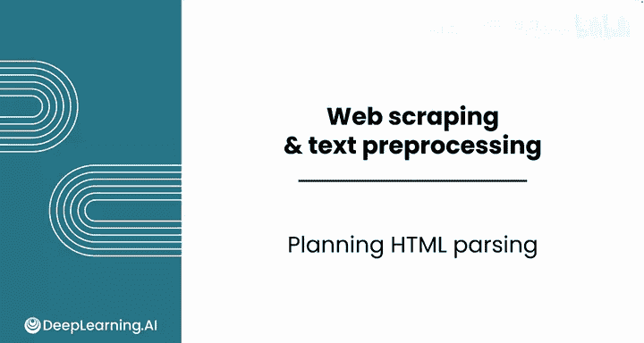
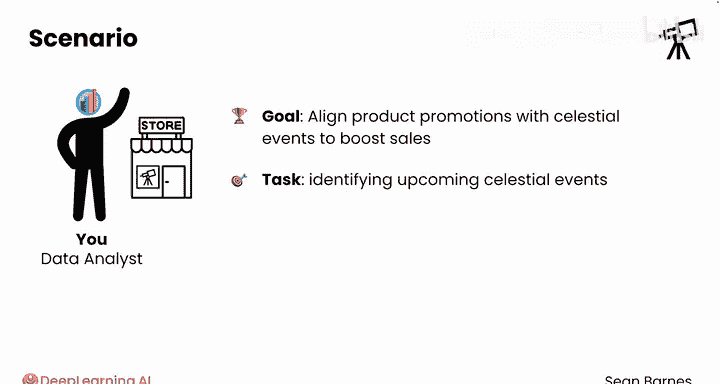
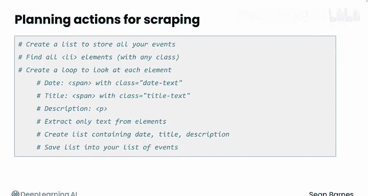

# 吴恩达《数据输入／输出与预处理（Python 和 SQL）Data I／O and Preprocessing with Python and SQL》中英字幕 - P17：16_HTML解析规划.zh_en - GPT中英字幕课程资源 - BV1sZEzzQEkF

In the last video， you learn how websites are structured using HTML。

 Now you have the tools you need to parse response content with the beautiful suit module。

 Just to recap， you are a data analyst at a retailer specializing in astronomy equipment。

 your company aims to align product promotions with celestial events to boost sales to plan for 2030。

 your manager has task you with identifying upcoming celestial events before you start parsing the web page。

 It's helpful to look at the structure of the HTML so that you can plan what you're about to do right click inspect and then navigate to the right column content element。

 You can see that as you mouse over each element， the corresponding element and the web page is also highlighted。

 This third div， a container element contains an unordered list of consistently formatted events。

 Each event is inside a paragraph tag inside a list item tag which contains several elements Right click view the page source and navigate to the right column content element you can also control F to search for where this is located in the page source First。

 a span tag with the class D tag。😊。

Wwhich contains the event date next， another span tag with the class title text with the event name。

 and finally the description of the event， which doesn't have its own container。

 This structure is important because it tells you exactly where to look for each piece of information Since every event follows the same pattern you can plan to loop through all the list item tags under the right column content element from there you'll extract the date the event title and the description by targeting their respective tags in classes knowing the structure ahead of time makes the process much more efficient and ensures you don't miss any details when parsing the data using the structure let's write out some code comments to plan the actions you'll need to take when scraping this website First create a list to store all your events in it will start out empty you'll need to find all the list items or li elements in the HTML and it will help to only look for the items that have any kind of class you saw that these list items have classes like B9 and so on create a loop to look at each of these items individually Next identify the span with the class date text and save it into a variable。

Then identify the span with the class title text， then identify the paragraph tag。

 finally extract only the text from each of these elements， discarding the HTML tags and attributes。

 create a list containing the date， title and description for that event and save it into your list of events Okay this process looks complex at first site。

 you'll get more comfortable with it as you work with HTML parsing more and more。

Planning our approach before starting to code is crucial for complex prepros tasks。

 follow me to the next video where you'll implement your plan using beautifulut suit。

