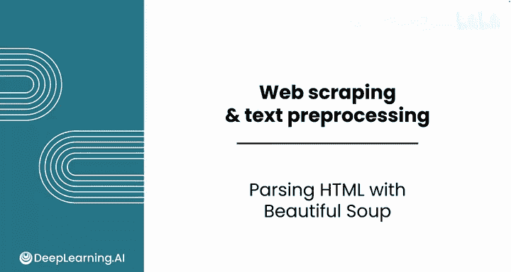
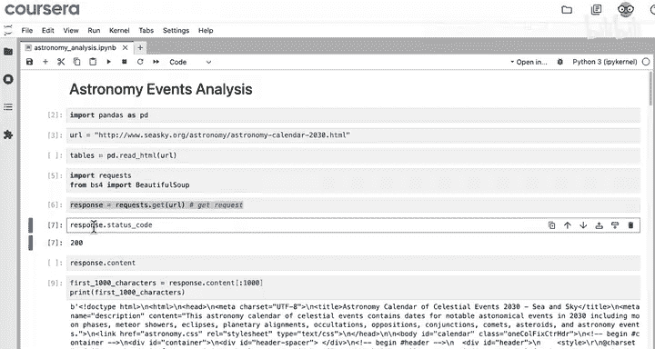
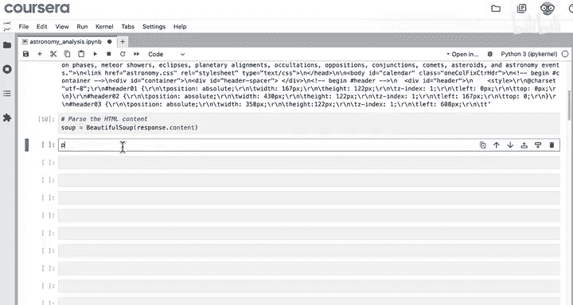
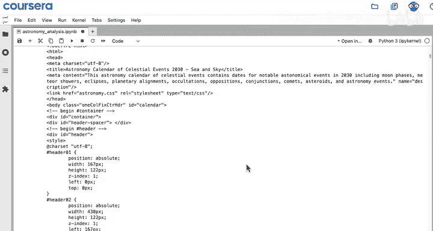
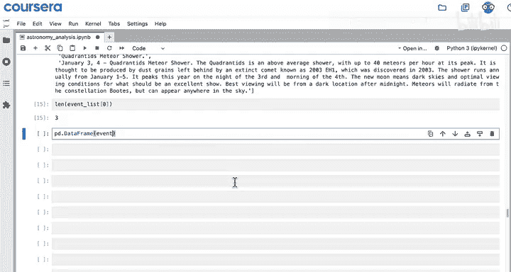
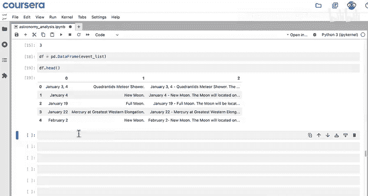
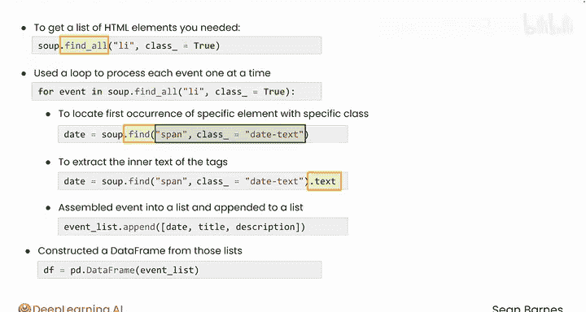

# 吴恩达《数据输入／输出与预处理（Python 和 SQL）Data I／O and Preprocessing with Python and SQL》中英字幕 - P18：17_使用Beautiful Soup解析HTML.zh_en - GPT中英字幕课程资源 - BV1sZEzzQEkF

Now that you've planned how to parse the HTML based on the structure of the website you're working with you'll want to implement income returning to your notebook。

 let's get right into it to implement your HTML parsing plan。 So far。

 you've used the request module to get the C sky website and it save in this variable response。

 The next step is to parse the HTML。 recall that parse means finding and formatting the right information。

 First， call beautifulut soup and pass in Repon content as the argument。

Store the parse content in a variable like soup。 If you print soup。

 you'll see the HTML written in a much more organized way。 usinging this soup。

 let's implement the plan from the previous video。 Here are the code comments you can use to structure your code。

First， create an enth list to store your events。 It can be called event list。

 Then use beautiful soup to find all list item elements within a class。

 Matt code is soup do find all L class equals truth。

 Note that class needs to have an underscore after it because it's a reserve word in Python that has a different meaning。

 Now create a loop over these elements。 So for event and this find all command。 inside your loop。

 you're now dealing with each individual event。 So if you run this loop and just print each event。

 you get each event with the date， title and description。 Next， remove this print statement。

 You can reference the structure of the HTMLml here while you're writing。

 create a new variable date to save the date。 and within this list item。

 you'll use event dot find span class equals date text。 So you're finding the span for the date。

 Then for the title now you have event dot find span。 But this time the class is title text。😊。

Finally， for the description， you have no better method than just to grab this whole paragraph which doesn't have a class。

 so you can sayeven do find P Before you extract the text。

 let's see what happens if you just add these directly to your list。So create a new list。

 call it event row since it corresponds to one row in your data frame。

 create a new list containing date， title and description that represents your event。

 finally a penless list to your list of events which represents your entire data frame。

 run this code and take a look at your first event。Notice that you have three elements。

 the date text， the title text and the description。

 you don't want this extra HTML in your data frame though。

 rather than directly adding the tag to your data frame。

 you can use dot text on each of these calls to find to just get the text Allright。

 run that loop Now take a look at the first element。Marvelous。

 you have only the inner text from each component of the page as a final step。

 you can convert these lists into a data frame just by using PD data frame and saving the result of the variable Df。

That's a nicely formatted data frame。 Of course， there's still a lot more preprocessing to do。

 but you've scraped im pared the core information that you need。 One final note。

 you've seen a lot of beautiful suit code in this video。 You don't need to memorize all these steps。

 You actually did most of the work in the previous video where you plan your approach。

 Don't believe me here， I'll show you。 pull up your LLM chat bot and use the following prompt。

 write code that follows these comments for the soup variable。

 The goal is to create a data frame from this scraped data。😊。

Then paste in your comments。Copy the code and give it a try。

You can remove these import statements since you've already imported these modules。Hey。

 that worked nice， So the point is you don't need to memorize all these commands。

 because LLMs can help you write the specifics， but you should understand how to plan your approach and how to interpret this code Let's quickly recap first you use So do find all to get a list of HTML elements that you needed The first argument is the HTMLl tag you're looking for In this case L then you used the class underscore named argument set to true to only find elements that had a class attribute。

 you used the loop to process each event one at a time。 within that loop。

 you use the event dot find method to locate the first occurrence of a specific element with the specified class do find has the same arguments as dot find all。

 For example， you used it to find the first span tag with a specific class like gate text。

 Then you used the dot text attribute to extract the inner text of the tags you found Finally you assembledem each event into a list appended the item to a list of events and constructed a data frame from those lists。

 you also saw how to use an LLM to generate code from comments planning。

Your scraping approach is crucial and once you have your plan in place。

 you can pair code with an LLM to get the result you're looking for amazing。

In this video， you've seen that parsing HTML is all about taking content made for human browsing and reshaping it into something you can analyze。

 follow me in the next video where you'll use your text processing skills to clean up the data frame it just created。

