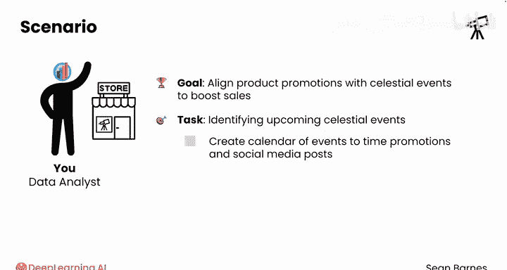
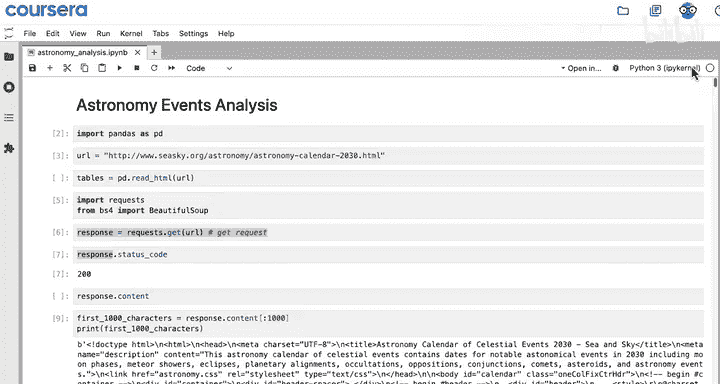
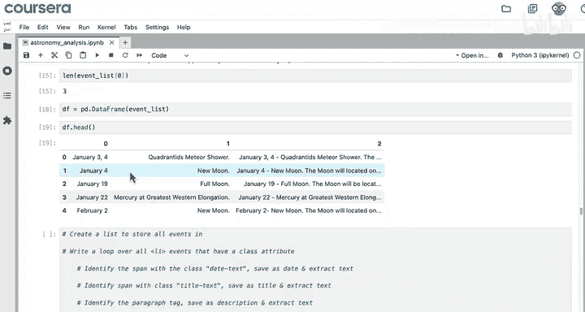
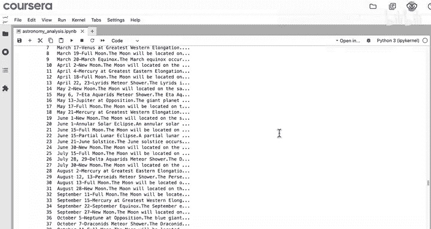
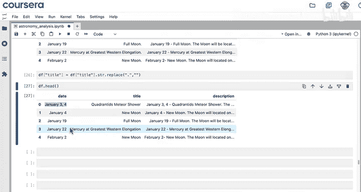
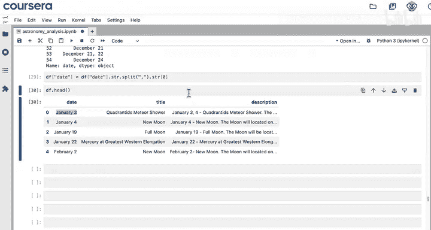
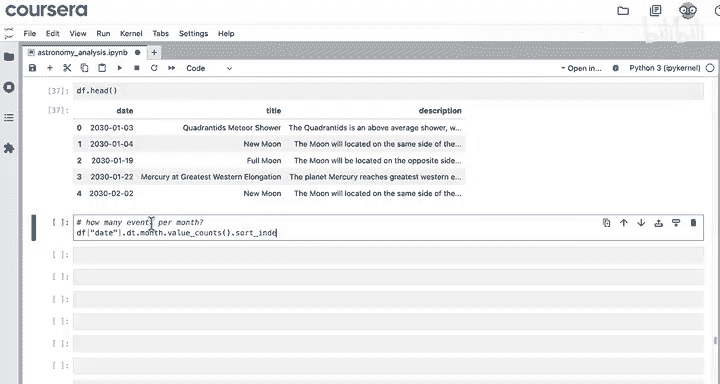
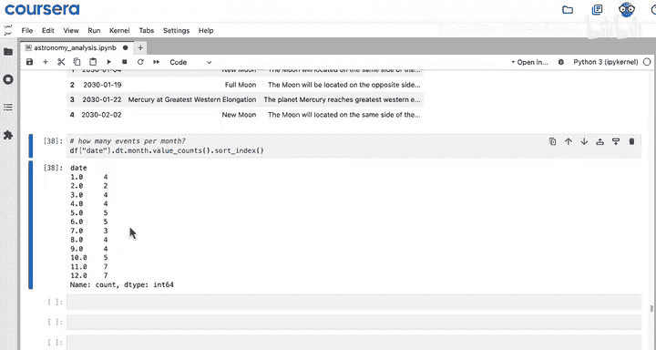
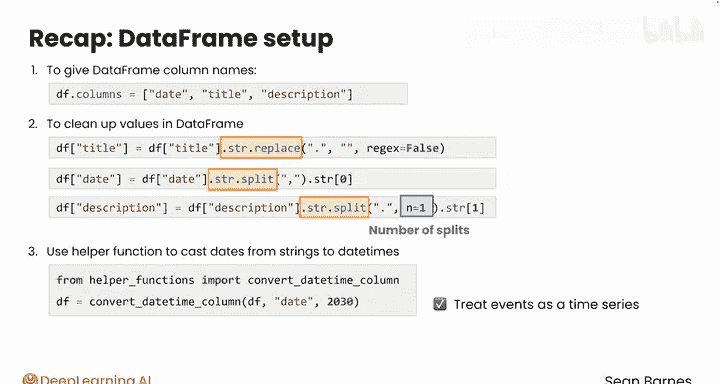

# 吴恩达《数据输入／输出与预处理（Python 和 SQL）Data I／O and Preprocessing with Python and SQL》中英字幕 - P19：18_数据框设置.zh_en - GPT中英字幕课程资源 - BV1sZEzzQEkF

In last video， you parched a web page using beautiful soup。

 It took a lot of steps just to get that messy data into a data frame。

 even so the process didn't fully clean up the results the way you want it。

 let's see some of the key preprocessing steps you can use for this kind of scrape data。

 Just to recap you are a data analyst at a retailer specializing an astronomy equipment。

 your company aims to align product promotions with celestial events to boost sales to plan for 2030 your manager has task you with identifying upcoming celestial events。

 Your goal is to eventually create a calendar of events so that your marketing team can time promotions and social media posts to quickly recap what you've done in the notebook you use the request module to get this C sky website Then you use beautiful soup to transform the raw HTML into this data frame Df with three columns date title and description and one row for each event。

 First up， let's give these columns names rather than numbers。

You can do that by setting the Df。 columns attribute to the list date。

 title description check out Df。thead。All right， that's settled， as you can see。

 the titles include a period that isn't necessary， you can use。sR。replace to remove it。

Nice Now notice that some of the dates include date ranges， like January 3 CO before。

 you could clean this up to only include the start date using dotstrR。

sp that way we could treat this column as a date。

So use dotstrr。 split with a comma as the argument， which will split and remove the comma。

 then don't forget to use dot STR0 to pick only the first element in the resulting list。

Now check out the description column， just take a look at the first value for a moment。

Notice that the description you actually want is everything after this period。

 which is the first period， but there are multiple periods in the description because there are multiple sentences you can use STr do split to accomplish this splitting。

 The idea is to split a maximum of one time at the first period。

 you'll do that with a new argument to do STR。 split。You can borrow the same code as before。

 split on a period rather than a comma， then add a new argument and equals1。

 That's the number of splits。 So you only want to break each string at one point to create two parts。

 Now， which part do you want， The one at index 0 or the one at index 1。You want to wna index1。

 the second part。 Stepping back this line of code， split the description into two parts at this period。

 then grab only the second part and save it back into the description column。

 Run that code and check out Df dot head。 Co， the date and title were removed。 One final step。

 remember， when you first scrap this data， Python treats dates as plain text。

 which you can see by looking at Df do D types。 This format makes it difficult to perform any analysis or sorting based on the dates。

 This step can be a bit complex。 So we've created a helper function called convert daytime column to use it。

 import it from helper functions。 Then you'll use it like this。

 convert daytime column with three arguments。 The data frame。

 the name of the column to convert in the year。 in this case 2030。

 Then save it back in the variable Df。 If you're curious。

 you can always inspect this file helper functions Py yourself or ask the LLM to step you through the code。

 So check out Df do head。😊，AndCo， you've got daytimes now since the goal of this analysis is to figure out how best to market your astronomy equipment。

 it would be helpful to know when the most astronomical events occur。

 This information can help you time your marketing campaigns effectively to align with peaks and astronomical activity First。

 you'll want to analyze how many events are listed for each month to do that。

 you'll extract the month numbers from the date column using dot dt month then you can use the dot value counts method to count how many events are associated with each month。

 And hey， why not throw want to sort index as well to make sure the months are in order Once you've calculated this you can display it so it seems that the most events are in December and November。

 these will be ideal times to promote your astronomy gear。 to visualize these results。

 you can also add dot plot kind equals bar。😊。

To recap in this video you saw a few new techniques for organizing your scrappe data in a data frame First you set df。

 columnns to a list of strings to give your data frame column names， then you use dostrr。

replace and dosr。 splitlit to clean up the values in your data frame you saw the named argument N for the split method which specifies the number of splits you want to make Finally you use the helper function to cast dates from strings to date times allowing you to treat these events as a time series。

Great work。 As you've seen， Bea soup is a powerful tool for turning messy web data into a clean format ready for analysis。

 Next up， you'll discover how to search for flexible powers and text to extract exactly what you need。

 I hope you'll join me there。😊。