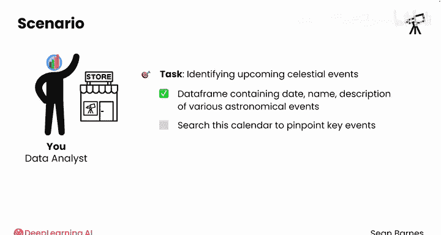
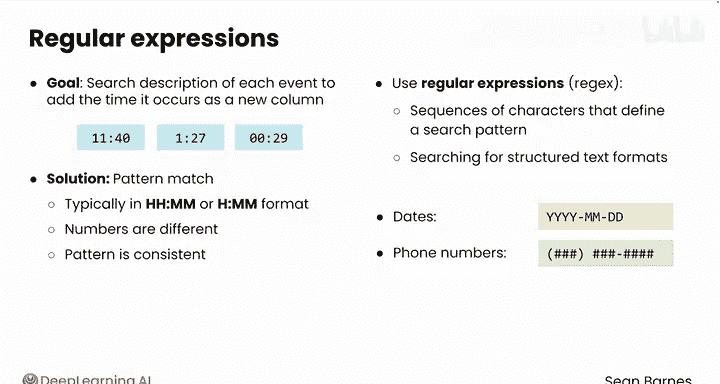
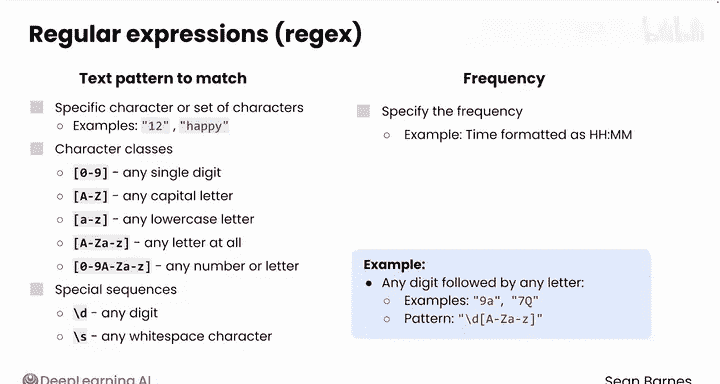
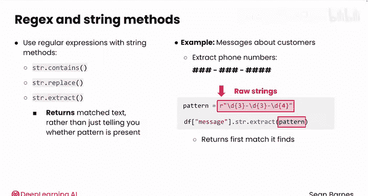

# 吴恩达《数据输入／输出与预处理（Python 和 SQL）Data I／O and Preprocessing with Python and SQL》中英字幕 - P20：19_正则表达式.zh_en - GPT中英字幕课程资源 - BV1sZEzzQEkF

A lot of the data you scrape from the web comes in plain text format In this video。

 you'll find out how to search with flexible patterns using regular expressions over the last few videos you've created a data frame containing the date。

 name and description of various astronomical events However。

 you'll need to search through this calendar to pinpoint key events for your marketing campaign say you want to search the description of each event to add the time it occurs as a new column。

 How would you go about that search。 there's no one specific time you're looking for。

 What you need is a way to pattern match。 Think about what all times have in common。

 They're typically an hour hour colon minute minute or hour colon minute minute format。

 So while the numbers are different between every time the pattern is consistent for flexible text matching like extracting times。

 you can use regular expressions rex for short regular expressions are sequences of characters that define a search pattern that are especially useful for searching for structured text formats like dates in four digit year two digit month and two digit day format or phone numbers localized to a particular regional format like in the US。

😊。

where you often have a three digit area code in parentheses followed by three numbers。

 a dash then four more numbers to write and use a regular expression。

 you'll need to define the pattern you're looking for。

 This pattern is made up of two components the text pattern to match and the frequency you're about to see a ton of options So just try to focus on the big picture you'll see in the next video how to leverage an LLm to write patterns but it's important that you understand the basics of how they work so you can troubleshoot for the text pattern to match you can use a specific character or set of characters like searching for 12 or happy or you can use a character class like0 to9 for digits which matches any single digit。

 you can also use the character class capital A through capital Z for any capital letters and lowercase a through lowercase Z for any lowercase letter or you can combine them together for any letter at all and even0 through9 and the letter ranges for any number or letter regular expressions also have special sequences you can use including backlash D for any digit and backslash s for any whitespace character so if you want to。

Search for any digit followed by any letter like 9 a or 7 Q you can use the pattern backslash D uppercase A to Z and lowercase A to Z。

 Then you can also specify the frequency So for example。

 in the case of a time formatted as hour hour minute minute you can match any two digits followed by a colon then any two digits you can use curly braces with the number of repeated characters For example。

 backlash D2 colon backslash D2 This pattern matches any two digits followed by a colon followed by any two digits。

You also have special characters like plus and star that help you match even more flexible patterns plus matches one or more characters and star matches0 or more characters。

 So for example， if you wanted to match any sequence of digits。

 you could use the pattern backlash D+ which will match1 or more digits if you wanted to match a phone number of three digits。

 followed by any number of spaces， including zero spaces followed by four digits。

 you could use the pattern backslash D3 backslash S star backlash D4。

You can use regular expressions with the panda string operations you've already learned。

 including STr do contains and STr do replace。 Another powerful method is STr do extract。

 which will return the match text as opposed to just telling you whether the pattern is present like contains to us。

 For instance， let's say you have a data frame containing messages from your sales team about customers ordering telescopes。

 You want to extract phone numbers from this column and the format three numbers。

 a dash three more numbers， a dash then four more numbers。

 here's the corresponding match pattern In Python match patterns are written as raw strings。

 which use the R prefix raw strings and Python tell the program to treat backslashes literally rather than as part of a sequence for creating new lines with backlash n and similar Df message STR do extract with the given pattern returns the first match of finds。

 Even if there are multiple options。 There's only one argument， the match pattern。😊。

In this video， you've seen that regular expressions let you perform more flexible matches。

 but match patterns can be tedious to write， follow me to the next video to implement regular expressions using LLLs。

