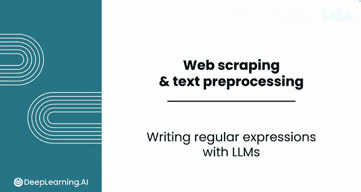
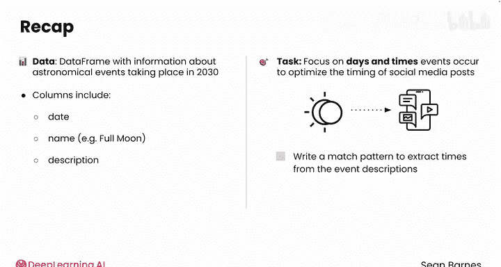
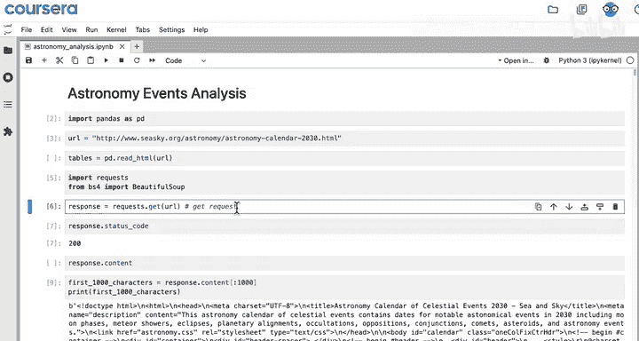
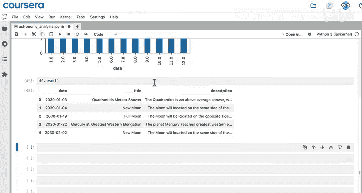
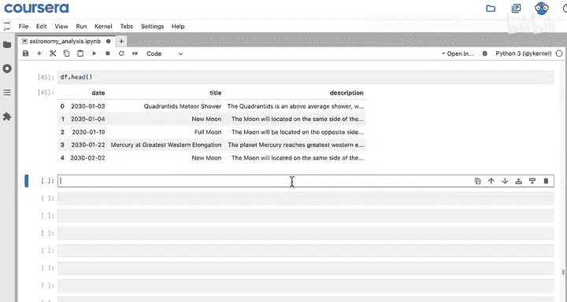
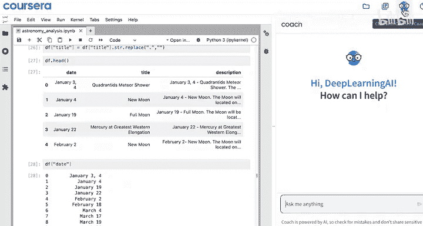
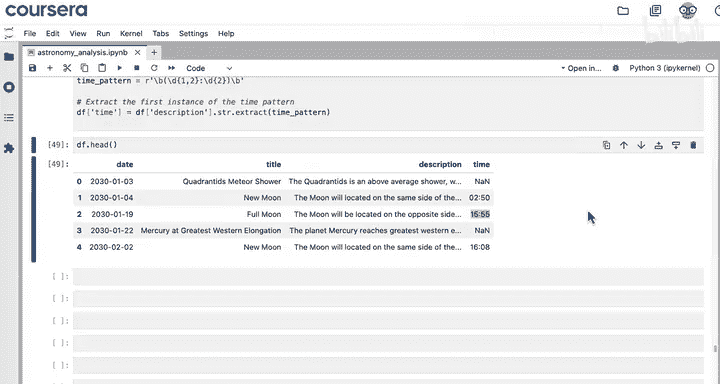

# 吴恩达《数据输入／输出与预处理（Python 和 SQL）Data I／O and Preprocessing with Python and SQL》中英字幕 - P21：20_使用LLM编写正则表达式.zh_en - GPT中英字幕课程资源 - BV1sZEzzQEkF

In the last video， you explored the foundational operations for regular expressions and how they help you match text in a flexible way。

 Now it's time to take things a step further and cowrite some match patterns with Lngs as a recap about the problem you've been working on。

 you now have a data frame with information about astronomical events taking place in 2030 the columns include details on the full date of the astronomical event。

 the name of the event， for example， full moon and a detailed text description of the event。

 Let's say you want to focus specifically on the days and times these events occur to optimize the timing of your social media posts。

 you can write a match pattern to extract times from the event descriptions。

 Let's see that in action Here's the Python notebook where you left off previously You scrape the data using beautiful soup create a neat columns and save all that in the variable Df。

 The first few rows of which look like this。 If you check out the event description at index 0。

 it doesn't have a time。 but the description at index 1 does。😊。

Let's ask the LLM to write an appropriate match pattern。 The key is to be very specific。

 Write a regx pattern that matches a time either in the hour hour minute minute or hour minute minute format with any number of whitespace or characters around it。

 then write code that only matches the first instance of that pattern within a given string。

 apply the match pattern and a vectorized way to the panda's data frame column Df description and save that in a new column called Df time。

 make sure this regular expression is properly formatted for use with dot STR dot extract。

 notice how you're giving the LLM all the information needed for it to solve the problem。

 so ignore this unnecessary sample data frame at the top。

 the code saves the pattern as a raw string and the provided variable。

 Then extracts the first time and saves it into this new column。

 You really don't need to print the data frame either。 Let's try out these two lines of code。😊。

Now let's check out DF outhead， What do you expect when running this code？Well。

 the Roa index 0 shouldn't have a time， but the Roa index 1 should have the time 2，50。 Awesome。

 This regular expression worked。 This would have been a pain to write by hand。

 Remember to always check the output of the LLM against your expectations。

 And don't be afraid to iterate if it doesn't get the pattern right on the first try。

 Well done on all your work in this lesson。 You see how to extract actionable data from text。

 using regular expressions。 In the final video， you'll wrap things up by exploring the ethics of web scraping。

😊。

