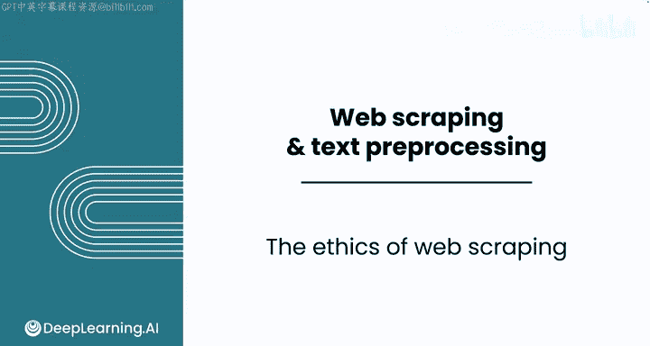
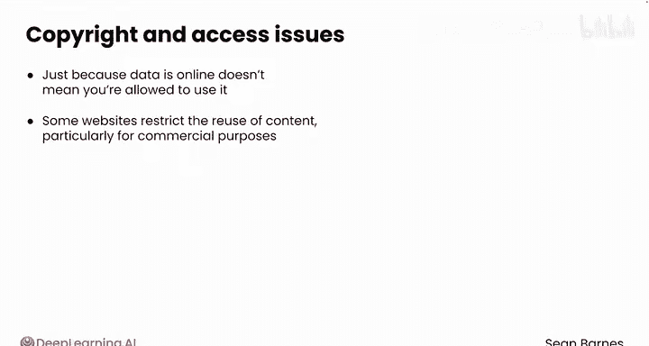
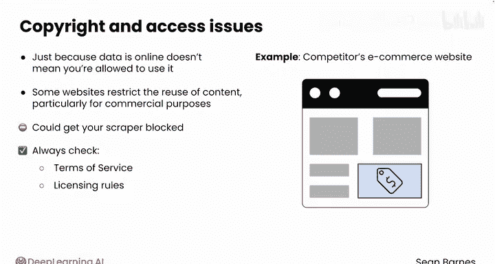
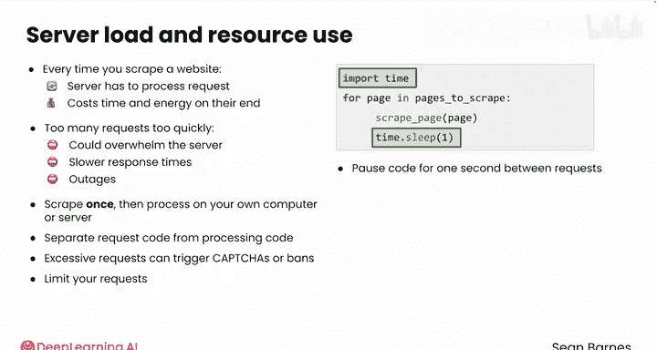
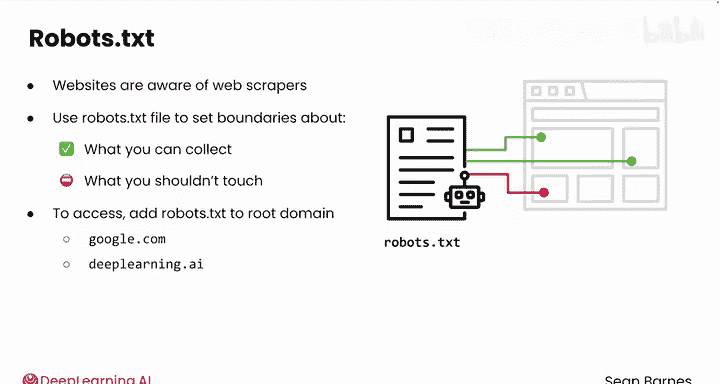
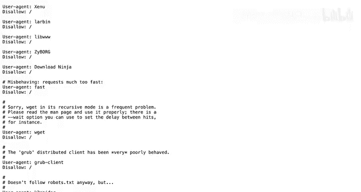
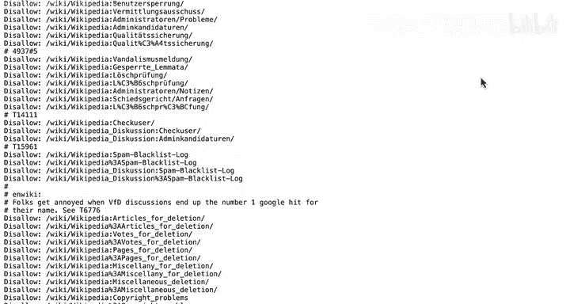
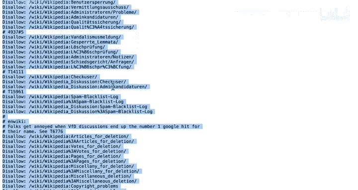
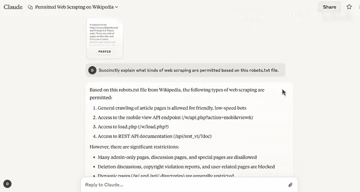

# 吴恩达《数据输入／输出与预处理（Python 和 SQL）Data I／O and Preprocessing with Python and SQL》中英字幕 - P22：21_网络爬虫伦理.zh_en - GPT中英字幕课程资源 - BV1sZEzzQEkF

Throughout this module， you've been using web scraping to access data that someone else created on their own website。

 but this process comes with ethical and legal considerations that you need to keep in mind throughout your data analytics work。

 First， web scraping can run into copyright or access issues just because the data is online doesn't mean you're allowed to use it for your project Some website restrict the reuse of their content。

 particularly for commercial purposes there is a distinction here between what's legal according to local laws and what constitutes a breach of contract or violation of a website's terms of service For example。

 scraping every single page on a competitor's ecommerce-merce website to get their product prices could get your scraper blocked。

 even if you end up not facing direct legal action。

 you should always check if a site's terms of service or licensing rules allow what you're trying to do more on this in a moment by the way I am not a lawyer and this is not legal advice you should also consider the burden of your request on the website Every time you scrap or website their server has to process your request even if it's to deny that processing costs time and energy on their end if you send。

requestquests too quickly you could overwhelm the server。

 causing slower response times or even outages for yourself and other users。

 You should also consider the burden of your request on the website。

 It's good practice to only scrape a page once then do all your processing on your own computer or server rather than making many smaller requests to try to get access to specific data For example。

 you can separate your request code from your processing code so that you don't have to rere the data if you need to make changes。

 you may have noticed in the previous demos that you only set one request for the entire page then completed your pre-processing steps in your Python notebook。

 Accesscessive requests can trigger capchas or bands you should also limit your request if you plan to scrape many pages。

 you can do this in Python with the time module which lets you pause between requests For instance。

 in this code time sleep1 will pause the code for one second between each requests。

Websites are aware of webscrapers and often use a robots Txt file to set boundaries about what you can collect and what you shouldn't touch to access this file。

 just add robots。txt to a website's root domain The root domain is the main part of a site's address like Google co deep learningarning AI or wkipedia work For example。

 here's the robots Txt file for deep learningarning AI which you can access by going to deep learningarning Ai robots。

txt。 It's short because deep learningarning AI allows you to freely scrape information on all pages。

 however， take a look at the robots。 Txt file for wkipedia。 Many robots。

txt files look long and complex like this one however， to get a summary of what is and isn't allowed。

 you can use an Lm let's use cloudde 3。7 onnet be aware that you may have a more advanced model available to you When you write the prompt succinctly explain what kinds of web scraping are permitted based on this robotstxt file and paste the Wikipedia file。

Okay so the LLM summarizes what you can and can't do。

 so it tells you that you can do general crawling of article pages and then you can access some different APIs。

 but it does tell you that there are several restrictions many admin only pages。

 discussion pages and special pages are disallowed you're not able to access deleted discussions。

 copyright violation reports or user related pages Lastly。

 fast or aggressive crawling is prohibited with an explicit warning that access may be blocked。

 so this is where you need to use the time do sleep function so that you don't get blocked。

Great work in this module。 You now have all the knowledge you need to work on the graded assignment and graded lab on analyzing tech industry jobs Once you've completed the assignment and lab。

 follow me to the next module on collecting and preprocess data with APIs I'll see there。😊。

