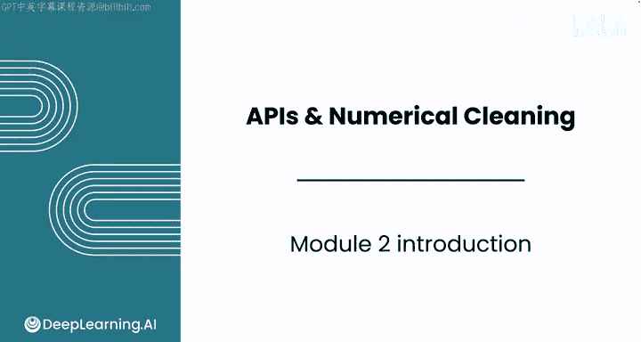
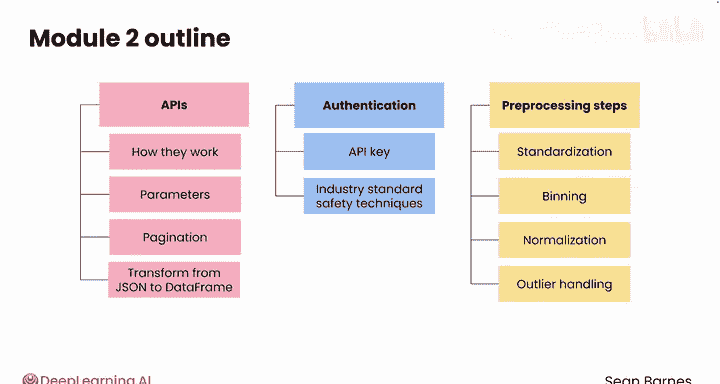

# 吴恩达《数据输入／输出与预处理（Python 和 SQL）Data I／O and Preprocessing with Python and SQL》中英字幕 - P23：22_模块2 简介.zh_en - GPT中英字幕课程资源 - BV1sZEzzQEkF

Welcome to module 2 APIs and numerical cleaning This module equips you with the skills you need to access and preprocess。

 structure data from the web for analysis you'll learn how to retrieve data from application programming interfaces for APIs and prepare numerical data for inside finding in your first lesson you'll explore APIs you'll see how they work and the many customization options you have including parameters and pagination you'll learn how to transform data from the special JSON format to a data frame for analysis In the second lesson you'll level up your API skills through authentication using an API key to access data you'll learn industry standard safety techniques for keeping your key which is like a password safe in the final lesson you'll tackle key preprocessing steps like standardization bidding normalization and outlier handling all of which are essential for working with numerical data these techniques ensure your data is ready for analysis no matter its original format you'll also explore how to assess data quality across four dimensions By the end of this module you'll have the foundational skills。

To retrieve， clean and prepare data from APIs， critical abilities for any data analyst Let's get started。

