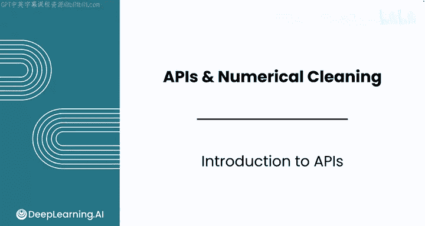
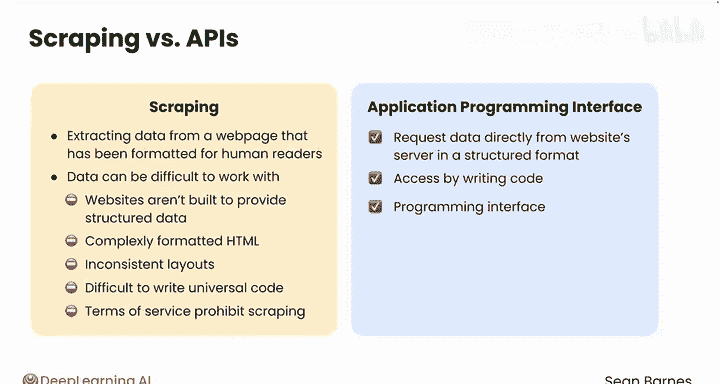
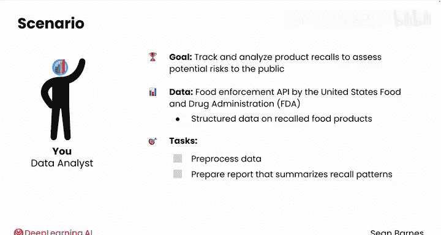
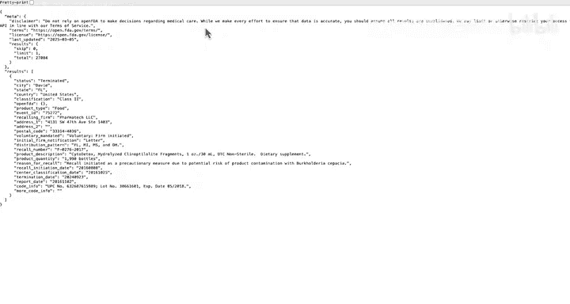
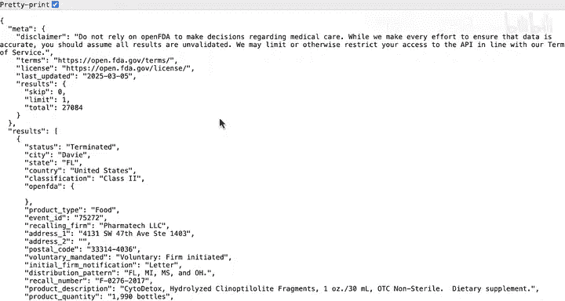
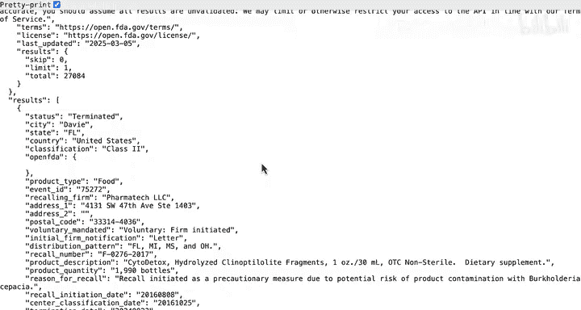
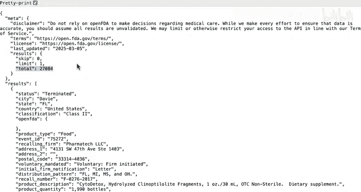
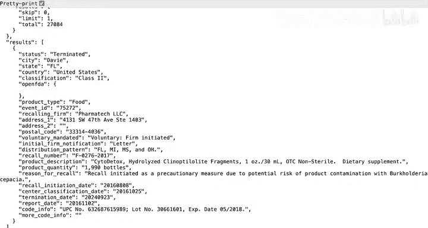

# 吴恩达《数据输入／输出与预处理（Python 和 SQL）Data I／O and Preprocessing with Python and SQL》中英字幕 - P24：23_API介绍.zh_en - GPT中英字幕课程资源 - BV1sZEzzQEkF

In the previous module you saw how web scraping can be a useful way to gather data from websites。

 You actually have another highly useful option for gathering structured data from the internet As Scing involves extracting data from a web page that has been formatted for human readers rather than for your Python code as you saw in the previous module the data you gather from web scraping can be difficult to work with primarily because websites aren't built to provide structured data so you often have to extract what you need from complexly formatted HTML with a lot of extra text and code surrounding it you also saw that websites have inconsistent layouts where different pages on the same website may follow slightly different structures。

 This inconsistency makes it difficult to write one piece of code that works for everything when scraping you also run into websites that have terms of service that prohibit scraping complicating your data acquisition however there are ways to get well formatted structured data from the internet data that's intended for analysis for that purpose you can use an application programming interface or API for short and API allows you to request。

Data directly from a website server and a structured format。 you access an API by writing code。

 hence the name it's a programming interface， a way for code to access something As are purpose built for providing data so when they are available they are a more reliable and efficient way to access information compared to web scraping you' probably only find yourself using webs scraping if the data you need isn't available from an API As also use the same networking paradigm you learned about in the previous module your computer acting as the client sends a request to a server which processes it and sends back a response throughout this module。

 you'll work through a case study with API data which involves completing an analytics task for a consumer advocacy group you will track and analyze food product recalls to assess potential risk to the public understanding how often and why food products are pulled from the market can help inform policy recommendations In this lesson you'll use the food enforcement API provided by the United States Food and drug Administration or FDA using this API。

Re structure data on recalled food products you'll then preproces this data and prepare a report that summarizes product recall patterns。

Before you work with the code to use the API， let's take a look at its documentation。

 the FDA maintains this website listing all its APIs and explaining how they work if you're looking for data on food recallca enforcement。

 you can select food API endpoints from this list on the left you'll learn more about what an endpoint is in a moment then recall enforcement reports then overview it gives you a bit of info about this data it contains recall event information submitted to the FDA it covers data from 2004 to the present That's a major advantage of this API compare with the flat file is that the data is up to date when you're seeing this you'll have even more upto- date information than what's here Now check out how to use this API。

Go down to making a simple API call， you can make an API call from a web browser。

 and it gives you an example， let's ignore this search and limit stuff for a moment and just take the base endpoint which is in blue here。

 open a new tab and here's the data。Copy the base endpoint and paste the URL into the search bar。

 This is just one result。 If you check out the curly braces and brackets an indentation。

 this result isn't HTML。 It's in a format called JO。

 which you'll explore the next video For now you can skim the result there's some meta information at the top explaining when this was last updated how many results there are and how many total results are available then you get that one result displayed below and a list of results。

 It's a terminated recall from Da Florida in the United States。

 The recall was from pharmach LOC and it was for some type of dietary supplement。

 So before you work with a new API and code， it's excellent practice to explore the documentation and get a sense for the structure of data you'll be working with just like you do before scraping the web in this video you examine one result from an API in your browser API results typically common JSON format which is a common way to store structure data follows the next video to see how it works。

😊。

