# 吴恩达《数据输入／输出与预处理（Python 和 SQL）Data I／O and Preprocessing with Python and SQL》中英字幕 - P25：24_JSON格式.zh_en - GPT中英字幕课程资源 - BV1sZEzzQEkF

In the previous video， you learn about APIs and use one to retrieve structured data in your browser In this video。

 you'll learn how API results are typically formatted using JSO In the previous video。

 you request the data from an API maintained by the FDA take a look at the URL more closely you're requesting something called En JSson but what is that JSO which stands for JavaScript object notation is a format often used to transfer data between applications。

 It organizes data in a structured way。 This format originated from the web where jascript is a common programming language It mimics the way JavaScript is written JSO is a collection that is structured as key value pairs Each key is used to access a value previously you work with lists and Python and ordered collection lists use an index to access values like012 and so on JSO uses keys which must be strings and quotes if you recall the Python data structured dictionaries which you briefly encountered in the previous course you might notice this structure looks very similar to a dictionary once you load JsonN into your Python note。

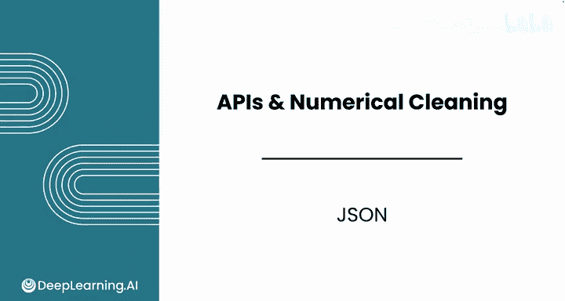

It will be represented as a dictionary。 You'll get into these details in a moment。 For example。

 let's say you have this data on a galaxy far far away and some key facts about it。

 A set of curly brackets surrounds the entire response。 How many key value pairs do you spot。

There are four name， distance in light years visible from Earth and neighboring galaxies。

 The first item in the pair like name is called the key and the second one like a Dmeda galaxy is called the value together。

 these two make up a key value pair like HTML JSON also has a nested structure meaning it can organize data in a hierarchical way where data nested inside other data。

 you learn in the previous module that HTML elements can contain other elements。

 JSON values too can have this structure， some values in JsonN are simple like a single number or string。

 but others can be nested inside like lists creating layers of information when working with JSON it's common to first take a look at the entire result to understand what data is available and which parse you'll need to access Unlike a table where everything is neatly arranged in rows and columns。

 JSON structures can be more complex to scan requiring you to navigate through different levels to get the data unique。

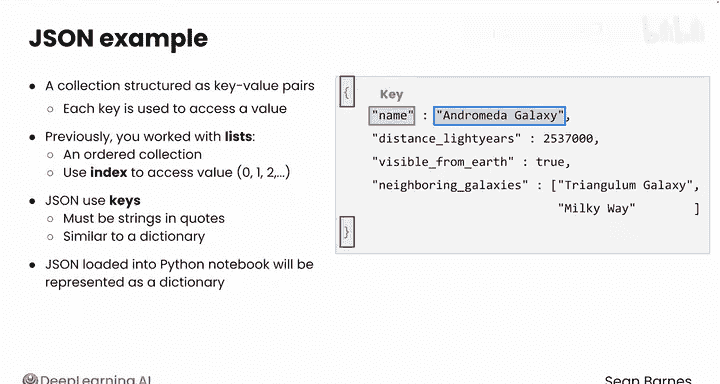

As you heard a moment ago in Python， JSsonN is represented as a dictionary。

 which looks extremely similar to JSOson， Dictionaries are written with curly braces and they also represent key value pairs。

 there are a few small differences though in JSsonN an empty value is represented by null while in Python it's represented by none。

 and true and false are capitalize in Python while their lowercase in JSOsonN。

 you don't need to memorize these differences， the important thing to remember is that JSOsonN is a structure of format for data that you'll encounter when using APIs。

 and that they are represented very similarly by dictionaries in Python。

 this conversion will be done for you by pandas。

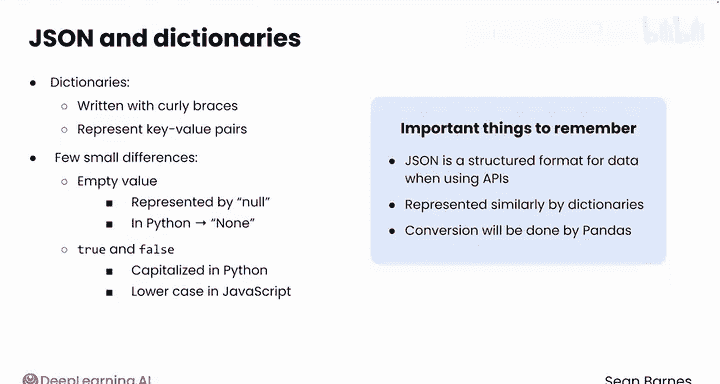

Here's an example in code， this is a Python dictionary representing the same FDA enforcement API response you saw in the previous video。

 let's check the keys of this dictionary to see what's available。

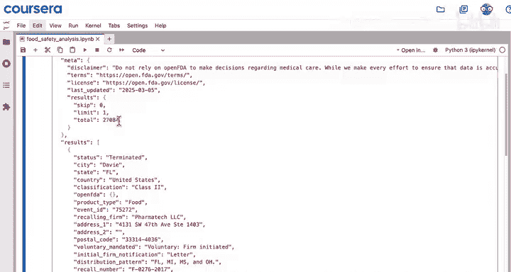

Notice that keys is a method， not an attribute since it has parentheses， and you get two keys。

 meta and results。 That's the first layer of the nest。 Check out the results section。

 You can access the value of this key using data results。

 and you just get the information about the one recall report。 Now。

 the cool thing about this dictionary。 this API response is that you can go deeper into the nest。

 Let's unwrap one layer deeper。 Not that this result is actually a list。

 You can tell that by the brackets。 That's because there can be many results returned in one go。

 So say you wanted to just get this result first you can say data results0。

 Now you've gone one level deeper。 Now you have a dictionary。

 So that's a dictionary inside a list inside a dictionary。

 Now say you just want to get the product quantity from this dictionary。 how could you do that。😊。

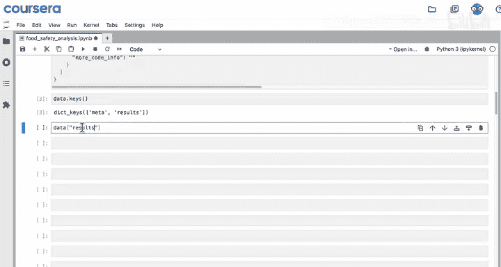

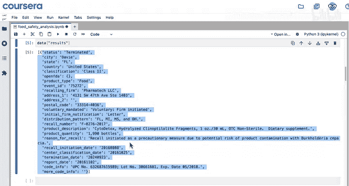

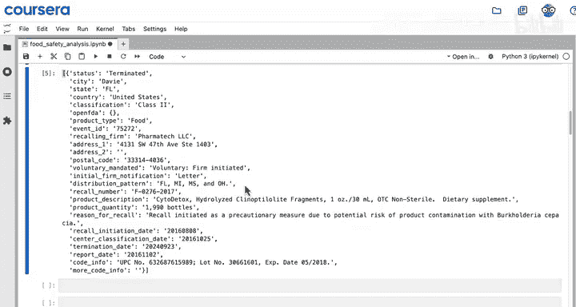

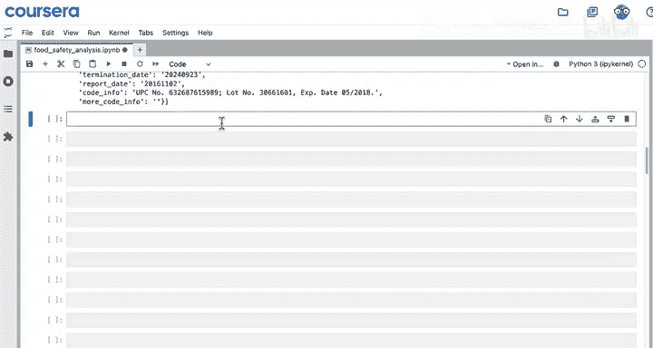

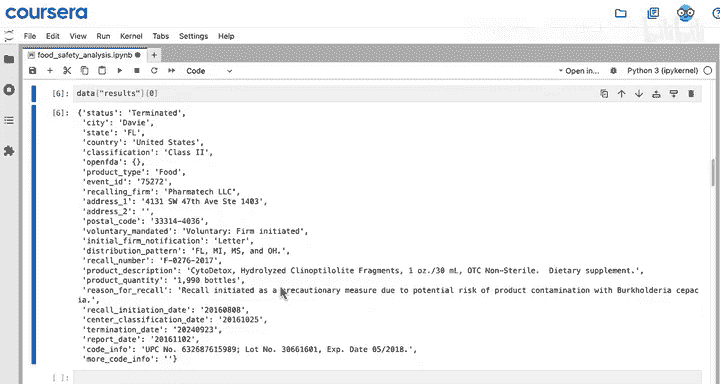

You can use data results zero， product underscore quantity。That's 1990 bottles。

 So you just unpack all these layers to get to the data you needed In this video。

 you learn how to work with JSsonN data。 JSON defines a nested structure of key value pairs for organizing data。

 you learn that JSsonN is formatted as a dictionary in Python， which is defined by curly braces。

 Dictionaries are also nested structures of key value pairs。

 You saw how to use chain indexing to unpack layers of that dictionary to get to the data you need。

 For example， you saw how to access the product quantity for the first recall result by first accessing the results list name getting the first item from that list。

 then accessing the product quantity from the dictionary representing that recall。

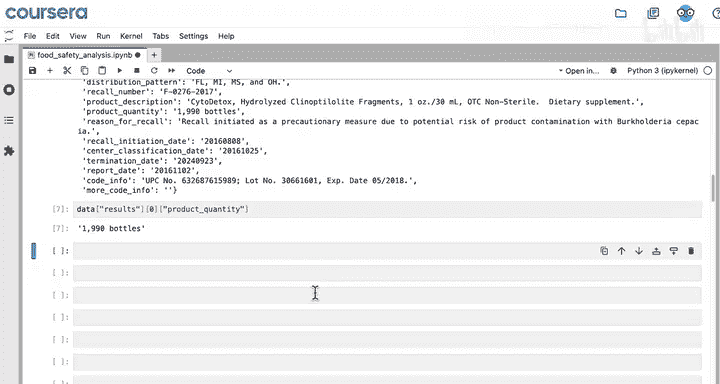

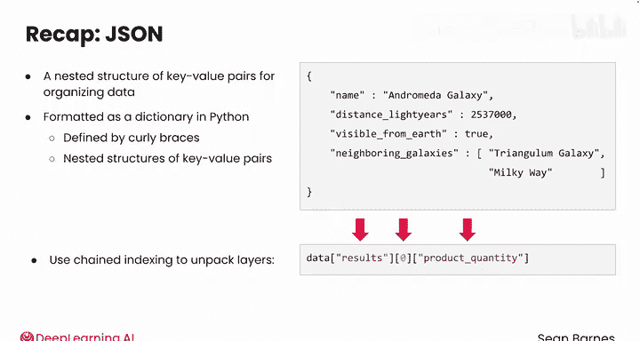

Now that you understand more about the structure of JSON。

 you're ready to extract the key information you need from your data。

 I hope you'll join me for that in the next video。