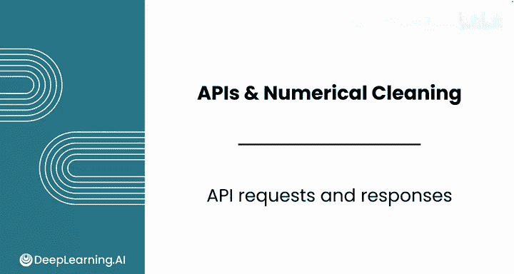
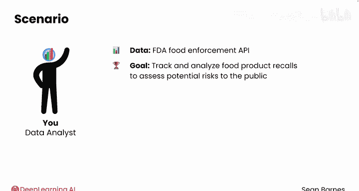
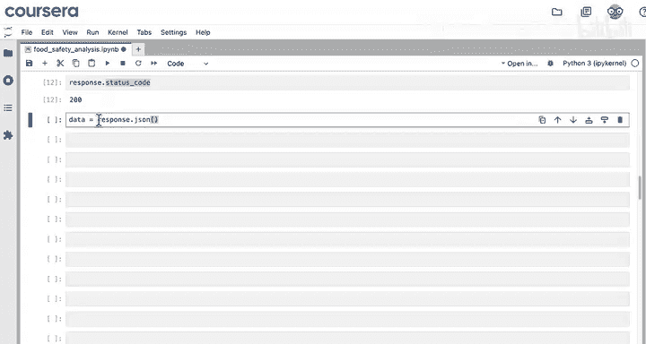
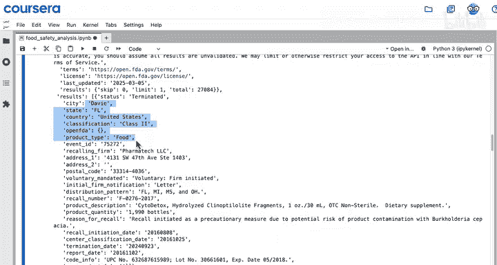
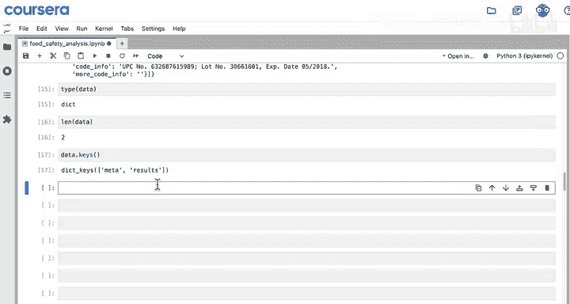
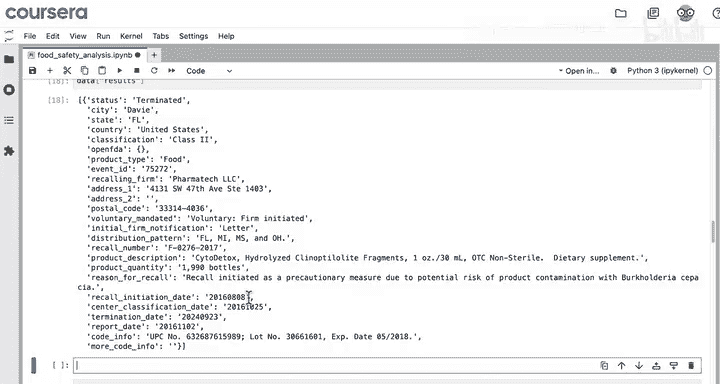
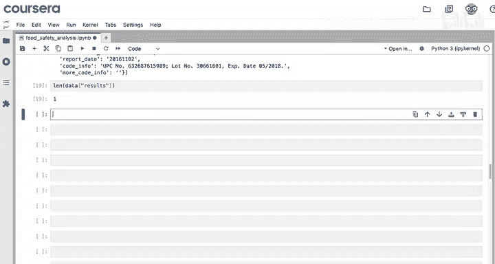
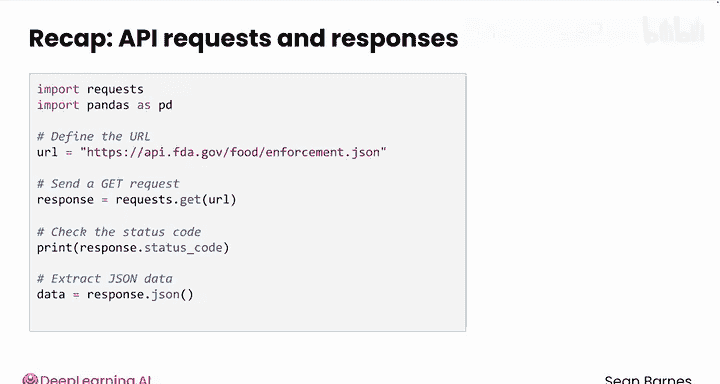

# 吴恩达《数据输入／输出与预处理（Python 和 SQL）Data I／O and Preprocessing with Python and SQL》中英字幕 - P26：25_API请求与响应.zh_en - GPT中英字幕课程资源 - BV1sZEzzQEkF

Now that you've seen how APIs work and how the responses are formatted。

 you'll create your first API column in Python。 recall that you have been working on an analytics task for a consumer advocacy group。

 you're using the FDA food enforcement API to track and analyze food product recalls to assess potential risks to the public。

 Let's take a look at how to get data from an API using code you'll notice a lot of similarities with webs scraping First you'll need the request and pandas modules so import those。

 remember that you can use the practice lab item to follow along with the demos。

 then define the URL you want to retrieve data from This is the URL for the FDA's enforcement API。

 what was called the base endpoint which again you'll learn more about in a coming video Next。

 send a get request to this URL。 remember that a get request is like asking the server。 Hey。

 can I have this data just as you would when scraping data you should first check the status code to see if everything works。

Great，200 means success。 The request went through， and hopefully you got the data you asked for。

 Once you've received a good response， you need to extract the data from the response。

 The response has a lot of other stuff stored inside it， like the status code， for example。

 This is the first new line of code you'll see。 Use response do Json to get the Json data from the response。

 Check out the data。 And hey， there's your recall from Da Florida。😊。

Check out the type of data。It's a dictionary you already learned that JSON data is stored as a dictionary in Python What else can you do with this data。

 let's do some quick checks to validate it， check in the length of data you get two that's the number of keys remember you can use dot keys to access those keys as well and let's check the length of the list of results so data results which you saw in the previous video。

The length of that list is one there's just one result there it's good practice to double check you've received the right data on receiving a response from an API In this video you retrieve live data from an API Great job you send a get request using Python's request library and check the status code to ensure your request was successful just like you would when scraping a web page you then use JSON to extract the JSON data in the response into a dictionary that you can work with in Python excellent work with API so far follow me to the next video to see how you can customize your API request。

