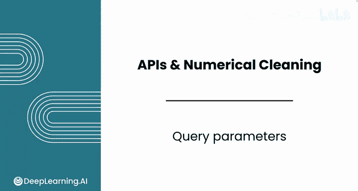
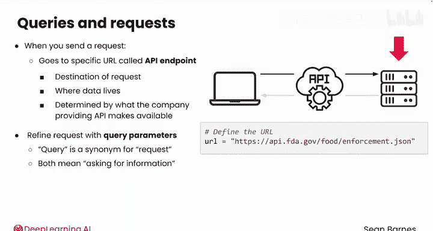
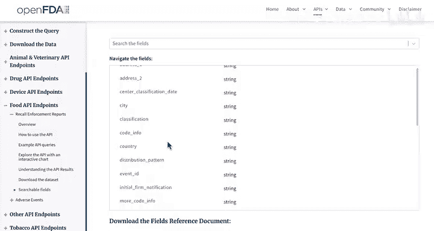
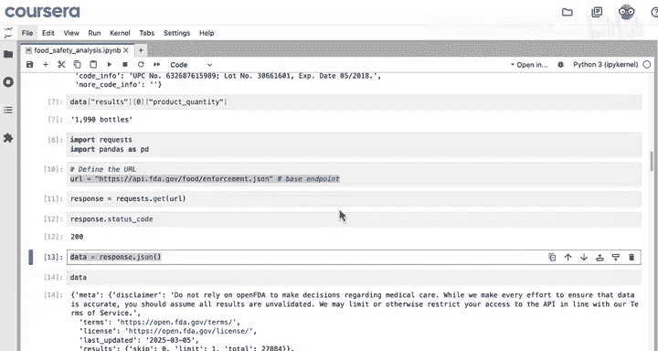
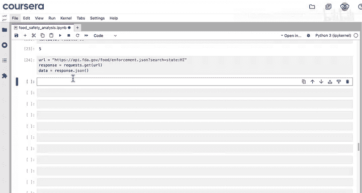
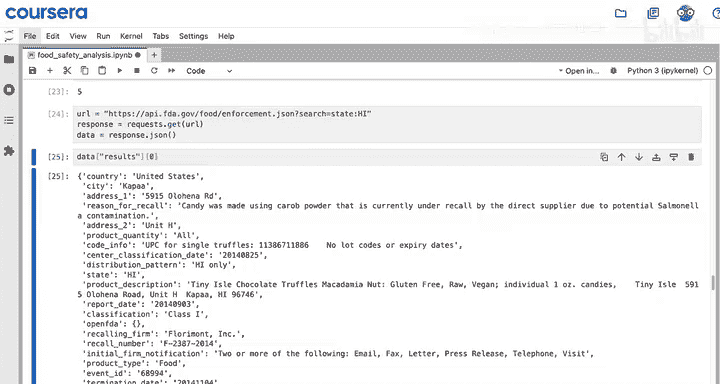
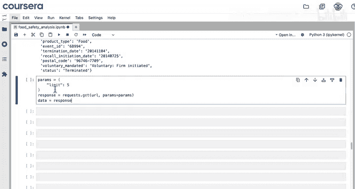
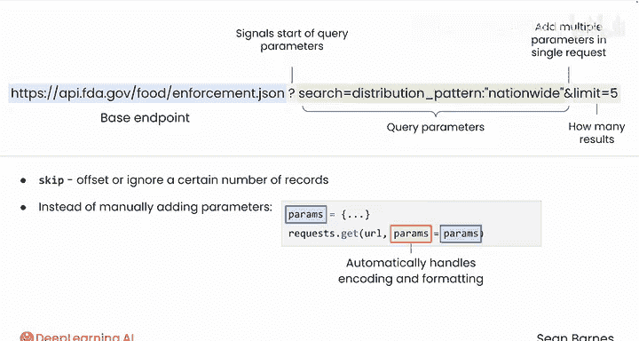

# 吴恩达《数据输入／输出与预处理（Python 和 SQL）Data I／O and Preprocessing with Python and SQL》中英字幕 - P27：26_查询参数.zh_en - GPT中英字幕课程资源 - BV1sZEzzQEkF

In the previous video， you use code to get a response from an API Now you'll see what other options you have when requesting data from APIs When you send a request。

 it goes to a specific URL called an API endpoint。 For example。

 in the previous video you send a request to this URL the base endpoint for the FDA food enforcement API think of the endpoint as the destination of your request It's the place where the data lives the endpoints you can use are determined by what the company providing the API makes available but you don't always want the default response from that endpoint for example you receive one recall event from your one API call What if you want to receive more than one event with just one request you can refine your request by adding extra details called query parameters Que is a synonym for request they both mean the same thing asking for information just like endpoints the available parameters depend on the API you're using and the best place to know what options are available is to look at the API documentation to learn more about the available parameters for the FDA food enforcement API you can visit this web page。

Use the API， which you saw previously recall this diagram showing you the base endpoint。

 which forms the beginning of every query。 a question mark after the base endpoint allows you to add query parameters like search。

 for example， this query looks for recalls where the distribution pattern is nationwide You can add another parameter using an ampersand like limit In this example you're requesting five results rather than just one you can check out the searchable fields page to see the possible options for search you'll see other options you can filter by like city reason for recall and status。

 Let's go back to the notebook to see this in action。

 recall that in this notebook you have made a request to this API and save that in data。

 You saw that if you just query the base endpoint with no parameters you get only one result。

 Let's say you want to get five results。 By the way。

 don't forget you can use the practice lab item to follow along with the demos。

 Start with the base endpoint Add question mark limit equals 5 to the URL。

Check out data results and you get a much longer response。Remember。

 results is a list and it has five items say you want to focus only on recalls in Hawaii。

 following the format shown on the FDA website， you add search equals state colon H。

Check out the result at inV0 and you get。

Oh， dear。 Some aadamia nut truffles。 unfortunate。 Some APIpis have many parameters。

 and you won't want to keep adding them onto this URL。

 There's a cleanerup approach you can use with the request module。

 You can pass the query parameters as a dictionary using the parametersms argument and request do git。

 for example， if you want to limit the number of responses to5。

 you can create a dictionary like parametersms equals limit colon 5。

 Then when you call request do git add a new named argument。

 parametersms equals parametersms note that it's totally okay to name a variable。

 the same as a named argument and a function。 When you run it。

 you'll get the same response as you did previously with5 rather than one events。

This parameterm's dictionary will be useful as you start to make more complex queries to quickly recap when making an API request。

 start with the base endpoint。 the question mark in a URL signals the start of query parameters。

 query parameters use the key equals value format similar to name arguments in a function。

 the Ampersand allows you to add multiple parameters in a single request。

 a common parameters across many APIpis is limit， which controls how many results you get。

 Another useful parameter is skip， which allows you to offset or ignore a certain number of records before returning results。

 Instead of manually adding parameters to your URL， you can pass them as a dictionary in request kit。

 which keeps your code cleaner and easier to manage using the parameterss argument automatically handles encoding and formatting。

 reducing the chance of errors in your API request。

Great work， you've seen that by using query parameters。

 you get exactly the data you need nothing more， nothing less in the next video you'll use parameters to expand your request from the API and format the data in a way that will make the insights clear。

