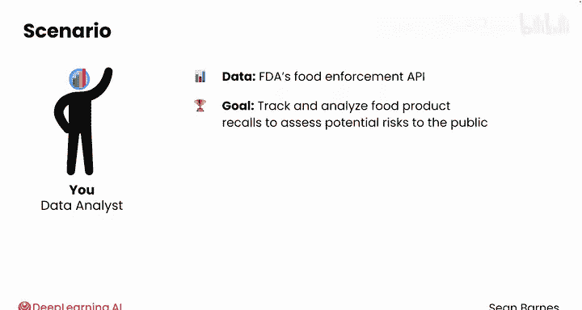
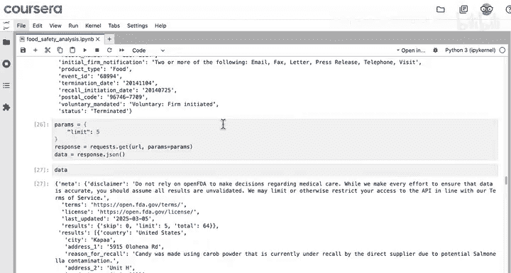
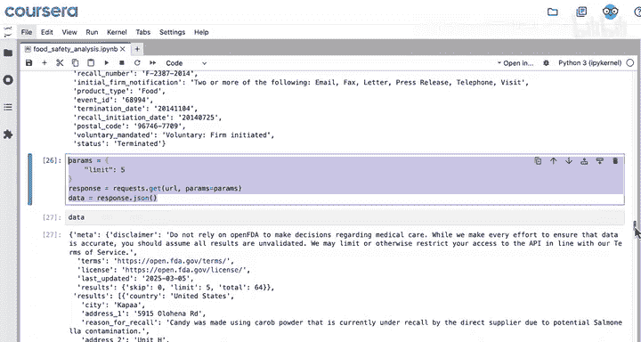
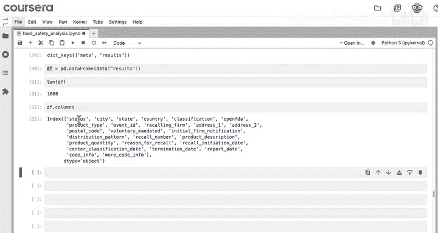
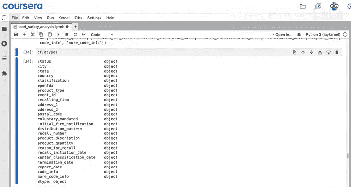
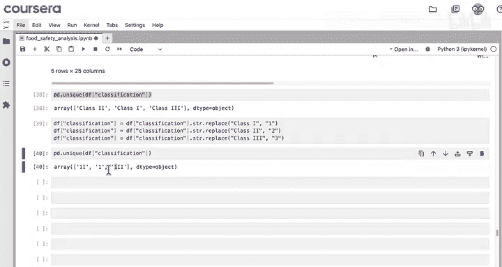
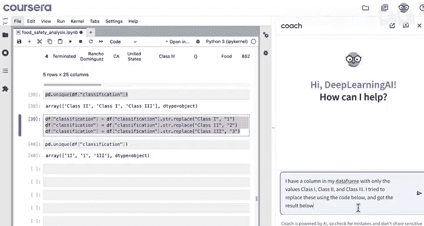
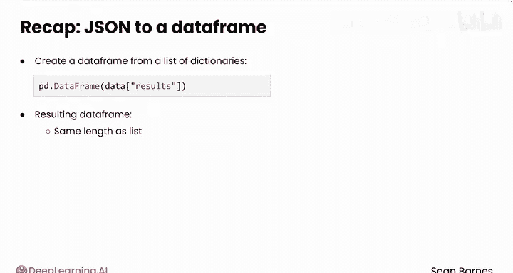

# 吴恩达《数据输入／输出与预处理（Python 和 SQL）Data I／O and Preprocessing with Python and SQL》中英字幕 - P28：27_从JSON到数据框.zh_en - GPT中英字幕课程资源 - BV1sZEzzQEkF

In the last video you' learn how to add parameters or additional info to your API request Once you've requested the right data。

 you'll need a converted to data frame to begin your preprocessing and analysis recall that you've been working on an analytics task for a consumer advocacy group you're using the FDA food enforcement API to track and analyze food product recalls to assess potential risk to the public so far on this notebook you've requested up to five results from the FDA's food enforcement API that limited number won't tell you much if we're trying to analyze broader product recall trends Let's take this a step further and request 1 thousand results。

 which is the maximum you can get in a single request from this particular API APIs often implement a request limit to protect server resources。

Notice that that request took a tiny bit longer to complete。Now。

 Pas provides you with a method to turn this dictionary into a data frame。

 take a look at the keys again， which one would you like to turn into a data frame？

That would be your results。All you need to do is PD。 data frame of data results， and that's it。

Saavor results into a variable， let's call it DF。Before any preprocess steps。

 you should start with a bit of data validation。 How many rows should this data frame have？

1000 which you can check with length。 that checks out perfect。

 And what do you expect for the columns， The column should be all the features of each enforcement event Yep。

 like status， city， recall number and so on。 So the keys of each dictionary in the list data results became your columns。

 Check out D F do D types。 All of these are objects。

As you learned previously， Python defaults to treating everything as an object， basically text。

 however， some of the columns are numeric， recall initiation date， center classification date。

 termination date and report date should be treated as dates。

 these dates look consistently formatted so you can try casting them to date times using PD to datetime Now when you check out DF。

head， you can see them formatted as dates with the year month and day what other opportunities do you see for data preprocessing。

If you look at the classification column's unique values， there are only three values。

 let's replace these with numbers so that we can treat them numerically。

 but it really depends on the direction of your analysis。

 in some cases leaving this feature as is would be fine so first replace class1 with just one as a string。

 same for class2 and then class3 as well。Now check the unique values to verify。Hang on。

 that doesn't look right。 Can you tell what's happened？

It looks like all instances of class1 were replaced。

 even when it was part of the string class 2 or class3。

 let's check with the LLM how to fix this issue I have a column in my data frame with only the values class 1。

 class2 and class 3 I tried to replace these using the code below and got the result below add your code and your odd result。

So the LLM suggests using a regular expression， that's an option， but you can also ask。

 is there an even simpler approach？Now to suggest using a map method。

 which you can certainly try out， I'm trying to get it to tell us to just replace Class 3 first。

 then class 2， but okay fine， we'll go with this option the proof is in the results。Now。

 since you already modified your data frame， you'll have to reconstruct it from the JSON。

 otherwise you'll start your processing from these incorrect values。Try out the LLM code andvoila， 2。

1 and3。Finally， save this result using dot as type N64 Awe。

 that's greatly simplified this data frame。To quickly recap。

 you saw how to create a data frame from a list of dictionaries using PD。 data frame。

 the resulting data frame was the same length as the list and the column names were the keys of each dictionary。

Well doneug， you just created a data frame based on a dictionary In the next video。

 you'll use a technique called Pagination to get 25，000 results rather than just  a0。 I'll see there。

