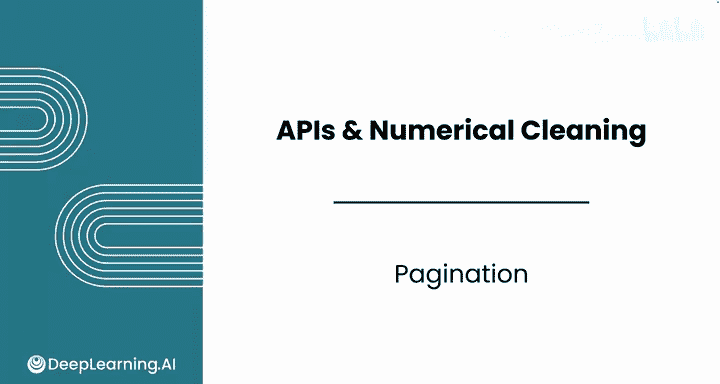
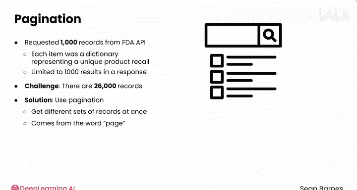
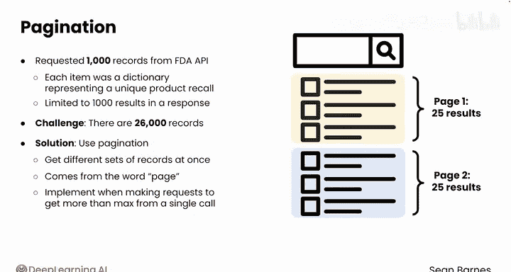
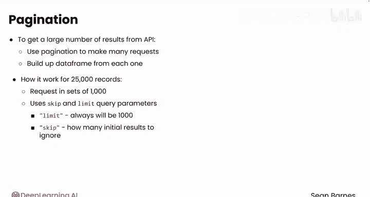
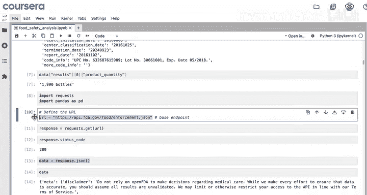
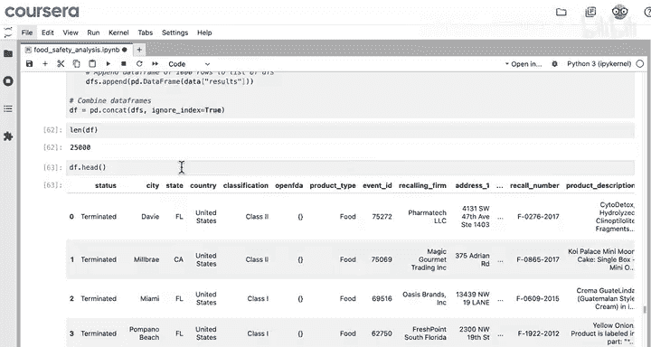
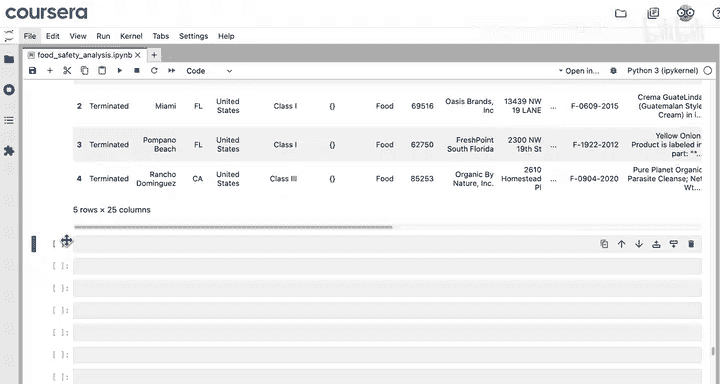
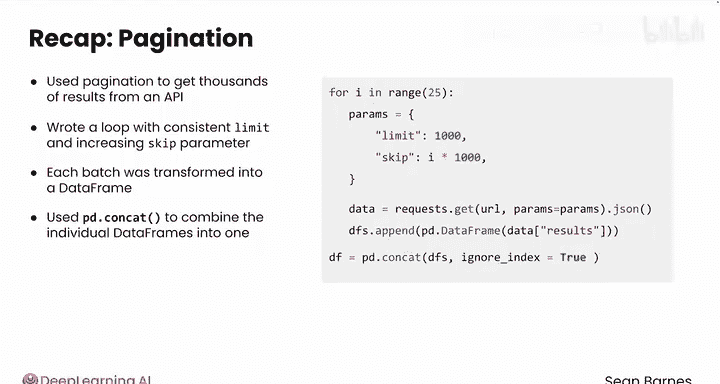

# 吴恩达《数据输入／输出与预处理（Python 和 SQL）Data I／O and Preprocessing with Python and SQL》中英字幕 - P29：28_分页处理.zh_en - GPT中英字幕课程资源 - BV1sZEzzQEkF

While you've successfully collected and preprocessed results from a single API call。

 you haven't collected all the data you need to get a larger sample。

 you can make multiple calls to the API and combine those results into a single data frame In the previous video you requested 1000 records from the FDA food enforcement API Each item you requested was in the format of a dictionary representing a unique product recall。

 However， say you won a larger sample for your analysis with recalls stretching back further than just the past 1000 examples。

 Unfortunately， you're limited to only 1000 results in a single response。

 remember that there were over 26000 records。 How can you get the rest of this data。

To do this， you'll use a technique called pagination。

 which is a way to get different sets of records at once。 Pagination comes from the word page。

 Think about when you search for something on Google。 you can get up to 25 results on the first page。

 When you scroll to the bottom， you click next and get 25 more results。

 You can implement this technique where making request to an API as well to get more than just the maximum number of results from a single call If you want to get a large number of results from an API。

 You can use pagination to make many requests and build up a data frame from each one。

 Here's how it works。 If there are 25000 records， you can request them in sets of10 This technique uses the skip and limit query parameters。

 limit will always be1 thousand since you want 10 records at once。

 but S will change Sip to the server how many initial results you want to ignore in your first request S is0。

 you get the first thousand results in the second request S is  a thousand you ignore the first thousand results because you already have those。

 It will get the next thousand records。 You'll keep increasing the S parameter by10 until all records are retrieved。

 recall that up until this point， you've saved the base inpoint URL and this very。

Let's start by creating an empty list。 You'll append the data frame of each set of1 thousand results to this list and then combine the results at the end。

 now comes the loop to request the data from the API。

 your plan is to write code to retrieve 25000 records and because you can only do this 1000 records at a time you'll have to make 25 API calls there are really only a couple of new lines of code here So start the loop for I and range 25。

 remember that this means you'll run the loop 25 times and each time you do so I will increase by1 Next you want to define the parameters。

 Use a dictionary to keep your code clean。 you'll need two parameters limit and skip As you saw a moment ago。

 limit is always 1000 Sip equals i times 1000 So at the start when I is 0 you skip 0 times 1000 which is 0。

 Then when I is1 you skip 1000 then 2000 and so on。

 Then you'll request the data as usual and extract the JO you'll create a data frame from the results then append this data frame to your list of data frames。

 you'll combine them all together later。Finally， once you've retrieved all the data。

 you'll want to combine these data frames into one giant data frame Outside the loopbe。

 use Pd dot conca with the first argument as dfs， the list of data frames you want to combine。

 and you'll need the argument ignore index equals true。

 Otherwise you'll have 25 sets of rows index from 0 to 999。 That's it altogether Let's run this code。

 Notice that it took several seconds。 That's networking in action。

 It takes a bit of time to send and receive all these requests。 How many rows do you expect to have。

That should be 25，000， which checks out and what columns。

It should be the same as the previous video。 Each feature of a recall event looks great。

 Now you can perform all the same preprocessing steps as you did before， including casting。

 which willll pick up in the next video In this video。

 you use pagination to get many thousands of results from an API。

 You wrote a loop with a consistent limit and an increasing skip parameter to fetch sets of records。

 Each batch of data fetched from the API was transformed into a panda's data frame。

 Then you use PDd do concat to combine the individual data frames into one。

 the concat function essentially stacked data frames on top of each other and automatically matches columns by name。

 So even if the columns are out of order。 the final data frame will stay organized。

 Se ignore index equals true renumbers the indices in the combined data frame starting from 0。😊。

Great work You've consolidated a ton of API data into a single data frame for analysis In the next video you'll learn more advanced techniques for preprocess and analyzing this combined data。

 I hope you'll join me there。😊。