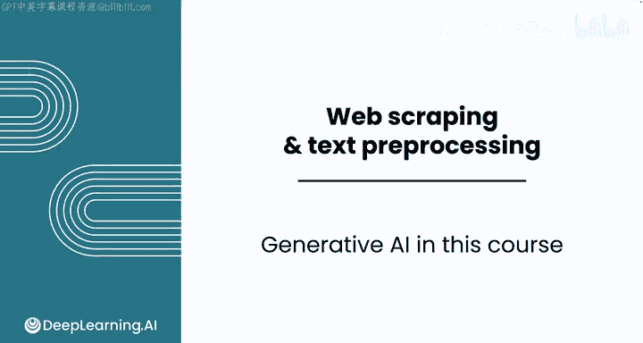
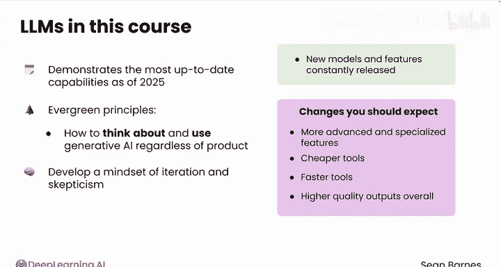
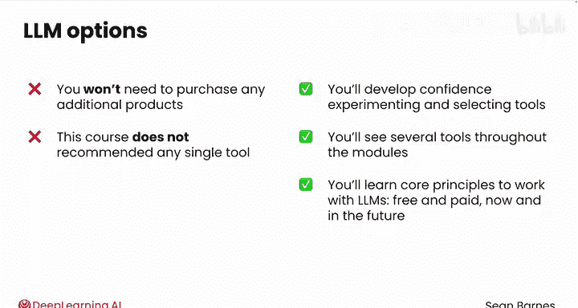

# 吴恩达《数据输入／输出与预处理（Python 和 SQL）Data I／O and Preprocessing with Python and SQL》中英字幕 - P2：1_本课程中的生成式AI.zh_en - GPT中英字幕课程资源 - BV1sZEzzQEkF

One of the key elements of this course is learning to code alongside generative AI in particular。

 large language models or LLMs like Cha EptT， Claude， Gemini and so on。

 effectiveff use of LLMs will help you both streamline your work and stand out in the workforce In this course you'll learn how to use large language models or LLMs to find and fix code and database query errors。

 write code based on comments， explore new preprocessing methods。

 interpret the results of an analysis and more LLMs are ever evolving and present challenges for both teaching and learning。

 I wanted to take a moment to share our team's philosophy about generative AI in this course。

First， LLms are a complement to your skills as a data analyst， not a replacement for them。

 They're an excellent coding companion that can help you write code and fixed bugs。 However。

 you'll only get the most out of an LLM if you know how to code yourself In this course you'll learn the fundamentals of both coding and LLm collaboration you'll build your code interpretation skills and develop an intuition about what tasks LLm's Excel app as well as where they can go wrong。

 you'll also use coursera's builtin lab chatbot to complement your code writing This course demonstrates the most upto- dateate capabilities as of early 2025 and we expect changes in the coming months and years。

 This course is designed to teach evergreen principles how to think about and use generative AI in your work。

 regardless of which specific product you use you will develop a mindset of iteration and skepticism。

 new models and features are constantly being released and here are some of the changes you should expect in the near future。

 First gen AI tools with more advanced and specialized features like the ability to use apps for you expect cheaper tools and faster tools and higher quality。

The outputs overall， it's challenging to keep up with the rapid progress in this field。

 but don't worry。 In this course， you'll develop the metacognitive skills you need to harness those advancements in your work。

 This course also demonstrates some paid features of LLms。

 but you won't need to purchase any additional products to complete the assignments。

 It's important for you to see the available options。

 including paid options so that you can develop the confidence experimenting and selecting the best tools in your work as a data analyst。

 This course does not recommend any single tool。 You'll see several throughout the modules。

 And remember that the core principles you'll learn will prepare you to work with LLms both free and paid now and in the future。

 You'll encounter your first LLM demo in just a few videos from now For now。

 join me in the next one to see all the exciting topics in this module。 I'll see there。😊。

