# 吴恩达《数据输入／输出与预处理（Python 和 SQL）Data I／O and Preprocessing with Python and SQL》中英字幕 - P30：29_组合数据分析.zh_en - GPT中英字幕课程资源 - BV1sZEzzQEkF

In the last video， you use pagination to request data from an API in batches Now that you have all the data combined into a single data frame。

 it's time to preprocess and analyze it。 recall that you've been working on an analytics task for a consumer advocacy group you're using the FDA food enforcement API to track and analyze food product recalls to assess potential risks of the public At this point。

 you've got a single data frame with 25000 records from the FDA food enforcement API。

 Let's perform the same preprocessing steps as you did in a previous video First convert classification to a numeric column All the steps here are combined looks great Now convert these day columns to a daytime。

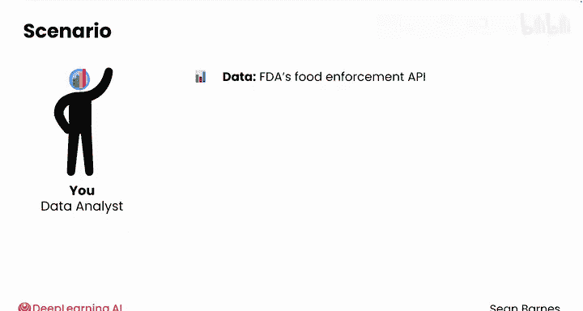

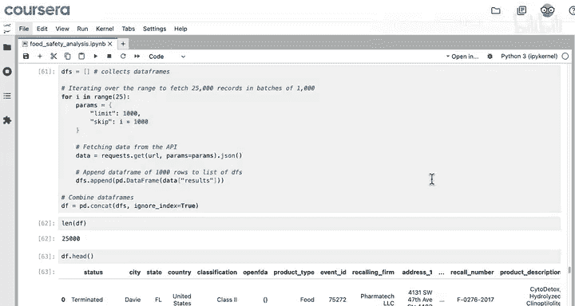

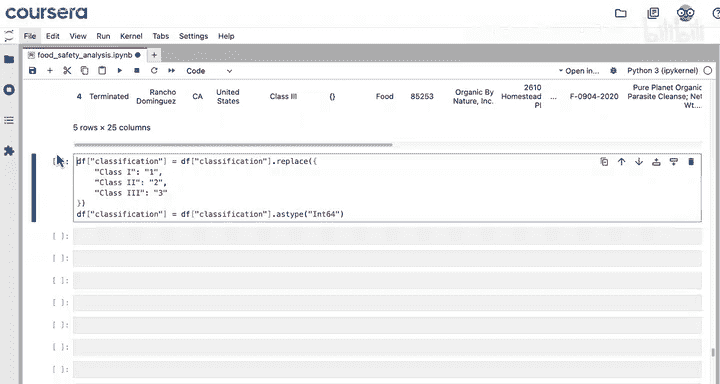

Whoa， hang on。 There's a problem here。 Let's scroll down to the bottom of the air to see what's up on of bound timestamp 0。

2，1，2，1207。 Ha okay， it looks like someone may have incorrectly entered the recall date as happening in the year 212。

 At least onm guessing that's the problem。 If you check out the earliest dates using D F recall initiation date dot sort values。

 You can see this appears to be an outlier。 since otherwise the dates go back to 2008。

 Let's ask the LM how to fix this。 write code to fix this timet by setting the value of the recall initiation date column to 212。

1207 for the data frame row at position 20513。 My data frame is called D F。😊。

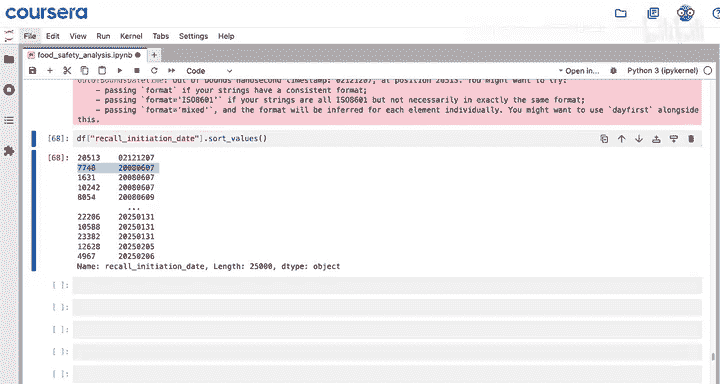

And try the code。Okay， no errors there。 Now you can try running the daytime casting again。All right。

 it worked， check out Df。d types to confirm。You can see that all the date columns were correctly converted to a datetime type Now you can do a bit of analysis towards your ultimate goal of analyzing recall rates over time。

 you can study how quickly recall incidents are being resolved on average and if this is getting faster or slower over time first create a new column that takes the termination date minus the recall initiation date to give you the duration of the incident from when it was started until when it was resolved here's what it looks like。

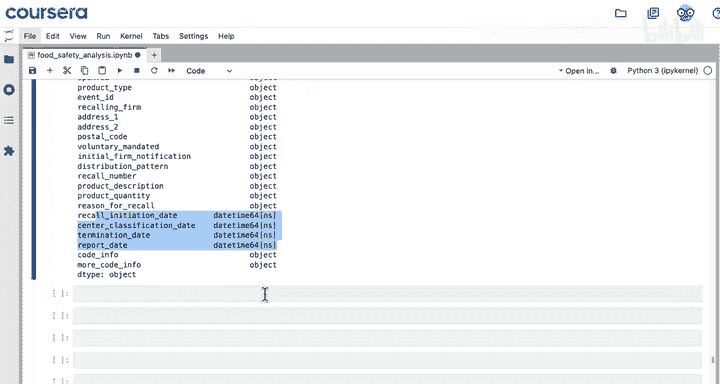

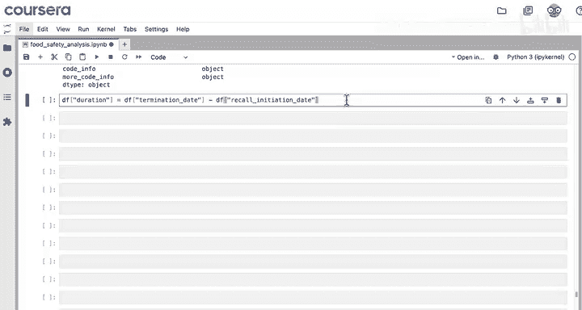

Notice that if you check df infofo there are only about 23700 nonminural durations。

 that's because if you look at the unique values for status。

 some of these cases are still ongoing so there's no termination date yet。

 there are a few ways you can deal with these missing values but one option is to drop those rows in a new data frame called duration Df to proceed with analysis so use Df drop in a subset equals duration which you learn in the previous module remember that subset must be specified as a list checking out duration Df info Now there are 23755 rows。

 you can now sort the data frame from recall initiation date ascending so you now have the data starting in 2008 and go into 2024 duration Df sort values duration if you check out the first few rows。

 some of these cases were closed in just one week。

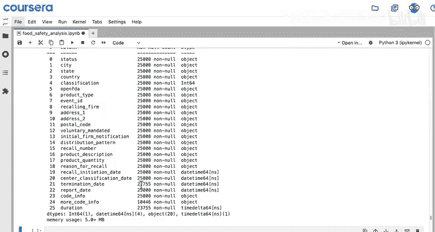

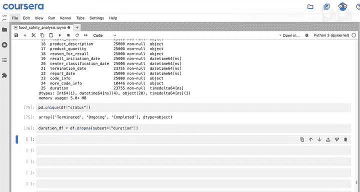

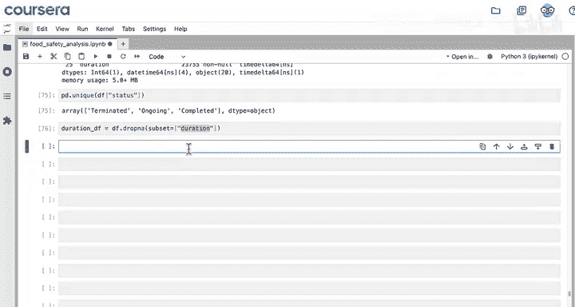

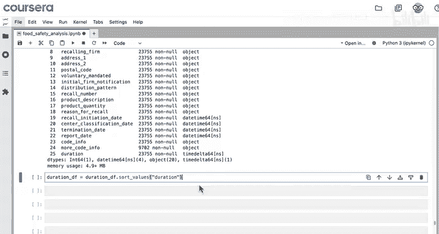

The mean duration is just under a year。Wow。😮，And there's one case that was closed after a while。

 almost 10 years， but 75% of recalls are resolved within 500 days。

 You can now do a bit of plotting for your report。 Iport mapplled。

 Here's some code to graph the duration of requests。 Don't worry too much about the code specifics。

 You can just focus on the insights。 The data is strongly skewed to the right。

 Most cases are resolved within 500 days。 but you can see there are still a few thousand incidents that aren't resolved for more than 500 days to show how recall durations have changed over time。

 You can create a line chart that plots the average duration of recalls that started in each quarter。

 This plot involves grouping your data。

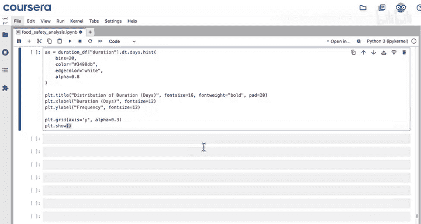

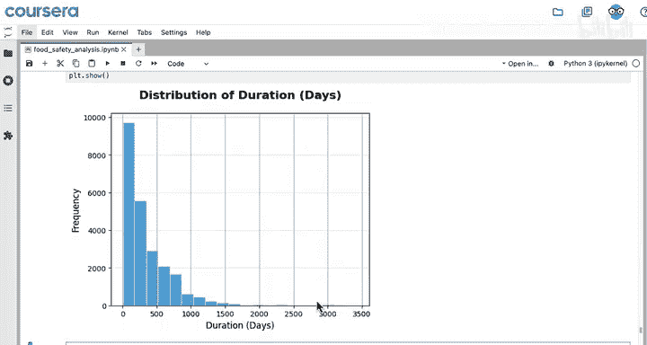

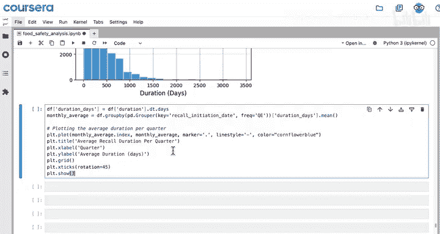

As you can see， recall duration has decreased significantly from 2008 to 2024。

 it's possible some of the more recent decrease in 2024 is due to dropping rows with open cases。

 however， the overall trend is quite clear， this would be a great insight to share with consumers to help them understand the FDA's hard work。

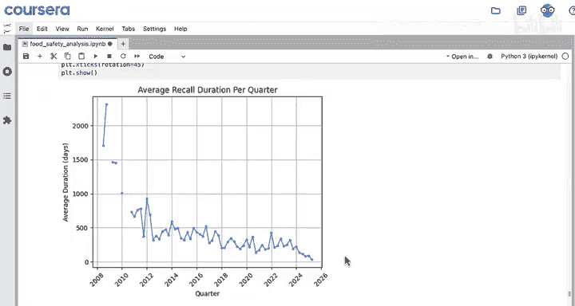

Create work In this lesson you learn how to request structure data from an API and transform JSON into a data frame。

 both web scrapping and making API requests are extremely valuable skills for any data analyst Com up you'll complete the practice assignment and practice La Once you're done follow me to the next lesson API keys。

