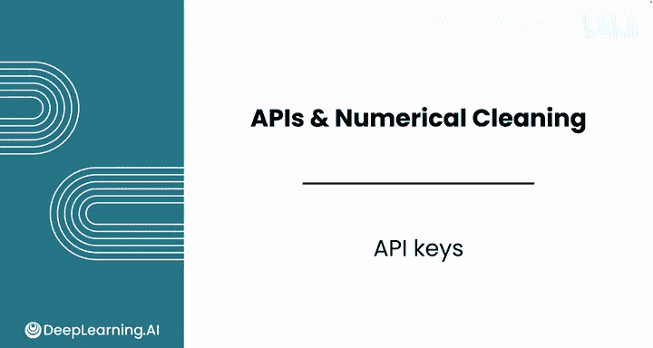
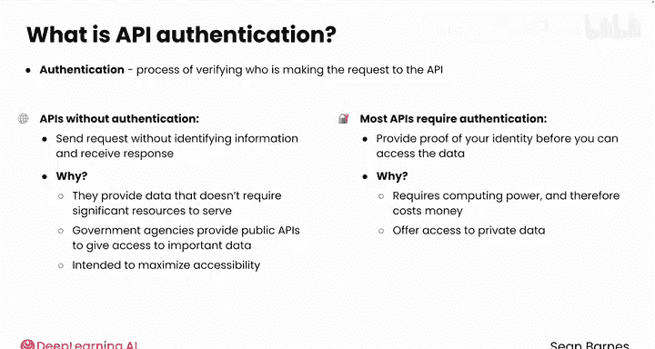
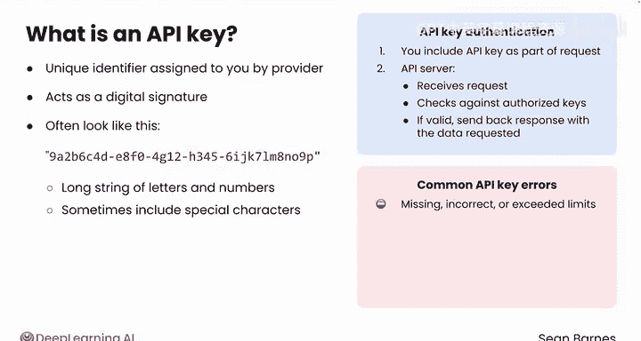

# 吴恩达《数据输入／输出与预处理（Python 和 SQL）Data I／O and Preprocessing with Python and SQL》中英字幕 - P31：30_API密钥.zh_en - GPT中英字幕课程资源 - BV1sZEzzQEkF

In the previous lesson， you learn how to use APIs for collecting structured data from the web。

 but you'll find that many APIs in the wild require a special string called a key to access。

 It's a layer of security you'll have to contend with as a data analyst previously you work with an API that didn't require authentication Aation is the process of verifying who is making the request to the API。

 you perform authentication every time you log into a music or movie streaming account The platform meets to know who's logging in to show you personalized recommendations and to make sure you maintain control over your account。

 accessing an API without authentication means you can send a request without providing any identifying information and still receive a response。

 an API that doesn't require authentication is relatively rare It's nice that the FDA publishes the food enforcement API and makes it openly accessible but most APIs require authentication。

 There are a few key reasons why some APIs do not use authentication First。

 some APIs do not need to track individual users because they provide data that doesn't require significant resources to serve For example。

 a group of hobbyists。

Might maintain a small API for accessing data about their favorite video game。

 They may only get a few hundred requests a month， which is a low cost to maintain。 Secondly。

 many government agencies provide public APIs to give the public access to important data such as public health records these APIs are intended to maximize accessibility so usage restrictions or counteract the ultimate goal。

 However， most APIs do require authentication。 you need to provide proof of your identity before you can access the data。

 there are several reasons why an API might require authentication。

 First running an API requires computing power and therefore cost money。

 the more data you request the more computing power you use。

 companies often track API usage so they can bill you based on what you use Second many APIs offer access to private data。

 For example， Google provides a Google drive API where you can access your own files。

 Aation ensures that each user can only access their own information。

 Third authentication access a safeguard against malicious requests without authentication An users can flood an API。

Excessive requests Ba actors can be identified and blocked more easily One of the most common ways to authenticate API requests is with an API key an API key is a unique identifier assigned to you by the API provider when you register this key acts as a digital signature proving that your requests come from an authorized source API keys often look kind of like this a long string of letters and numbers they sometimes include special characters different APIs format or keys differently when you send a request to an API that requires authentication you include your API key as part of that request the API server receives your request and checks it against its list of authorized keys If your key is valid and you have a necessary permissions the server will send back a response with the data you request however if your API key is missing incorrect or has exceeded its usage limits the server will respond by rejecting your request instead of the data the response might include an error message like invalid API key depending on the specific issue。

Now that you've seen the purpose of API keys and holiday work follows the next video to write code to use an API key。

