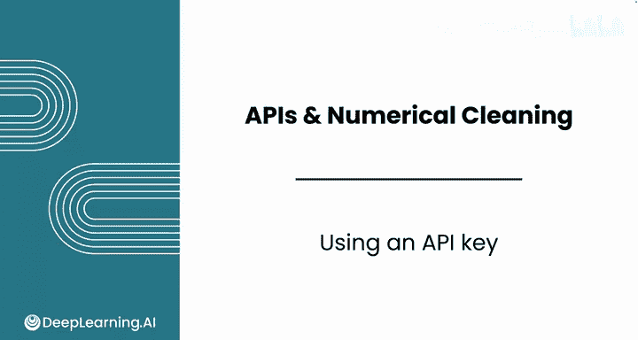
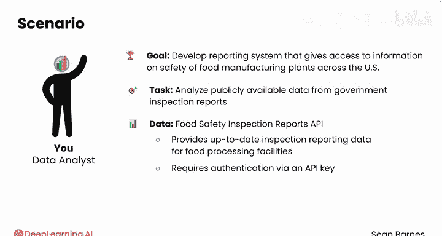
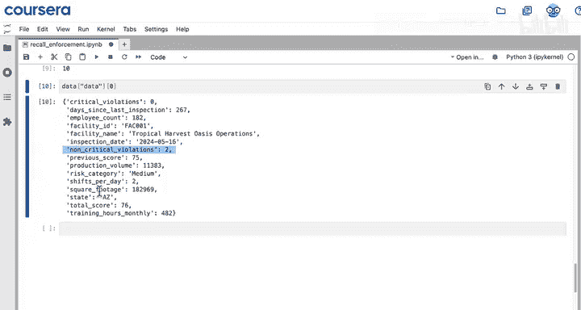
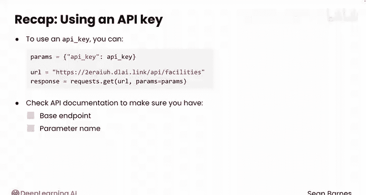

# 吴恩达《数据输入／输出与预处理（Python 和 SQL）Data I／O and Preprocessing with Python and SQL》中英字幕 - P32：31_API密钥使用.zh_en - GPT中英字幕课程资源 - BV1sZEzzQEkF

In the previous video， you learned that many APIs require a key to authenticate access without this key。

 you won't be able to access the data you're interested in in this in the following lessons。

 you'll continue to work with public data to improve transparency and food safety You're starting a new project to develop a reporting system that gives consumers access to up-to-date information on the safety of food manufacturing plans across the United States。

 your plan is to analyze publicly available data from government inspection reports to power your reporting system you've identified and signed up for a food safety inspection reports API which provides up-to-date inspection reporting data for food processing facilities The provider requires authentication via an API key to access you'll learn how to get an API key in an upcoming reading item You set up a new notebook and are ready to start working with the food safety API remember that you can use the practice lab item to follow along with the demos Start by importing the request module。

And here's the base endpoint you'll be using note that the data in this API is generated to be similar in structure to another public inspection Report API This API only has one key。

 which we'll see in a moment， you'll use this API provided by deep learningar。

 AI to avoid having to sign up for a key， Use a gi request to retrieve inspection data。

 try setting a request without a key notice that the PRs dictionary is empty。

Instead of getting back the data you expected， you get an error saying unauthorized invalid or missing API key This error means you need to authenticate your access。

 you't need to do that with these four lines of code。

 This code is something that you'll explore more detail in the next video For now。

 just trust that this loads your API key and saves it into the variable API key this step follows industry standard safety practices If you take a look at API key It's a long string of letters and numbers。

 note that you should never share your API key with anyone This is only for demonstration purposes so you can see what it looks like Once you have your API key you can include it in your request by adding it as a parameter and parameterss what the API key parameter called depends on the API you should check their documentation for this API。

 the parameter is API underscore key Once you send this request the server will check if you have permission to access the data and if everything checks out。

 it will send you back what you requested。As you can see from the data。

 this API contains a list of facility inspections for different facilities in the US at the bottom。

 there's some metadata showing that the limit was by default set to 10 reports at a time with no offset the offset parameter performs the same function as ski and it looks like there's 15000 inspection reports available Check the keys of this data and you have three options this time data。

 metadata and success and the length of the data is 10 which matches the limit This API has a different name for the key that includes the results In this case its data as opposed to results So you have information for each inspection such as facility ID and name which uniquely identify each facility。

 critical and noncritical violations days since last inspection inspection date and some other features related to the characteristics of each facility to recap you saw that to use an API key you can typically add it as a parameter to your PRms dictionary and send it with your request。

 you'll need to check the API documentation to make sure you have the right base endpoint and parameter name first。

You've successfully made an authenticated request and received data back Next up。

 you'll break down the code that loads your API key in more detail so you can see exactly how it works followow me to the next video。

