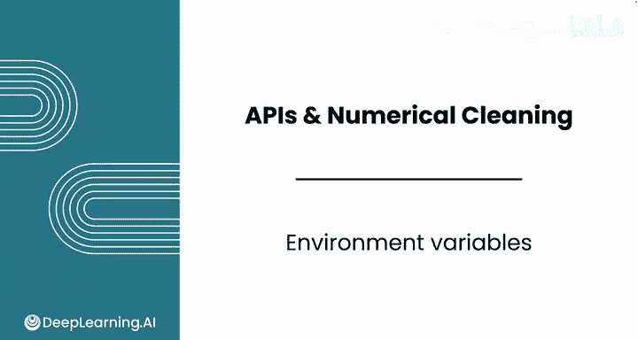
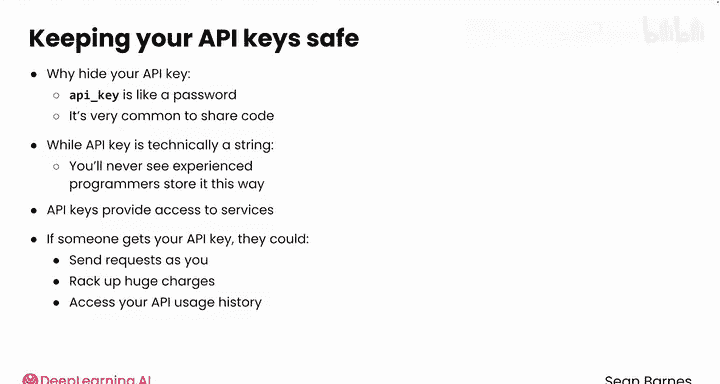
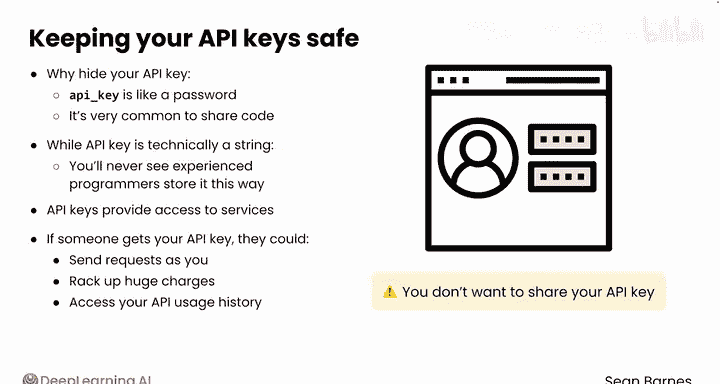
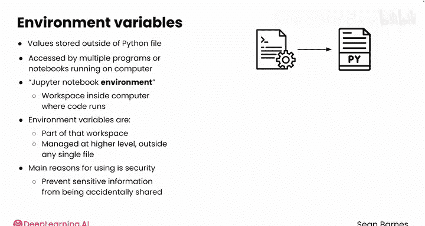
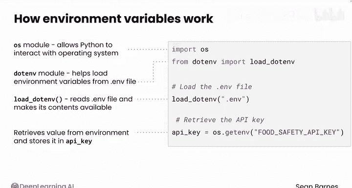

# 吴恩达《数据输入／输出与预处理（Python 和 SQL）Data I／O and Preprocessing with Python and SQL》中英字幕 - P33：32_环境变量.zh_en - GPT中英字幕课程资源 - BV1sZEzzQEkF

You've now successfully made an authenticated request and received data back。

 but it may seem like you loaded your API key。

From nowhere， let's take a step back and break down how the code you saw securely loads your API key。

First question。 Why bother up to hide your API key at all。

 The short answer is your API key is like a password。

 You don't want to just store that password directly in your code because it's very common to share code。

 It would be like storing your email password in a Google doc that share with all your colleagues in programming。

 there are often multiple ways to accomplish the same task you'll often encounter tradeoffs between simplicity and security while an API key is technically a string。

 you will virtually never see an experienced programmer store their API key this way like passwords API keys provide access to services on your behalf if someone else gets their hands on your API key。

 they could send requests as you rack up huge charges on your account or access your API usage history which might contain sensitive informationEssential if someone has your API key。

 their log into your account and if you accidentally upload your key somewhere public it can be stolen later on when you work in a company as a data analyst you'll often need to share your code but you don't want to share your API key you're learning the best practices now to avoid security problems later to key API keys。

You can use environment variables。 Environ variables are values stored outside your python file that your code can access when needed。

 unlike the kind of variables you've been working with so far。

 which exist only inside the program you're running environment variables can be accessed by multiple programs or notebooks running on your computer In this course and the previous one you've heard the term Jupyter notebook environment thrown around environmentron here refers to the workspace inside your computer where your code runs En variables are part of that workspace。

 they are managed at a higher level outside any single file the main reason for using environment variables is security they prevent sensitive information like API keys from being accidentally shared。

 So instead of typing these values directly into your code。

 you store them outside the code and load them when needed。

 the dotv file is where you store your actual secret API keys。

 It's a plain text file that looks like a bunch of string variables each on their own line like this inspection report API key you can even add multiple keys if needed just make sure that this file is never shared or uploaded to a public web。

Now， if you just have an EV file lying around in your computer， it won't do you much good。

 You need to give your Python file access to that information So let's look at the code you use earlier and break it down line by line the OS module allows Python to interact with the operating system。

 including reading environment variables you'll sometimes see OS use for navigating around folders or interacting with files the dot Ev module helps load environment variables from a dot Ev file。

 which you previously created and added your API key to the load dot Ev function reads the dot Ev file and makes its contents available as environment variables API key equals OS do get Ev retrieves the value of food safety API key from the environment and stores it in the API key variables。

Excellent work with API keys You've learned an industry standard security measure that you'll use frequently as a data analyst。

 follow mes the next lesson where you'll work on cleaning the numerical data you've retrieved I'll see there。

