# 吴恩达《数据输入／输出与预处理（Python 和 SQL）Data I／O and Preprocessing with Python and SQL》中英字幕 - P34：33_数据缩放.zh_en - GPT中英字幕课程资源 - BV1sZEzzQEkF

In the previous lesson， you saw how environment variables help you securely load your API key now that you've accessed the data you need。

 it's time to prepare for analysis。 just to recap your role in this project is to help improve transparency and food safety。

 your goal is to develop a reporting system that provides consumers with upto date information on food manufacturers take a look at this data from the API you've chosen At first glance。

 you might think to publish the violation count directly to help consumers compare different facilities violation counts。

 The violation count is how many safety issues a facility had during that inspection。 However。

 facility sizes vary significantly。 a large facility naturally has more room for potential violations So a simple count doesn't tell the full story For example。

 if you were to compare a facility with one violation in 1000 square feet with one that has two violations but is 30000 square feet。

 which would you say is worse。

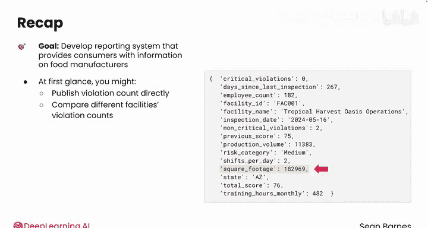

To fairly compare them， you need to scale your data。

 Scing is a technique that adjusts values to a consistent measurement to make comparison faire across different contexts。

 In this case， calculating violations by facility size gives you a more accurate risk measure。

 Let's see how to scale data in Python At this stage in the notebook。

 you've request the data from the API using your API key。

 The response you've received is in JSO format and the data contains information on each facility including details about its size。

 production volume and other valuable information for your analysis。 First。

 you'll want to modify this request to get all the inspection reports。

 you can add a new limit query parameter sets to you 1000。

1000 is the maximum number of results allowed in any given requests to this API。

 you can store by preprocessing these rows to validate your approach。

 then scale up with pagination later。 execute the Git request。

 to convert this data to a data frame use PDd data frame with the list of facilities。

 which is data data。 First import pan as Sd then create your data frame。Check out Df info。

 You have 15 features and 1000 rows。 There are no missing values。

 and many of these features are currently stored as integers， which is nice。

 You can also try Df do described to get a better sense of those numerical features to hit the highlights。

 there's a mean of 1。4 critical violations。 182 days since inspection and 161000 square feet for facility size。

 supposeuppose you want to calculate violations per 100000 square feet to create a scale measure。

 the data set includes details on both critical and non-critical violations to get a more comprehensive view of problems at each facility。

 you can sum the critical and noncritical violations to get count of total violations。

 add this column to your data frame and it appears at the end。

 So if you check out the first facility it has two violations for 182000 square feet。

 while the third facility has four violations but only 116000 square feet to scale this data divide the total violations by that value to get violations per square feet。

 Sa this to as a new column in your data frame。😊。

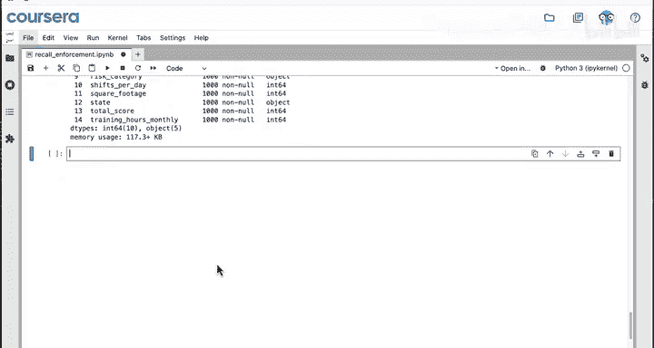

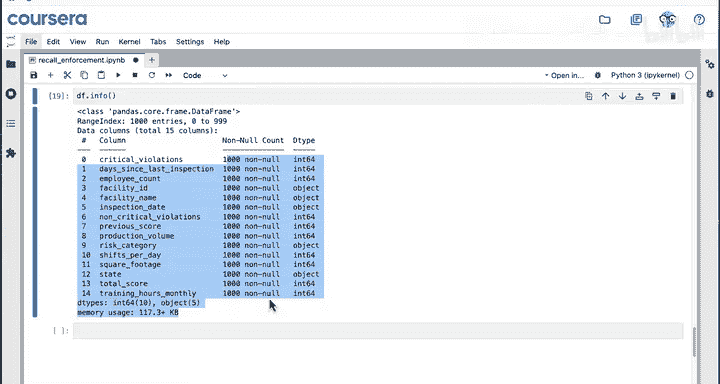

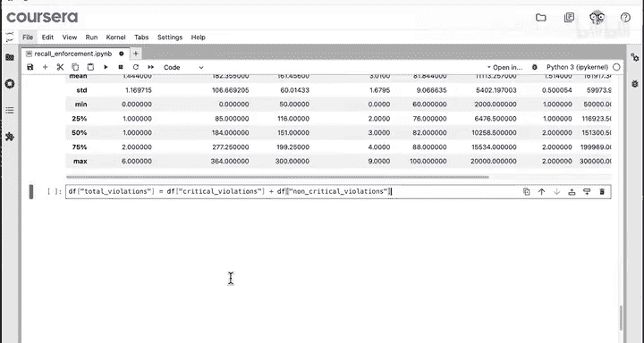

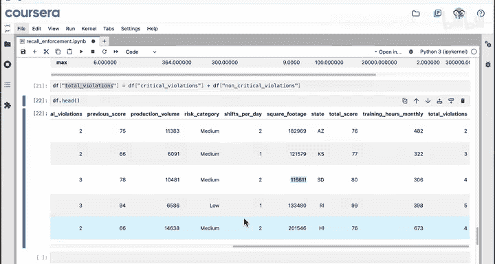

If you look at Df dot head again， notice that the scale violations are really small。

 that's because most of these facilities are quite large with only a few violations to make this measure easier to interpret。

 you can multiply by 100000 to convert this feature to violations per 100000 square feet。

 you can then describe this column to see summary statistics。 For example， the mean is about 3。

2 violations per 100000 square feet。 Now， if you take a look at the first few rows again。

 the first facility has a scale violation count of 1。09 while facility 3 has 3。

43 So it's a much fairer comparison and a better reporting metric for consumers。

 So the first facility has a scale violation count much less than the average While the third facility is much closer to the average。

 Finally， to improve readability， you can use the round method to round to 2 decimal places。😊。

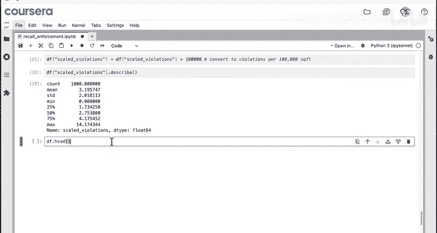

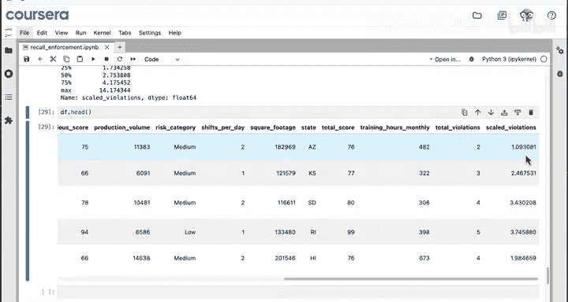

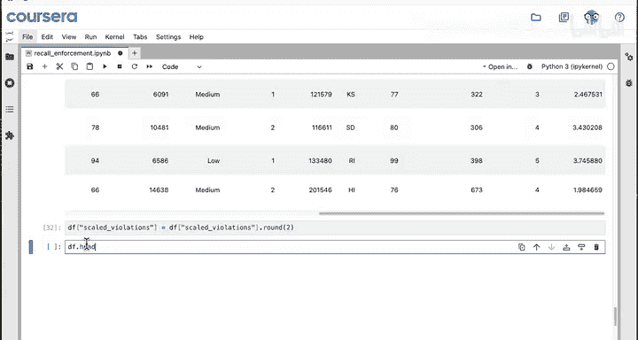

The only argument needed is the number of decimal places you want to round to。

 Check out the results to see if the rounding work correctly。

 Now you can check out a scatter plot a facility size against scale violations to really identify outliers。

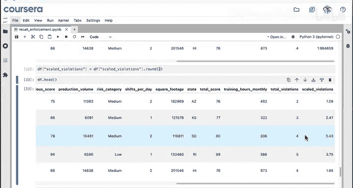

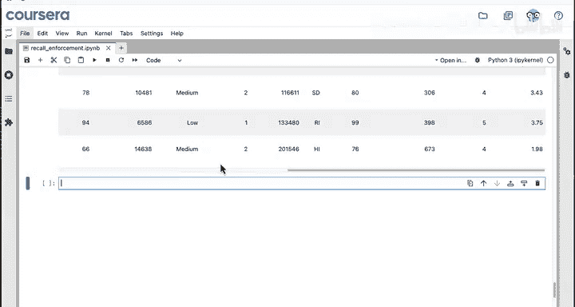

Notice that larger facilities generally have fewer violations per 100000 square feet。

 while smaller facilities are greatly affected by having just a few violations。 in this video。

 you calculated violations per 100000 square feet to make comparisons across facilities。

 You scale violation count by dividing it by the square footage。

 then multiplying by 100000 to get violations per 100000 square feet。

 You also saw how to use the round method on a series with the number of decimal places as the only argument。

 Scing helps transform raw numbers into meaningful comparisons。 Next up。

 you'll explore a technique for grouping numerical data into meaningful categories。

 I hope you'll join me there。😊。

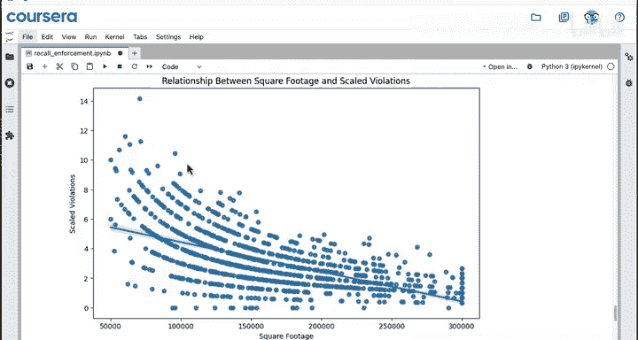

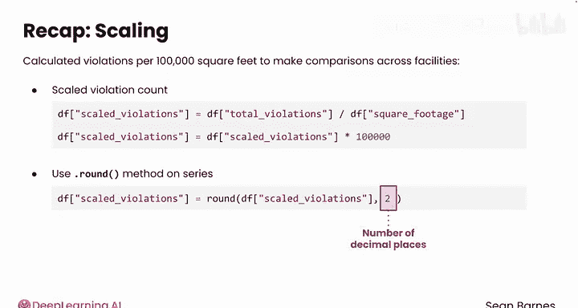