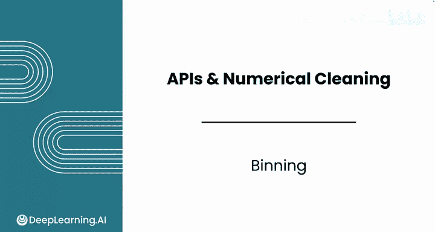
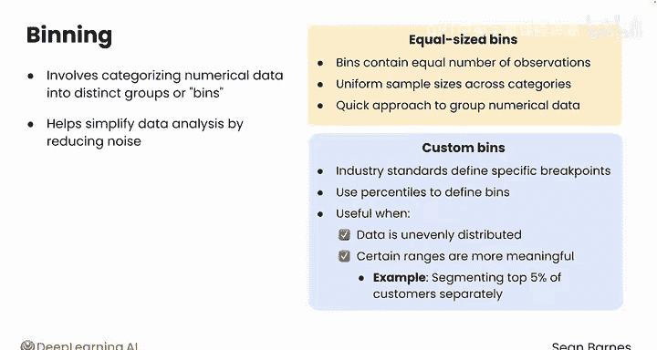
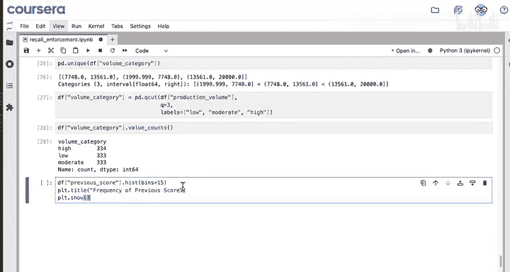
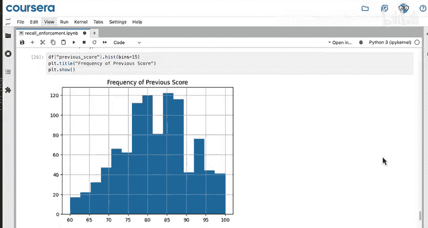
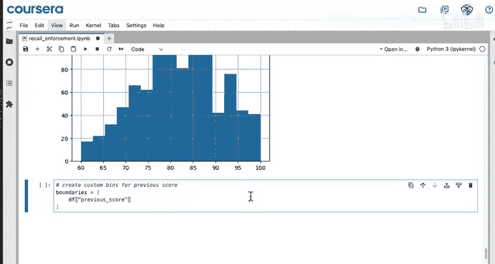
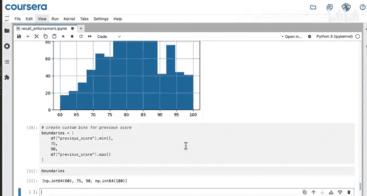
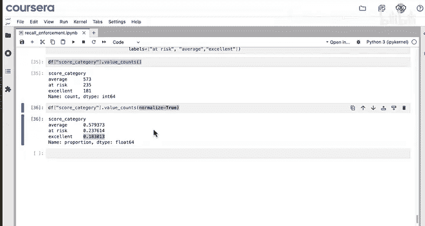
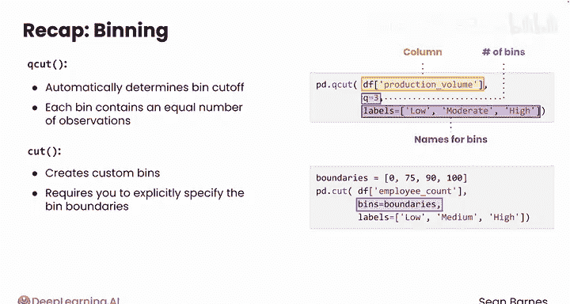

# 吴恩达《数据输入／输出与预处理（Python 和 SQL）Data I／O and Preprocessing with Python and SQL》中英字幕 - P35：34_分箱处理.zh_en - GPT中英字幕课程资源 - BV1sZEzzQEkF

In the last video， you saw how scaling adjust numerical values to a common scale and makes comparisons fair across different contexts。

 Another way to make numerical data more interpretable is to group it into meaningful categories。

 binning involves categorizing numerical data into distinct groups or bins this process helps simplify data analysis by reducing noise there are two general approaches to binning using equal size bins also known as quantile binning or using custom bins with equal size bins。

 you divide the data into bins that contain an equal number of observations。

 ensuring uniform sample sizes across categories it's a quick and dirty approach to help group numerical data。

 Your other option is to create custom bins。 For example。

 industry standards might define specific breakpoints。

 or you may want to use percentiles to define bins  custom bins are particularly useful when the data is unevenly distributed in particular if it's highly skew or if certain ranges are more meaningful For example。

 if you want finer granularity for specific portions of the data like segmenting the top 5% of customer separately let's revisit the data set of food production。

Facilities to see how this works At this point， you've got a data frame with all the data on each facility。

 including its size， production volume and more key information。

 You also created the scaled violations call。 you'd like to enable consumers to quickly identify major production facilities in their area。

 So you've decided to categorize production volume into low， moderate and high bins to do that。

 you can use the Q cut method， which stands for quantntile cut to create categories based on production volume。

 The first argument is the column you want to bin。 Then you'll use the named argument Q to specify the number of groups you want。

 Check out this column。 You can look at the unique values。 notice these are actually intervals。

 It's a bit inconvenient。 If you prefer something more readable。

 you can modify this function to add names to these bands as well。

 Just add another named argument labels with the list of labels you like such as low。

 moderate and high。😊，Now， take a look at the value counts of this category。

 notice that each bin is essentially equal。 Of course， there is some rounding error。

 but for all intents and purposes， these bins are equal。 Take another case。

 let's look at the histogram of the previous score feature。

 Sa these scores are categorized as at risk if it's less than 75 average if they're between 75 and 90 and excellent if the scores are above 90。

 regardless of how frequently these scores are achieved you could create custom bins for this feature to do that。

 Def a list of boundaries。 Since you have three bins。

 you'll need four boundaries The two sides and the two cuts in the middle for the lower and upper boundaries。

 you can use the min and max of your data， then add 75 and 90 so that 60，75，90 and 100。😊。

Now borrow the same Q cut code as before， but this time the function is cut instead of Q。

 use the named argument bins and set it equal to boundaries。

 the list you just defined Add labels for at risk， average and excellent。 Co。

 check out the value counts。Quick tip by the way， you can use the named argument normalized to convert your value counts into proportions So 58% of facilities are average 24 are deemed at risk and 18% are excellent。

 This would be a helpful metric to report to consumers so they can understand what progress is being made to improve these scores to recap the Q cut function automatically determines bin cutoff so that each bin contains an equal number of observations The first argument is the column of data you want to bin then you can use Q to specify the number of bins and labels to provide a list of names for those bins。

 you also learned about the cut function which creates custom bins This method requires you to explicitly specify the bin boundaries by supplying a list to the named argument bins。

You've just seen two methods for grouping numerical data and learn how to choose between them in the next video you'll learn how to improve the interpretability of your data using normalization。

