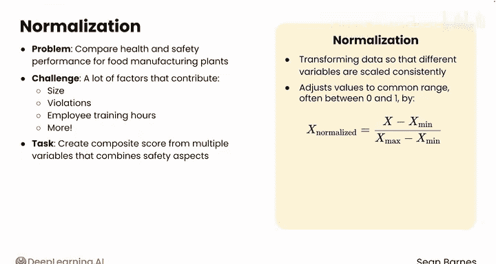
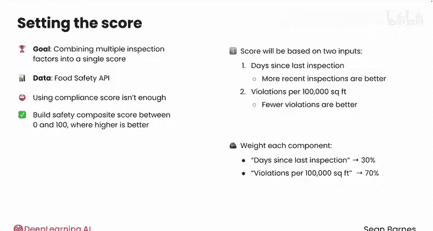
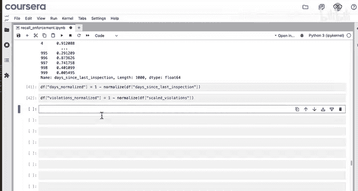
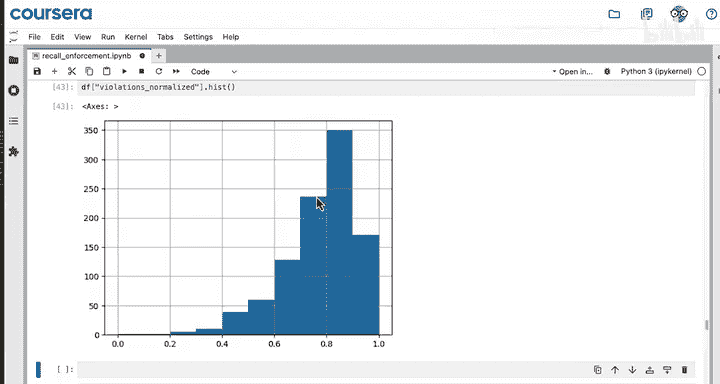
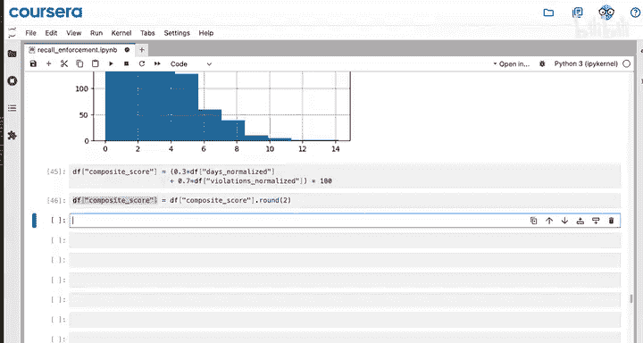
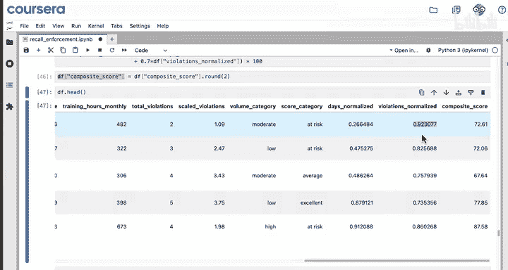
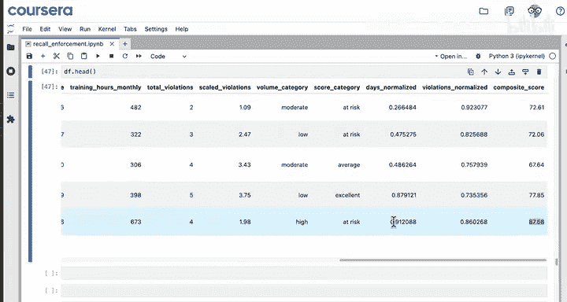
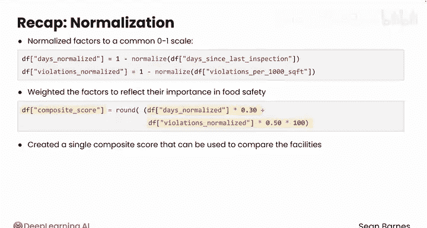

# 吴恩达《数据输入／输出与预处理（Python 和 SQL）Data I／O and Preprocessing with Python and SQL》中英字幕 - P36：35_数据归一化.zh_en - GPT中英字幕课程资源 - BV1sZEzzQEkF

In the last video， you learned two bidding methods for categorizing numerical data In this video。

 you'll see how to make your data even more meaningful for your stakeholders。

 Just a reminder you're trying to compare health and safety performance for food manufacturing plants。

 but there are a lot of factors that contribute to a facility safety size violations employee training hours and more you could create a composite score from multiple variables that combines all aspects of safety into one number This score will be more interpretable for consumers before creating the score you will need to apply normalization normalization is the process of transforming data so that different variables are scaled consistently normalization works by adjusting values to fit a common range often between zero11 by subtracting the minimum value and dividing by the range This method is called main max normalization though you have other options Z scoring is another common method of normalization you've seen previously normalization ensures no single variable dominates just because of its scale For example。

 if you wanted to include employee count and square footage in the score you'd have one feature typically in the hundreds。

And another that's typically in the hundreds of thousands。

 So square footage in this case would have a disproportionate impact on the score normalization allows you to compare different variables on the same scale。

 making it easier to assess the relative values。 So your goal is to create a composite score that combines multiple inspection factors to do that you have access to the food safety inspection API the API includes a total score but you don't have any information about how it was constructed to improve transparency you will create your own to do that you'll build a safety composite score that will be a single number between0 and 100 where higher is better This score will be based on two specific inputs。

 First days since last inspection。 more recent inspections are better and second。

 violations per 100000 square feet fewer violations are better you'll normalize each one so that it's on a scale of0 to1 Finally。

 you'll need to weight each component how much of the score should it make up days since last inspection will contribute 30% while violations per 100000 square feet will contribute 70%。

At this point in the notebook， you set up a data frame with information on each facility。

 including creating the scaled violations column of violations per 100000 square feet。 First。

 you'll want a min max normalize your two inputs， so they are on a common scale of 0 to1。

 Let's import a helper function to do this calculation。 This function normalize。

 just takes in a column of your data and returns that column normalized。

 It calculates each value minus the min divided by the range， which is the maximum minus the minimum。

 This transformation ensures that the smallest value in this series becomes 0。

 the largest becomes1 and everything else falls in between。

 Take a look at the output of normalized of days since last inspection。 It's a series。

 the same length as the column， but on a 0 to1 scale。 Facility 999， for example。

 has almost the highest days since last inspection。😊。

Before saving this into a column you'll want to subtract it from one。

 that's because in the composite score higher values are actually worse。

 the longer it's been since your inspection， the more that should negatively impact your score。

 this way facilities with the most recent inspections get a higher score save out into a new column days normalized。

Now do the same for violations， this one too is inverted since fewer violations are better。

 check out the histogram of the normalized violations compared with the scale violations。

 the distribution is exactly the same， just flipped。

With both factors normalized to a common  zero to1 scale。

 you can calculate the composite safety score by calculating a weighted average days since last inspection contributes 30%。

 and violations per 100，000 square feet contribute 70%。Finally。

 multiply the result by 100 so that your score ranges from 0 to 100 and round it so that you have easier to interpret integers instead of floats。

 save the result as a new column of the data frame。Cool， let's check out some examples。

 So for tropical Harst Oasis operations， it's been 267 days since their last inspection and they had 1。

09 violations per 100000 square feet。 their normalized day score wasn't helping them a ton at only 0。

26 which is a lot can change in 267 days， but they did score high for normalized violations。

 keeping them lower per square foot their composite score was around 73 so pretty good but not great Har Harst pantry house on the other hand scored at 87 15 points higher。

 they scored well for days since last inspection since it's only been about a month。

Let's recap before we end this lesson in this video。

 you normalize different factors to a common zero to one scale using a helper function for Min maxmobilization。

 weighted the factors to reflect their importance in food safety and created a single composite score that can be used to compare the facilities。

You've just created a scoring system so that consumers can quickly assess food safety risks across facilities one common situation in numerical data is outliers。

 unusual values follow me to the next video to see how to identify them。

