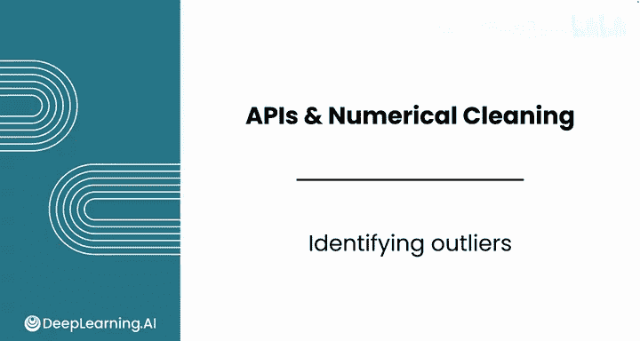
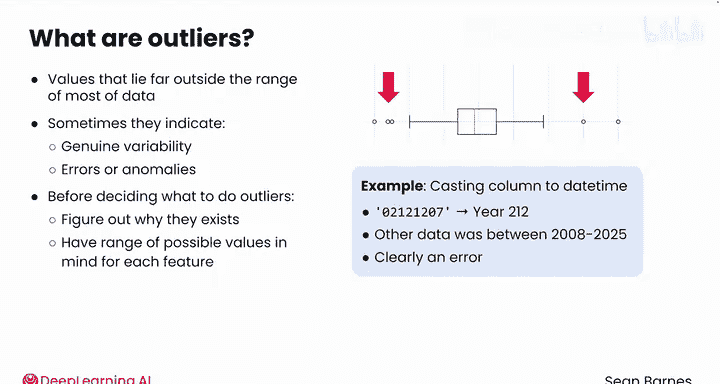
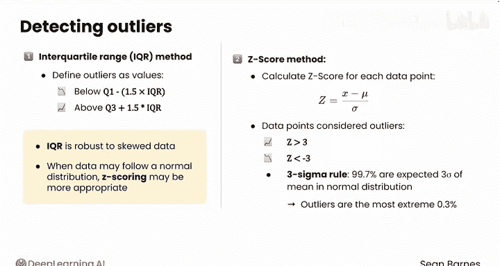

# 吴恩达《数据输入／输出与预处理（Python 和 SQL）Data I／O and Preprocessing with Python and SQL》中英字幕 - P37：36_异常值识别.zh_en - GPT中英字幕课程资源 - BV1sZEzzQEkF

好。Outliers are unusual values in your data set。 They can be challenging to define and handle。

 Let's take a look。As the name suggests， outliers are values that lie far outside the range of most of your data back in applied statistics for data analytics。

 you saw outliers represented as the individual data points beyond the whiskers of a box plot outliers are tricky to understand Sometimes they indicate genuine variability and sometimes their errors or anomalies it can be difficult to tell between these two cases before deciding what to do with any outliers it's important to figure out why they exist。

 you should have a range of possible values in mind for each feature For example。

 in an earlier video you ran into an issue casting a column to date times with pans on examining the problematic value you found that the date represented the year 212 while all the other data was between 2008 and 2025 that's clearly an error rather than genuine variability。

You have a few methods for identifying outliers。 One option is the intercorrtile range or IQR method。

 which is used to identify outliers in a box plot。 This method defines outliers as values below the first quartile -1。

5 times IQR or above the third quartile plus 1。5 times IQR。

 Another approach that works well for normally distributed data is the Z scoring method。

 In this method， you calculate the Z score for each data point by subtracting the mean and dividing by the standard deviation。

 Typically， data points with the z score greater than 3 or less than negative3 are considered outliers。

 Do you have an intuition about why。Thinking back to the 3 Sigma rule， you know that 99。

7% of data points are expected to fall within three standard deviations of the mean in a normal distribution。

 so here outliers are defined as the most extreme 0。3% of values， similar to the medium。

 the IQR is more robust to skew data when you suspect your data may follow a normal distribution。

 Z scoring may be more appropriate。

Now that you're familiar with the steps for identifying outliers。

 follow me to the next video to see how to handle those outliers。

