# 吴恩达《数据输入／输出与预处理（Python 和 SQL）Data I／O and Preprocessing with Python and SQL》中英字幕 - P38：37_异常值处理.zh_en - GPT中英字幕课程资源 - BV1sZEzzQEkF

You shouldn't just stop at identifying outliers。 Once you define which values in your data or outliers。

 you should choose a method for dealing with them。 Once you've identified outliers。

 there are three options for how to proceed。 You'll notice these options are similar to your options for handling missing values。

 First， you can choose to remove them。 If the outlier is clearly an error dropping it makes sense。

 Just be careful not to remove outliers without a justification。 Another option is to keep outliers。

 but analyze them separately。 Sometimes outliers tell an interesting story。

 but would skew analysis of the other data points。 Finally， you could transform them。

 You can replace extreme values with a predefined percentile or use a log transformation。

 These processes are a bit more advanced and outside the scope of this course。

 Feel free to explore these concepts with an LLM to learn more。

 say you've been asked to take a look at the number of training hours。

 The different facilities provide your colleague is concerned that it has some outliers and has suggested dropping most of them。

 You're looking to calculate the mean number of training hours per employee。

 Let's take a look and code At this point in the notebook。 you set up a data frame with information。

😊。

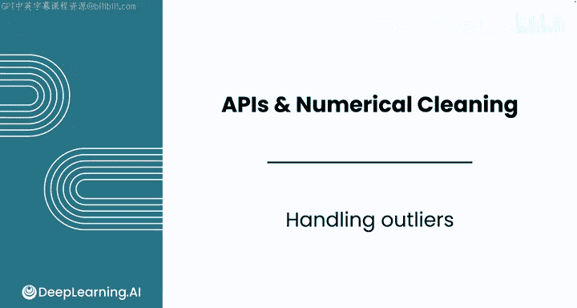

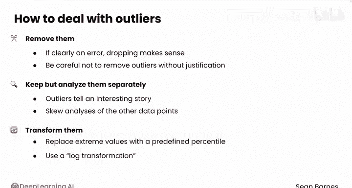

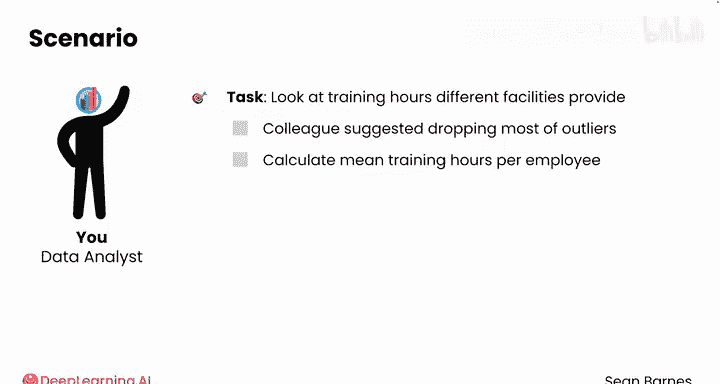

On each facility， including creating the scaled violations column and you've also created a composite score before doing anything else。

 let's standardize this training hours monthly column because these facilities have different numbers of employees createate a new column with the training hours a monthly divided by employee count So the first three facilities all have about 2。

6 hours per employee then about 3 hours than about 3。

3 hours so these all seem pretty consistent Your next step might be to look at the histogram of this feature to figure out whether this data might follow a normal distribution that will help you determine whether you should use the IQR or Z score method to identify outliers So this is a strange looking histogram Let's check out describe to see if we can learn more about the distribution of this data。

When you look at these statistics， what stands out the most is this maximum value of 68。

 so that's probably an outlier， which is why we only got one big bar for the histogram。

 but otherwise you can see that the mean and the median are relatively equal。

 so this still looks like it could be a symmetric distribution。

 so it's reasonable to use the Z scoring method to identify outliers。

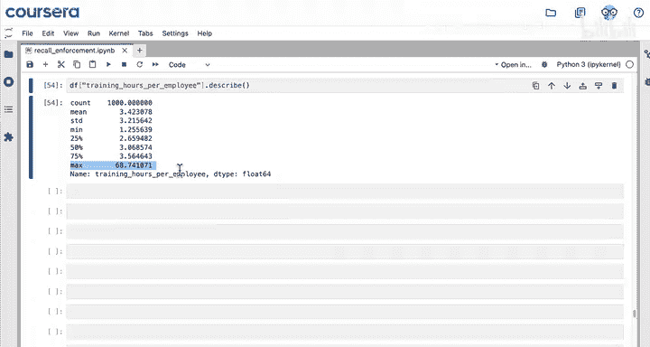

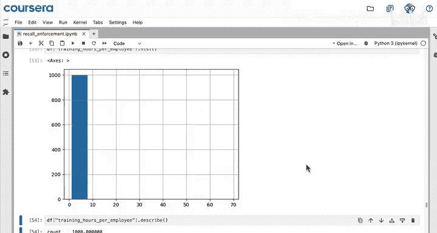

Create a new column for Z scorere。Then calculate each value minus the mean and all that divided by the standard deviation。

 First， let's visualize the distribution of training hours per employee using a box plot from this visualization。

 you can see that there's three data points that are well outside the range of the rest of the data。

 These are excellent candidates to filter out explicitly from your data 40 or more training hours per employee per month seems like pretty extreme。

 so these are probably errors。So the next step here would be to filter out those extreme values and based on your intuition。

 you could probably conclude that it's unrealistic to have more than 20 training hours per employee in a given month。

 remember you may want to scale up your analysis later to the full data set so you want to give yourself some room to exclude additional outliers that you may observe So now that you've removed those extreme outliers it may be useful to plot the remaining distribution in a histogram based on this visualization it looks like there's a couple things going on here there's a bigger cluster distribution center somewhere around three training hours per month and then there's this smaller cluster of points that have a few more training hours per month Let's explore using the z scoring method to see if we can systematically separate these two clusters So to calculate the Z score you're going to subtract the mean from each training hours value and then divide by the standard deviationation from the histogram it doesn't look like there's any outliers on the lower end so you can segment your data by only filtering the outliers out that have a z score greater than3 So let's create two segments in the data The first one will have data points that have a z score less than or equal to3 and the outliers will have z。

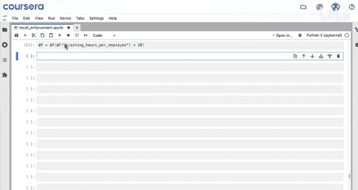

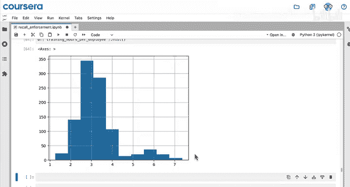

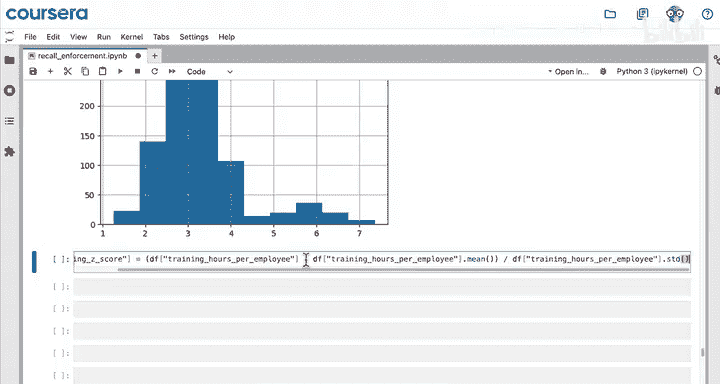

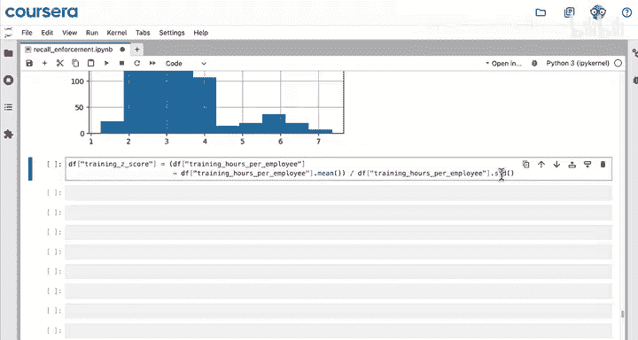

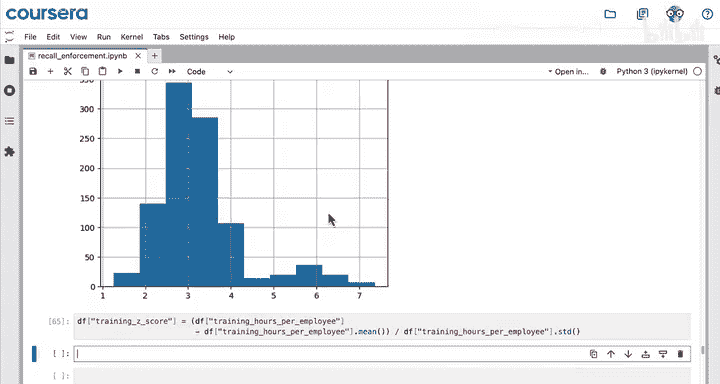

Or greater than threeNow let's analyze these two segments of data to understand the differences between these two clusters。

 Let's take a look at the production volume for each of these two segments。

 the outliers and the nonoutliers It looks like the mean production volume for the nonoutliers is just under 11000 units and the production volume for the outlier population is around 20000 So it looks like the facilities that have higher training hours per month per employee have production volume that significantly higher on average so this result may prompt you to dig a little further into the differences between these production facilities。

 one potential conclusion you could draw is that investing in higher employee training per month might lead to higher production volume on average。

 but another possible conclusion is that it's not the training hours itself that leads to higher production but perhaps these facilities include specialized employees that require more training Now you could take this analysis further with inferential statistics but you've seen how to handle outliers both by dropping erroneous ones and separating out legitimate ones for analysis。

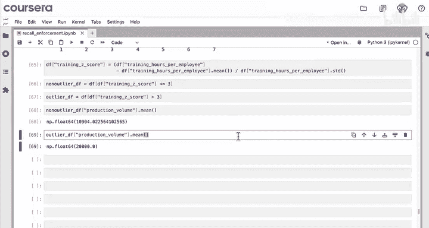

Great work handling outliers new data。 You're almost to the end of this module。 In the next video。

 you'll learn how to identify high and low quality data sets before starting your analysis。😊。

