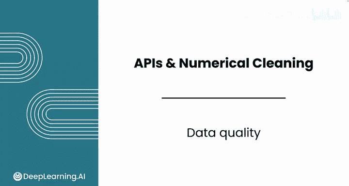
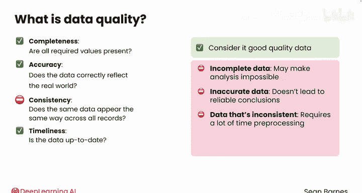
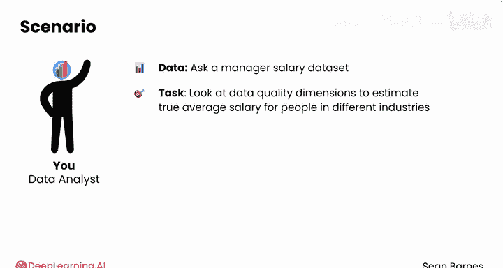
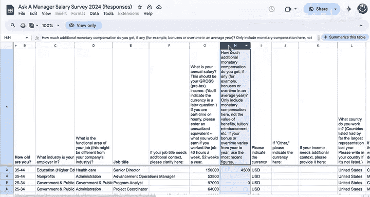
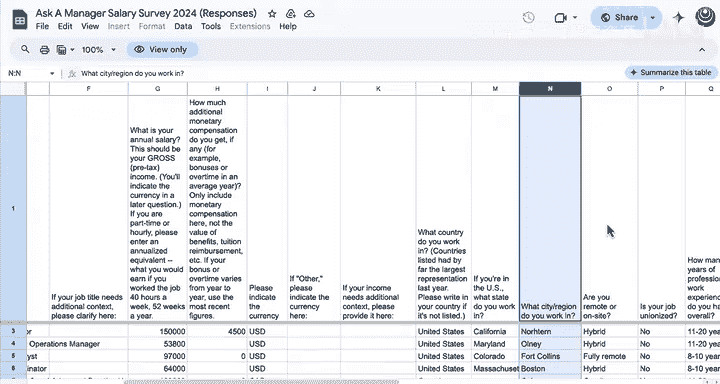
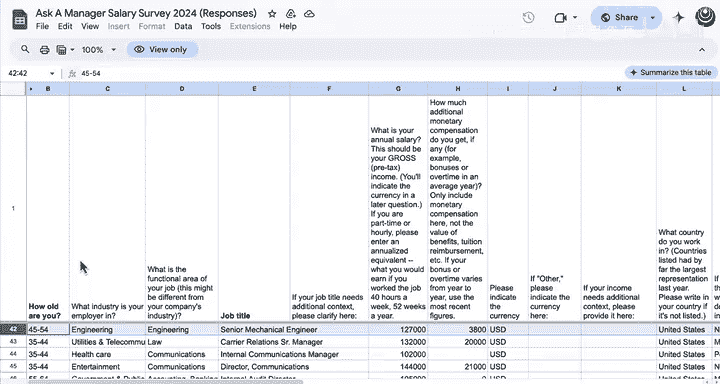

# 吴恩达《数据输入／输出与预处理（Python 和 SQL）Data I／O and Preprocessing with Python and SQL》中英字幕 - P39：38_数据质量.zh_en - GPT中英字幕课程资源 - BV1sZEzzQEkF

As a data analyst， it's crucial for you to understand the quality of your data low quality data can create headaches down the road or even lead you to incorrect conclusions Datas are of varying quality and you'll work with both high and low quality ones throughout your career Sometimes a low quality data set is the only one available and you may still be able to extract valuable insights from it data quality can be broken down into four key dimensions First completeness are all require values present Second accuracy does the data correctly reflect the real world。

 Third consistency does the same data appear the same way across all records and fourth timeliness is the data up to date if your data is complete。

 accurate， consistent and timely， you can consider it to be good quality data Each of these dimensions creates different issues in your analysis。

 for example， Incomplete data may make analysis impossible while inaccurate data will allow you to perform analysis that doesn't lead to reliable conclusions data that's inconsistent requires a lot of time spent and pre-processing while data that isn't timely can make your conclusions less generalizable。

Note that these dimensions relate to your business problem。 What counts as timely， for example。

 may differ depending on the question you're trying to answer。

 You've encountered the Ask a manager' salary dataset set multiple times throughout this program。

 It's so fascinating because it's so messy。 Let's take a look at the data quality dimensions from a perspective of trying to estimate the true average salary for people in different industries。

 here are the survey responses from 2019。 right away from the dimension of timeliness。

 if you're trying to figure out the current true average salary by industry that you're missing out on the pandemic and several years of inflation。

 from a timeliness perspective， this may not be the most useful data For completeness。

 it looks like most rows are filled out but it would be worthwhile to determine how many missing industries and salaries there are since you need those for your analysis。

 As far as accuracy， this data is all selfreed。 you don't have any way of verifying that these people are telling the truth from a consistency point of view。

 the quality of this data really suffers As you've seen， for example， in this row 245。

 you have someone who's working in fintech。 they are a corporate social responsibility manager。

And they make what looks to be $1。7 million， but they have put the currency in this other category for any other currencies。

 you'll need to analyze those separately and even identifying them may be challenging since this is a plain text field。

 you've also seen these salary inconsistencies before This person put 90K instead of 90000 This person put 42000 ish and this person included their health insurance stipend。

 so you'd have to do a lot of text processing， maybe with some regular expressions to try to remove all of the text and symbols as well as account for shorthand。

 What's fascinating about the data set is that this survey still exists。

 and the owners of the survey have actually updated their questions and addressed a lot of the issues you just identified。

 So here's the data from 2024。 Each row is still a survey response but check out the questions for example。

 now they distinguished between the industry of your employer and the functional area of your job。

 For example， this person is an education but they work at healthcare So it could be， for example。

 a director of student health services at a university they've also separated out gross income and additional compensation they separate。

country， state and region。 So the consistency is much improved。 regarding completeness。

 it also looks like most of the fields were required。 The salary field appears to be all numeric。

 So this is much higher quality data， not only is it more recent but it's more complete and consistent。

 Still， this data suffers on that accuracy dimension。

 You still don't know if these people are really reporting their true salaries。

 It's possible that this is a bias survey that only circulated in certain communities or only circulated among high incomecome individuals but these are all dimensions of data quality you should examine before you start working with the data。

 Ask yourself the hard questions。 I this data really better than nothing。

 I this really going to help answer the business question I'm trying to solve or create more confusion。

If just seen why data quality checking is one of the most important aspects of your data analysis。

 you should always perform a quality check before you begin preprocessing。

 and that takes you to the end of this lesson you're almost to the end of this module Once you've completed the practice lab and practice assignment。

 you'll complete the graded items for this course in the graded lab you will use census data to identify vulnerable populations for a nonprofitfi once you're done。

 I'll see you in the next module which is all about databases。

