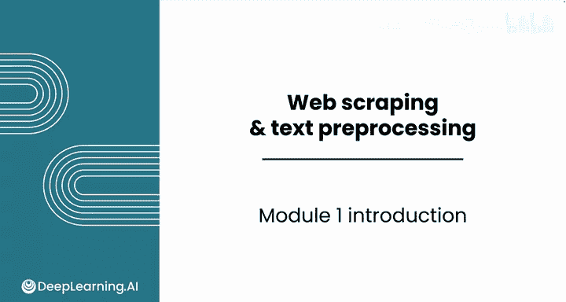
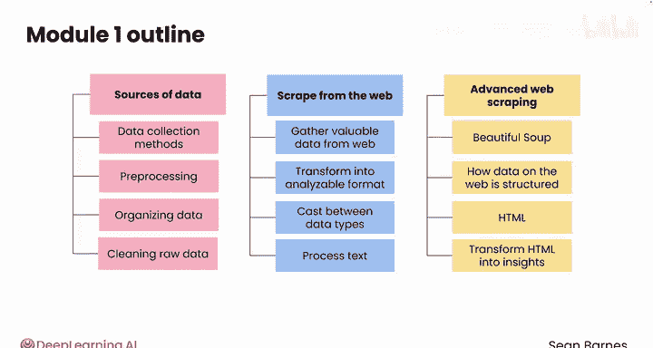

# 吴恩达《数据输入／输出与预处理（Python 和 SQL）Data I／O and Preprocessing with Python and SQL》中英字幕 - P3：2_模块1 简介.zh_en - GPT中英字幕课程资源 - BV1sZEzzQEkF

Welcome to module1 of this course web scraping and text processing This module will give you the foundational tools to handle data harvested from real- worldd websites with a focus on collecting it and preparing it for analysis In the first lesson。

 you'll learn about the various sources of data and see how different data collection methods serve unique business needs you'll also explore how pre-processing organizing and cleaning raw data plays a vital role in preparing data sets for effective analysis In the second lesson you'll learn how to scrape structured data from the web you'll write code to gather valuable data from the web and transform it into an alyzable format you'll learn how to cast between data types and process text with common methods like contains。

 replace， split and strip In the third and final lesson you'll tackle more advanced web scraping challenges using the wonderfully name Python module beautiful suit you'll explore how data on the web is structured using HTML and how to transform that raw HTML into actionable insights。

😊。

By the end of this module， youll have mastered the foundational skills of sourcing data from the web and processing that data so it's ready for analysis。

 I promise it will be so satisfying。 Let's get started in the next video。😊。

