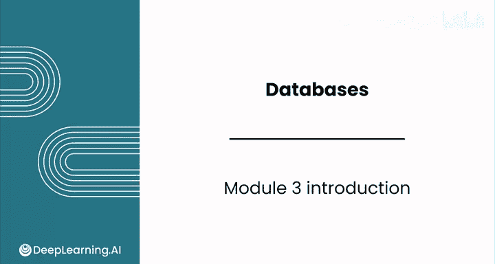
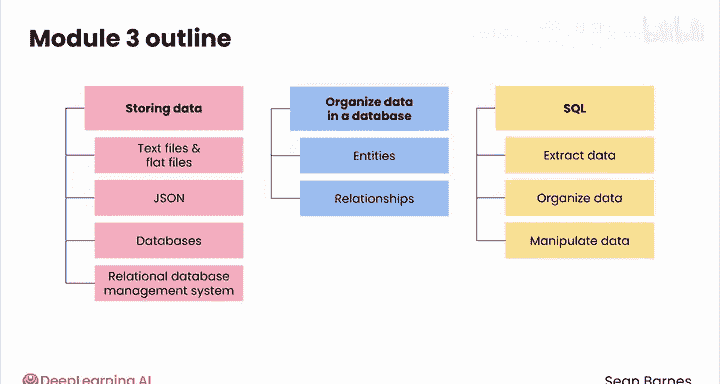

# 吴恩达《数据输入／输出与预处理（Python 和 SQL）Data I／O and Preprocessing with Python and SQL》中英字幕 - P40：39_模块3 简介.zh_en - GPT中英字幕课程资源 - BV1sZEzzQEkF

Welcome to module 3 databases Throughout this module you'll learn the fundamentals of working with data in a database。

 Datas are ubiquitous in business where they help manage large volumes of data efficiently。

 In your first lesson， you'll explore the many options for storing data including text files。

 flat files， structure formats like JO and databases。

 you'll learn how the choice of a data storage system can impact your work as an analyst。

 you'll also learn how databases are managed by software called the relational database management system Moving into the second lesson。

 you'll learn how to organize data effectively in a database。

 you'll model how databases represent real-wd entities and relationships。 In the final lesson。

 you'll start writing SQL， a programming language specifically designed for accessing data in a database。

 It's one of the most inded skills for analyst today through handson practice。

 you'll learn to extract， organize and manipulate data techniques that will build a strong foundation for more advanced preprocessing and analysis in the final module of this course By the end of this module。

 you'll feel comfortable retrieving。😊。

Limiting and sorting data from a database， as well as explaining how they work and their strengths。

 Let's get started in the next video with data storage systems。

