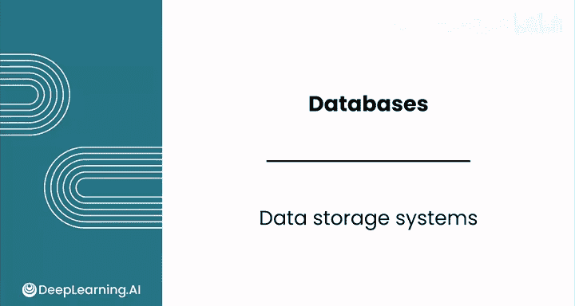
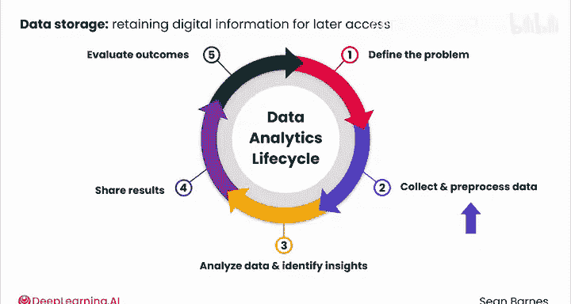
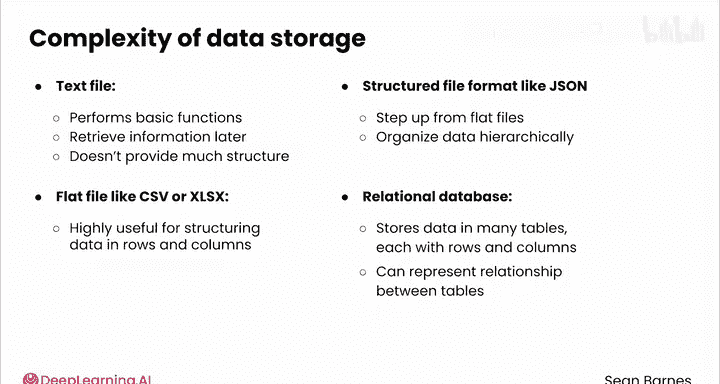
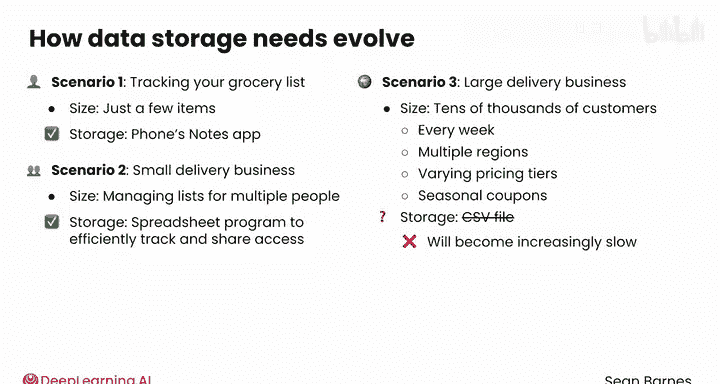
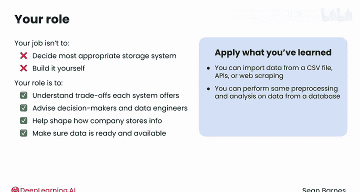

# 吴恩达《数据输入／输出与预处理（Python 和 SQL）Data I／O and Preprocessing with Python and SQL》中英字幕 - P41：40_数据存储系统.zh_en - GPT中英字幕课程资源 - BV1sZEzzQEkF

Data can be stored in many ways， depending on its structure and complexity as well as the business needs。

 now that you've seen multiple methods of data input， flat file， web scraping， API。

 you're prepared to learn the nuances of where data is stored Data storage refers to retaining digital information for later access and data analytics foundations you learn the five steps of the data analytics lifecycle。

First， define the problem。 Second， collect and preprocessed data， third。

 analyze data and identify insights。4， share results。 and fifth， evaluate outcomes。

 Before you can even begin analyzing the data or sharing the results。 Step 3 and 4。

 your data will need to be stored in step 2， where and how your data is stored directly impacts how easily you can draw insights from it。

 In fact， data storage is a matter of some complexity。 As you learned earlier in the program。

 theres an entire role， the data engineer dedicated to collecting and storing data。

 In order of increasing complexity， data can be stored in a text file。

 a flat file like CSv or Excelsx， a structured file format like JSO or a relational database。

 A text file performs the basic functions of data storage by allowing you to retrieve information later。

 but it doesn't provide much structure。 A CV file is highly useful for structuring data and rows and columns。

 JSO， as you saw in the previous module is a step up from flat files because it can organize data hierarchically。

 However， the ultimate data storage mechanism。

The relational database， which stores data in many tables each with rows and columns and can represent relationships between those tables as well。

 you'll learn much more about databases in the coming videos。

 Data stores needs typically evolve as the company grows。

 Think about how you might keep track of your own grocery list if it's just a few items you might jotted down in your phone's notes app but say you start your own grocery delivery business if you're managing grocery list for multiple people you'll need to start organizing them in a structured way to prevent missing items and so you can analyze those lists you could use a spreadsheet program like Google sheets which allows you to efficiently track data for many customers and share access with your team but suppose you're now managing grocery delivery for thousands or tens of thousands of customers every week across multiple regions with varying pricing tiers and seasonal discounts。

 exporting a cv and then loading it into your python notebook for analysis might work at first but as the data grows。

 it will become increasingly slow plus it won't update dynamically you'll have to keep downloading your data to keep it current for your analysis if multiple teams。

Members are working with the same file。 It's easy to create conflicting versions and accidentally overwrite someone's work。

 A solution that worked well for a handful of customers won't work anymore。 At this point。

 your company would likely start using a database。 your job as an analyst typically isn't to decide the most appropriate storage system or to build it yourself rather。

 your role is to understand the tradeoffs each system offers so that you can better advise the decision makers who will choose the system and the data engineers who will build it。

 You should view yourself as an active participant and the data ecosystem。 not a passive consumer。

 In fact， you can help shape how your company stores information and make sure that the data you need is ready and available when you need it。

 remember， all these data storage steps are happening before you load your data into your python notebook for analysis。

 you've already seen how to import data from a Cv file and API or via web scraping。

 You can perform the same types of preprocessing and analysis on data from a database using the techniques you've already learned。

 although working with different sources of data can have different challenges。😊。

ready have the analytical skills needed to work with that data。

You've seen that databases are more powerful and flexible than text files， Fl files。

 and even JSO data， but what exactly are they and how do they work。

 followllow me to the next video to learn more。😊。